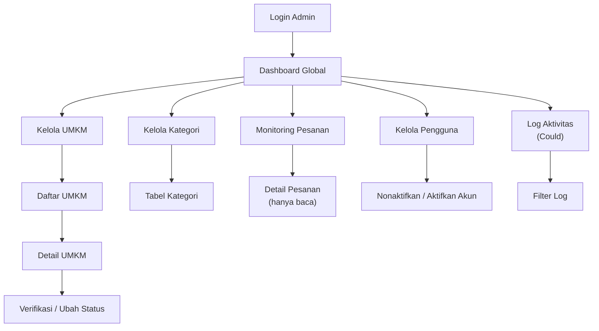
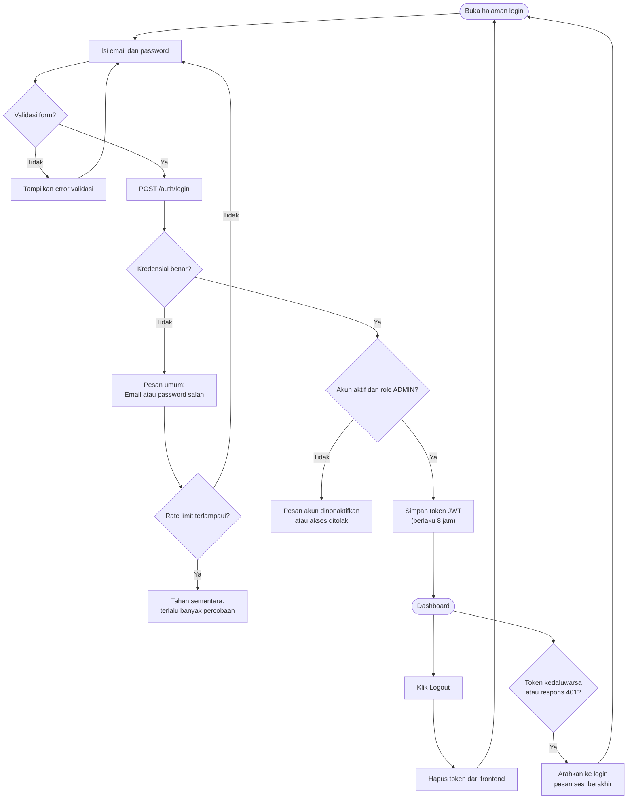
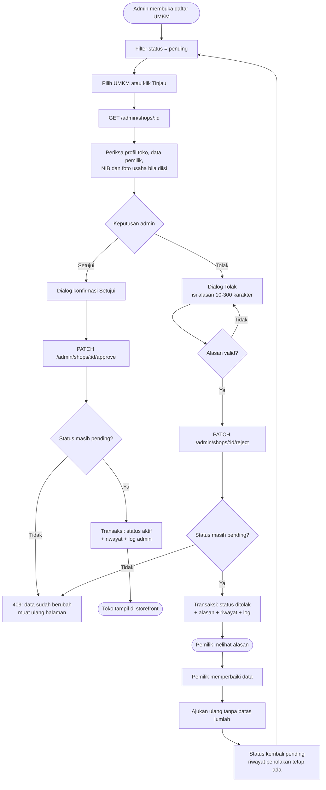
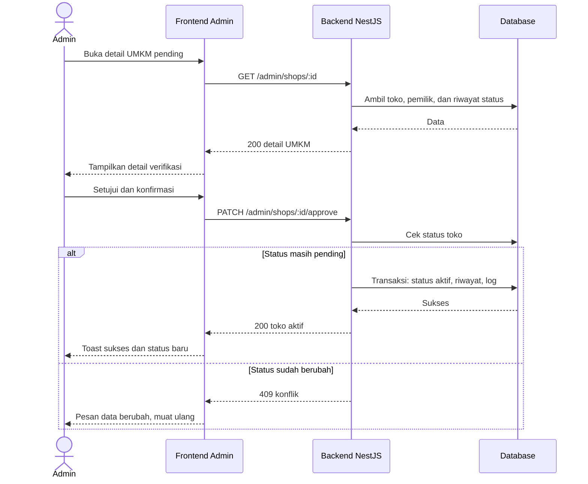
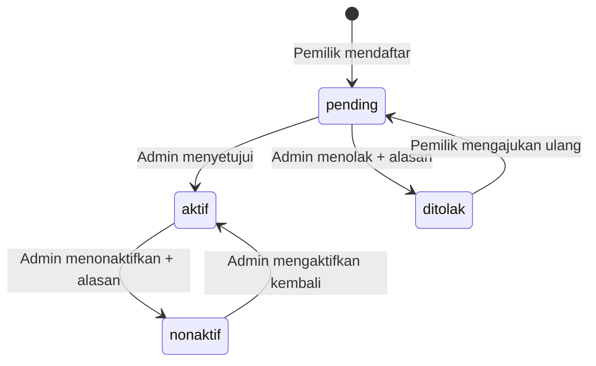
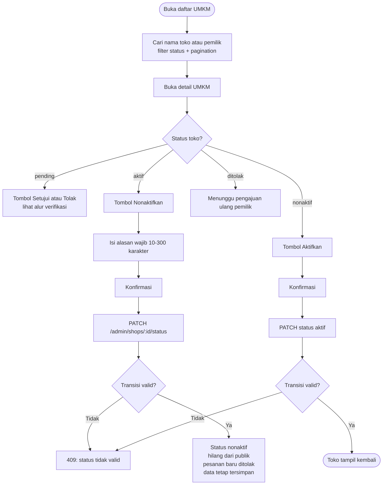
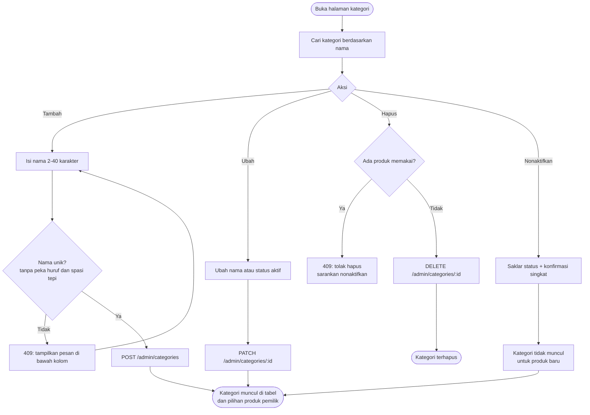
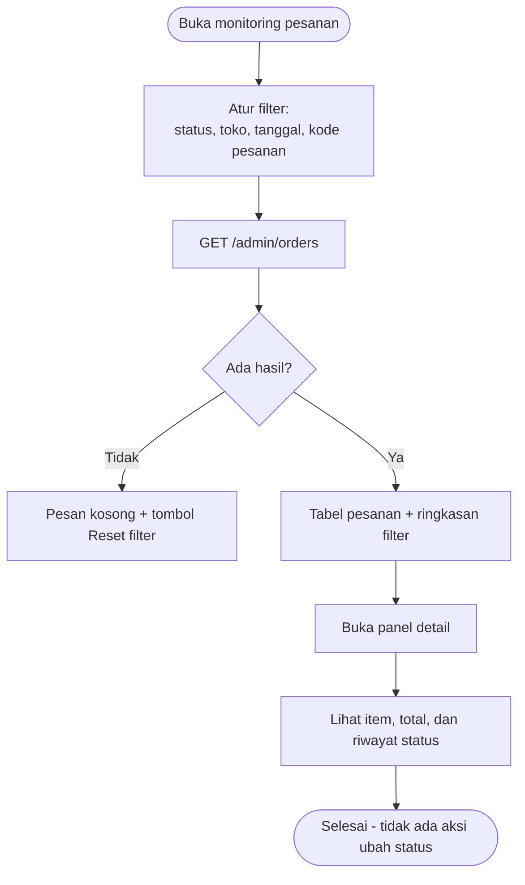
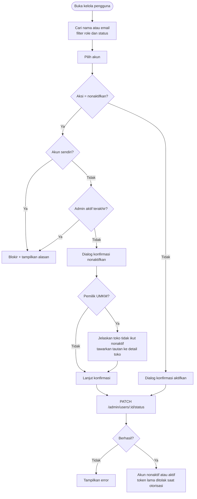
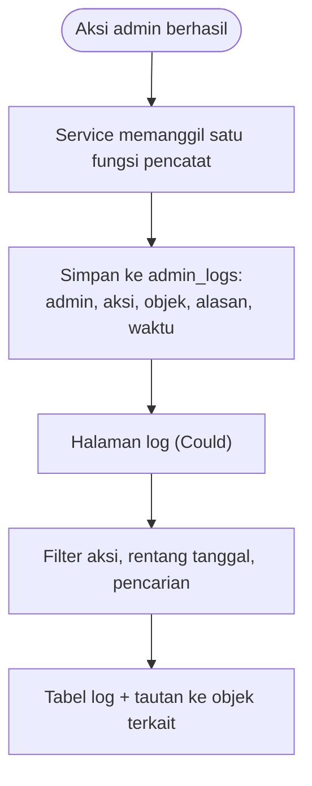

# Flowchart dan Alur Role Admin

Dokumen pendamping `PRD Ratis Role Admin.md`. Semua diagram ditulis dengan **Mermaid** sehingga bisa dirender di GitHub, VS Code (ekstensi Mermaid), atau mermaid.live. Alur mengikuti keputusan tim pada bagian 15.3 PRD.

## Daftar diagram

| No | Diagram | Fitur PRD |
| --- | --- | --- |
| 1 | Peta navigasi panel admin | Semua |
| 2 | Login dan logout | A1 |
| 3 | Verifikasi UMKM | A3 |
| 4 | Transisi status UMKM | A3, A4 |
| 5 | Kelola UMKM | A4 |
| 6 | Kelola kategori | A5 |
| 7 | Monitoring pesanan | A6 |
| 8 | Kelola pengguna | A7 |
| 9 | Pencatatan log aktivitas | A8 (Could) |
| 10 | Aturan lintas alur | Semua |

## 1. Peta navigasi panel admin

## 2. Login dan logout (A1)

Catatan:

- Rate limit login 10 percobaan per menit per alamat IP.
- Pengguna non-admin yang membuka halaman admin ditolak.
- Admin yang sudah login dan membuka halaman login langsung diarahkan ke dashboard.

## 3. Verifikasi UMKM (A3)

### Urutan interaksi verifikasi

## 4. Transisi status UMKM

Transisi di luar diagram ditolak dengan kode 409. NIB dan foto usaha opsional, sehingga UMKM tanpa NIB tetap dapat diverifikasi.

## 5. Kelola UMKM (A4)

Catatan:

- Penonaktifan tidak menghapus produk, pesanan, atau keuangan.
- Pesanan lama yang masih pending atau diproses tetap bisa diselesaikan pemilik.
- Pemilik dan staf melihat banner status toko.

## 6. Kelola kategori (A5)

Catatan: ubah nama memakai validasi unik yang sama. Kategori nonaktif tetap tampil pada produk lama.

## 7. Monitoring pesanan (A6)

Catatan: data pelanggan dibatasi pada nama, dan kombinasi filter tercermin di alamat halaman.

## 8. Kelola pengguna (A7)

Catatan:

- Menonaktifkan pemilik tidak otomatis menonaktifkan toko.
- Akun yang dinonaktifkan tidak bisa login dan mendapat pesan yang jelas.

## 9. Pencatatan log aktivitas (A8, Could)

Pencatatan log diimplementasikan sejak awal. Halaman log dikerjakan jika waktu tersisa.

## 10. Aturan lintas alur

- Semua endpoint admin memerlukan JWT dengan role `ADMIN`; role lain mendapat 403.
- Setiap aksi berisiko (tolak, nonaktifkan, hapus) melewati dialog konfirmasi.
- Alasan penolakan dan penonaktifan wajib 10-300 karakter.
- Transisi status yang tidak valid ditolak dengan 409.
- Perubahan status UMKM, riwayat, dan log dicatat dalam satu transaksi database.
- Token JWT berlaku 8 jam; login dibatasi 10 percobaan per menit per alamat IP.
- Admin tidak bisa menonaktifkan akunnya sendiri atau admin aktif terakhir.
- NIB dan foto usaha opsional; UMKM tanpa NIB tetap dapat mendaftar dan diverifikasi.
- Penonaktifan tidak menghapus data apa pun.
