# Flowchart dan Alur Role Pemilik UMKM

Dokumen pendamping `PRD Ratis Role Pemilik UMKM.md`. Semua diagram ditulis dengan **Mermaid** sehingga bisa dirender di GitHub, VS Code (ekstensi Mermaid), atau mermaid.live. Alur mengikuti keputusan tim pada bagian 15.3 PRD.

Dokumen ini fokus pada apa yang dilakukan pemilik UMKM. Keputusan admin hanya ditampilkan sebagai batas alur, bukan sebagai aksi yang bisa dilakukan pemilik. Perbedaan tanggung jawab admin dan pemilik dijelaskan di bagian 2.

## Daftar diagram

| No | Diagram | Fitur PRD |
| --- | --- | --- |
| 1 | Peta navigasi panel pemilik | Semua |
| 2 | Perbedaan alur admin dan pemilik UMKM | Semua |
| 3 | Registrasi dan onboarding toko | O1 |
| 4 | Login dan logout | O2 |
| 5 | Status toko dan akses pemilik | O4, bagian 7.3 |
| 6 | Profil toko dan pengajuan ulang | O4 |
| 7 | Manajemen produk | O5 |
| 8 | Manajemen stok | O6 |
| 9 | Alur pesanan end-to-end | O7 |
| 10 | Transisi status pesanan | O7 |
| 11 | Pembatalan dan pengembalian stok | O7 |
| 12 | Keuangan otomatis dan manual | O8 |
| 13 | Manajemen staf dan hak akses | O9 |
| 14 | Notifikasi dalam aplikasi | O10 |
| 15 | Laporan dan ekspor | O11, O12 |
| 16 | Pratinjau storefront | O13 |
| 17 | Aturan lintas alur | Semua |

## 1. Peta navigasi panel pemilik

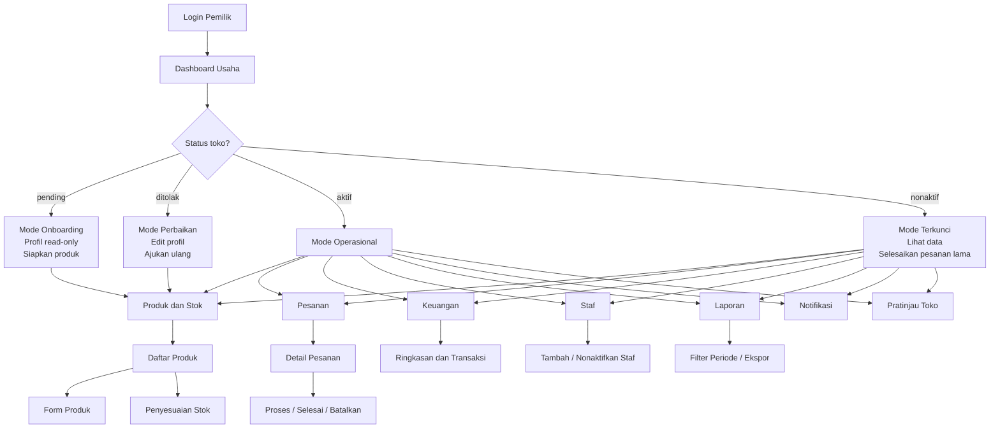

Catatan:

- Menu admin tidak pernah muncul di panel pemilik. Pemilik tidak dapat membuka verifikasi, kategori global, monitoring lintas toko, atau pengelolaan pengguna.
- Mode `pending` dan `ditolak` tetap memberi akses ke produk agar pemilik dapat menyiapkan katalog sebelum toko aktif.
- Mode `nonaktif` bersifat read-only untuk profil dan produk; tombol aksi tulis dinonaktifkan, tetapi pemilik masih dapat melihat data dan menyelesaikan pesanan lama.

## 2. Perbedaan alur admin dan pemilik UMKM

| Aspek | Admin | Pemilik UMKM |
| --- | --- | --- |
| Tujuan utama | Menjaga kualitas platform | Menjalankan usaha sendiri |
| Cakupan data | Lintas toko | Hanya tokonya sendiri |
| Status toko | Menyetujui, menolak, menonaktifkan, dan mengaktifkan | Hanya melihat status dan mengajukan ulang setelah ditolak |
| Verifikasi | Memeriksa data dan mengambil keputusan | Mendaftar, memperbaiki data, dan menunggu keputusan |
| Produk dan stok | Tidak boleh mengubah | Mengelola produk dan menyesuaikan stok |
| Pesanan | Hanya membaca semua pesanan | Memproses pesanan tokonya |
| Keuangan | Tidak mengakses keuangan toko | Melihat pemasukan otomatis dan mencatat pengeluaran |
| Kategori | Mengelola kategori global | Hanya memilih kategori aktif |
| Pengguna dan staf | Menonaktifkan akun bermasalah | Mengelola staf tokonya, maksimal 5 aktif |
| Kontak pelanggan | Hanya nama | Nama, nomor HP, dan alamat untuk pesanan tokonya |
| Dashboard | Statistik platform | Statistik usaha sendiri |
| Notifikasi | Log aktivitas dan monitoring platform | Pesanan baru, status toko, dan stok menipis |
| Endpoint | `/admin` dengan role `ADMIN` | `/owner` dengan role `OWNER` |
| Storefront | Melihat toko aktif di platform | Pratinjau tokonya sendiri dan melihat toko saat aktif |

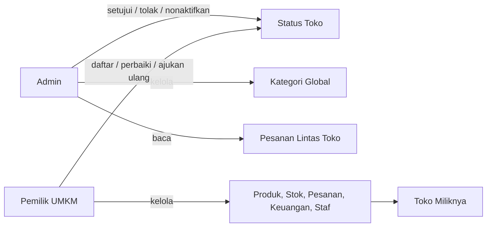

Batas tanggung jawab:

- Admin tidak mengubah produk, stok, pesanan, atau keuangan toko.
- Pemilik tidak dapat menyetujui, menolak, atau mengaktifkan tokonya sendiri.
- Staf membantu operasional tokonya, tetapi tidak mendapat akses admin atau keuangan.

## 3. Registrasi dan onboarding toko (O1)

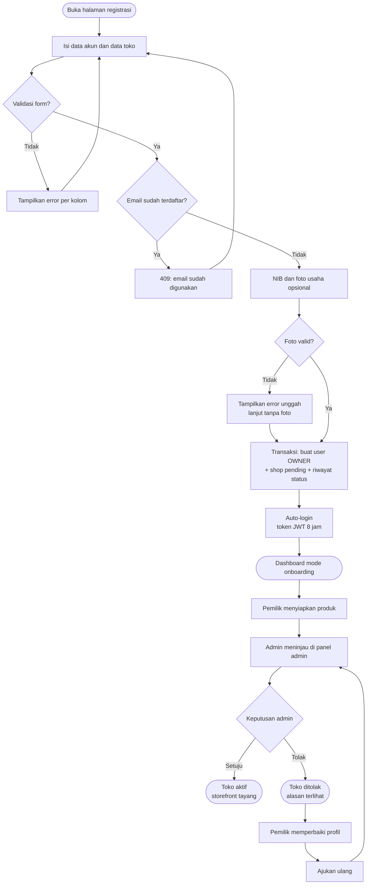

Catatan:

- Pemilik tidak dapat menyetujui atau menolak tokonya sendiri; keputusan ada di admin.
- NIB dan foto usaha opsional. UMKM tanpa NIB tetap dapat mendaftar dan diverifikasi.
- Produk dapat disiapkan saat toko masih `pending` atau `ditolak`.
- Pengajuan ulang tidak dibatasi jumlahnya, tetapi setiap pengajuan tercatat di riwayat status.

## 4. Login dan logout (O2)

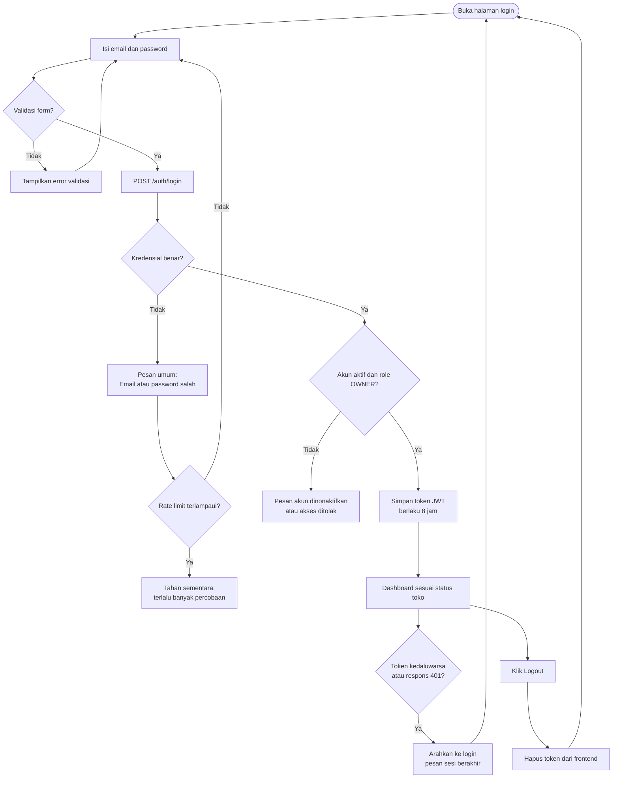

Catatan:

- Pemilik dengan toko `pending`, `ditolak`, atau `nonaktif` tetap dapat login dan melihat dashboard dengan banner status.
- Staf memakai endpoint login yang sama, tetapi diarahkan ke panel staf. Alur panel staf dibahas di PRD terpisah.
- Pengguna dengan role lain yang membuka halaman pemilik ditolak.
- Rate limit login 10 percobaan per menit per alamat IP.

## 5. Status toko dan akses pemilik

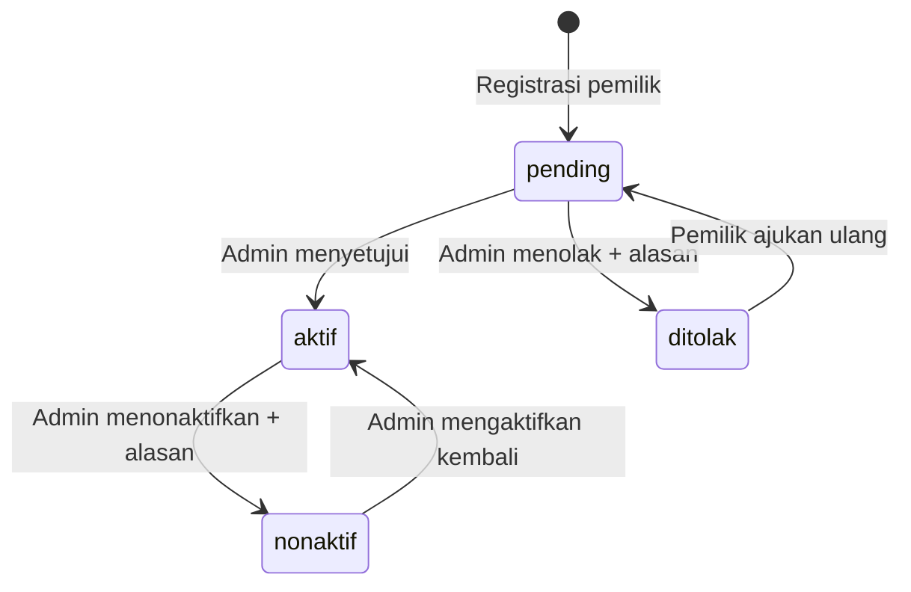

| Status toko | Yang dapat dilakukan pemilik | Storefront | Pesanan baru | Aksi utama |
| --- | --- | --- | --- | --- |
| `pending` | Login, melihat dashboard, mengelola produk, melihat profil dan status | Tidak tayang | Tidak ada | Menunggu verifikasi admin |
| `ditolak` | Login, mengelola produk, memperbaiki profil, mengajukan ulang | Tidak tayang | Tidak ada | Perbaiki data dan ajukan ulang |
| `aktif` | Semua fitur operasional | Tayang | Diterima | Jalankan operasional harian |
| `nonaktif` | Login, melihat data, menyelesaikan pesanan yang sudah ada | Tidak tayang | Ditolak | Menunggu admin mengaktifkan kembali |

Catatan:

- Satu-satunya transisi yang dipicu pemilik adalah `ditolak` menjadi `pending` melalui pengajuan ulang.
- Pemilik tidak dapat mengaktifkan toko `nonaktif` sendiri.
- Produk dapat dikelola saat `pending`, `ditolak`, dan `aktif`; saat `nonaktif` hanya dapat dibaca.
- Saat toko `nonaktif`, staf tidak dapat memproses pesanan; penyelesaian pesanan lama dilakukan oleh pemilik.

## 6. Profil toko dan pengajuan ulang (O4)

```mermaid
flowchart TD
    A(["Buka profil toko"]) --> B["GET /owner/shop<br/>tampilkan profil, status, riwayat"]
    B --> C{"Status toko?"}
    C -->|pending| D["Profil read-only<br/>tidak ada tombol edit"]
    C -->|nonaktif| E["Profil read-only<br/>tidak bisa aktifkan sendiri"]
    C -->|aktif| F["Tombol Edit"]
    C -->|ditolak| G["Tombol Edit + Ajukan Ulang"]
    F --> H["Ubah data<br/>NIB dan foto opsional"]
    H --> I{"Validasi?"}
    I -->|Tidak| I1["400: error per kolom"] --> H
    I -->|Ya| J["PATCH /owner/shop"]
    J --> K{"Status masih aktif?"}
    K -->|Tidak| K1["409: muat ulang status"] --> B
    K -->|Ya| L(["Profil tersimpan<br/>status tetap aktif"])
    G --> M["Perbaiki data yang diminta"]
    M --> M1["PATCH /owner/shop"]
    M1 --> M2{"Validasi berhasil?"}
    M2 -->|Tidak| M3["400: error per kolom"] --> M
    M2 -->|Ya| N["POST /owner/shop/resubmit"]
    N --> O{"Status masih ditolak?"}
    O -->|Tidak| K1
    O -->|Ya| P["Transaksi: status pending<br/>+ riwayat pengajuan"]
    P --> Q(["Masuk daftar verifikasi admin"])
```

Catatan:

- `slug` toko bersifat tetap agar tautan tidak berubah saat nama toko diedit.
- Perubahan profil pada toko `aktif` tidak memerlukan verifikasi ulang.
- Pengajuan ulang tidak dibatasi, tetapi admin dapat menolak lagi dengan alasan baru.
- NIB dan foto usaha tetap opsional saat memperbaiki profil.

## 7. Manajemen produk (O5)

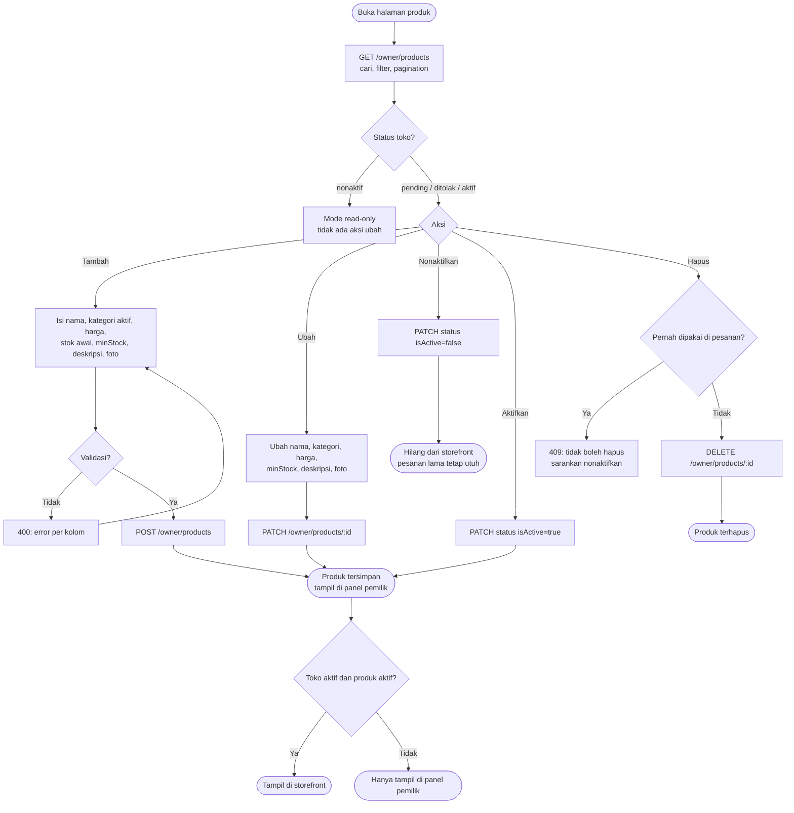

Catatan:

- Stok tidak diubah melalui form edit produk. Perubahan stok memakai alur O6 agar tercatat.
- Harga baru hanya berlaku untuk pesanan baru; item pesanan lama memakai harga saat pesanan dibuat.
- Produk dengan riwayat pesanan tidak boleh dihapus permanen.
- Produk dengan stok 0 boleh tetap aktif dan ditandai "Stok habis" di storefront.
- Admin tidak mengubah produk; seluruh aksi produk dilakukan pemilik.

## 8. Manajemen stok (O6)

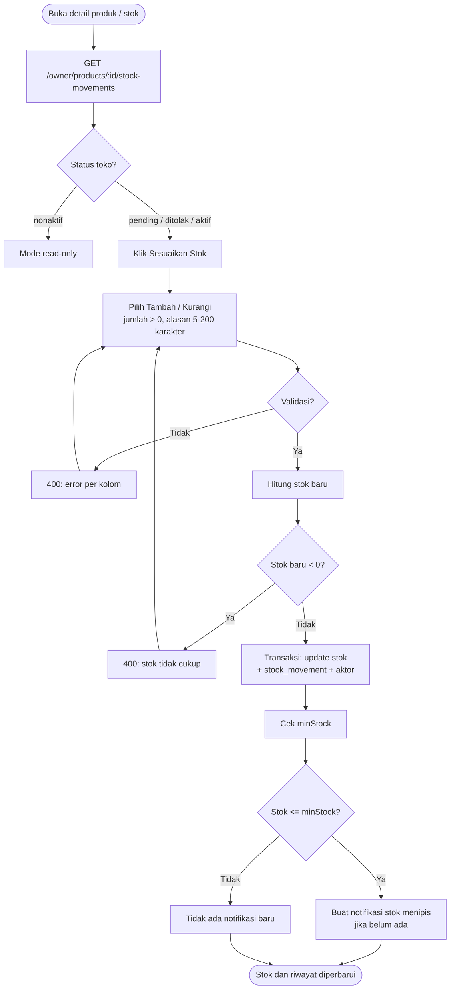

Catatan:

- Stok dikurangi saat pesanan dibuat oleh pelanggan, bukan saat pesanan diproses.
- Pembatalan pesanan mengembalikan stok tepat satu kali.
- Penyelesaian pesanan tidak mengubah stok lagi.
- Notifikasi stok menipis tidak dibuat berulang selama stok masih di bawah ambang.
- Pemilik dan staf dapat menyesuaikan stok saat toko tidak `nonaktif`.

## 9. Alur pesanan end-to-end (O7)

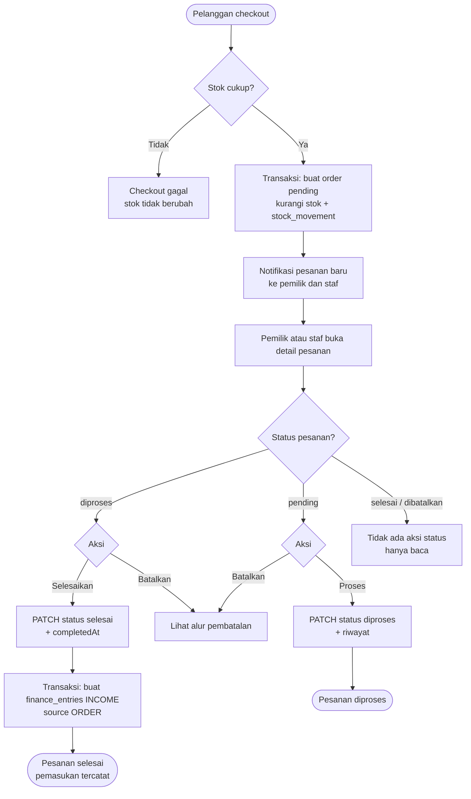

### Urutan interaksi pesanan

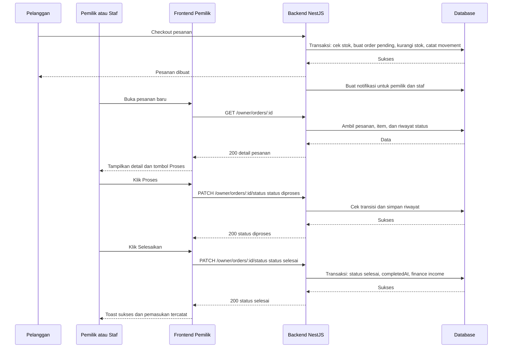

Catatan:

- Admin hanya dapat membaca pesanan lintas toko dan tidak memiliki tombol ubah status.
- Pemilik dan staf melihat kontak pelanggan lengkap hanya untuk pesanan tokonya.
- Pembatalan oleh pelanggan mengikuti PRD pelanggan; pemilik menerima notifikasi dan melihat alasan yang tersedia.
- Pesanan `selesai` dan `dibatalkan` bersifat final.

## 10. Transisi status pesanan

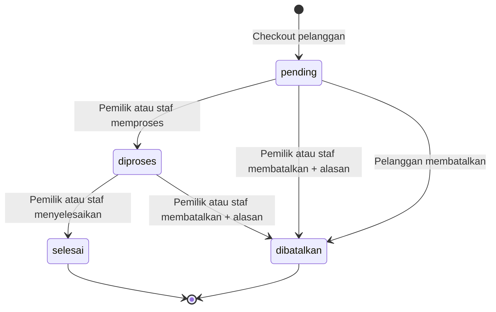

| Transisi | Pelaku | Efek stok | Efek keuangan |
| --- | --- | --- | --- |
| `pending` ke `diproses` | Pemilik atau staf | Tidak berubah | Tidak ada |
| `pending` ke `dibatalkan` | Pemilik, staf, atau pelanggan | Dikembalikan | Tidak ada |
| `diproses` ke `selesai` | Pemilik atau staf | Tidak berubah | Pemasukan otomatis dibuat |
| `diproses` ke `dibatalkan` | Pemilik atau staf | Dikembalikan | Tidak ada |

Catatan:

- Transisi di luar tabel ditolak dengan kode 409.
- Status `selesai` dan `dibatalkan` tidak dapat diubah lagi.
- Setelah pesanan selesai, pembatalan dan pengembalian dana tidak tersedia.
- Pembatalan oleh pemilik atau staf wajib memiliki alasan 10-300 karakter.

## 11. Pembatalan dan pengembalian stok (O7)

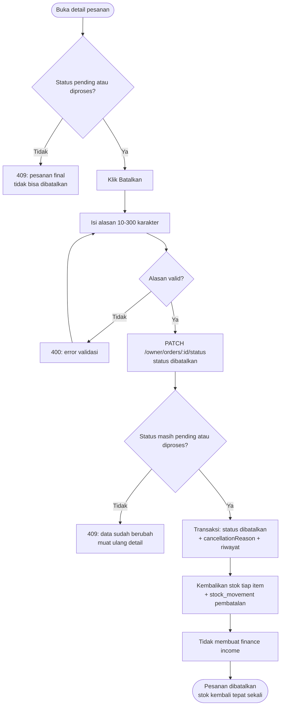

Catatan:

- Pengembalian stok dilakukan dalam transaksi yang sama dengan perubahan status.
- Klik ganda atau pembatalan ulang tidak mengembalikan stok dua kali.
- Pembatalan oleh pelanggan juga mengembalikan stok, tetapi alasan mengikuti PRD pelanggan.
- Setelah pesanan `selesai`, tidak ada pembatalan atau refund.

## 12. Keuangan otomatis dan manual (O8)

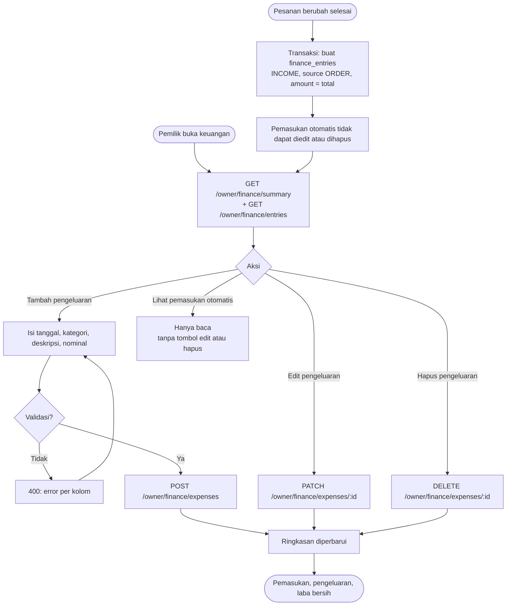

Catatan:

- Pembukuan memakai basis kas: pemasukan diakui saat pesanan selesai, pengeluaran diakui pada tanggal yang diisi.
- Nominal memakai rupiah tanpa desimal dan tanggal memakai WIB.
- Tanggal pengeluaran tidak boleh di masa depan.
- Tidak ada pemasukan manual; pemasukan hanya berasal dari pesanan selesai.
- Staf tidak dapat membuka keuangan dan mendapat 403.

## 13. Manajemen staf dan hak akses (O9)

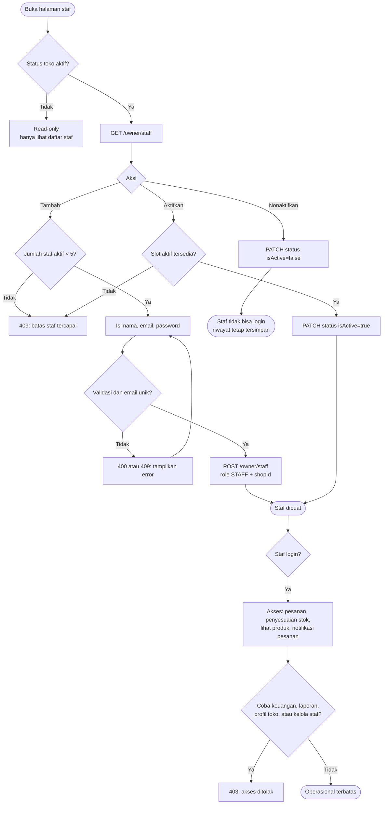

Catatan:

- Pemilik hanya dapat mengelola staf tokonya sendiri.
- Admin dapat menonaktifkan akun lintas platform; pemilik tidak dapat mengakses fitur admin.
- Staf tidak dihapus permanen agar riwayat pesanan dan stok tetap utuh.
- Saat toko `nonaktif`, staf dapat login dan melihat data, tetapi tidak dapat memproses pesanan.
- Penyelesaian pesanan lama saat toko `nonaktif` dilakukan oleh pemilik.

## 14. Notifikasi dalam aplikasi (O10)

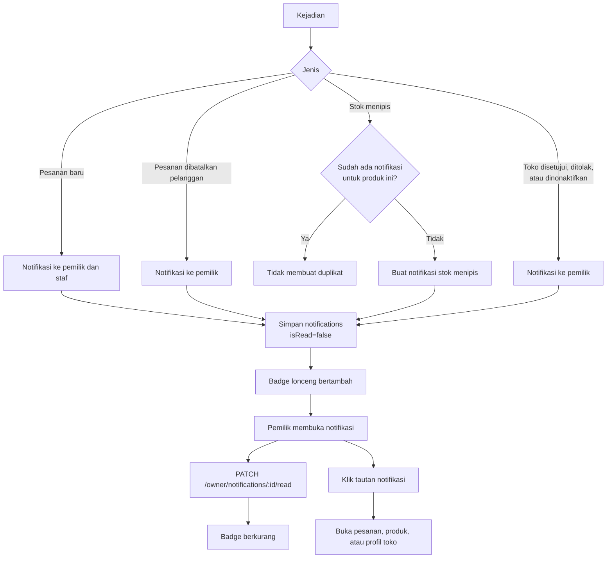

Catatan:

- Frontend memeriksa notifikasi baru setiap 30 detik dan saat tab kembali aktif.
- Tidak ada email atau WhatsApp pada versi ini.
- Notifikasi stok menipis tidak dibuat berulang selama stok masih di bawah ambang.
- Jika data terkait sudah tidak ada, tautan diarahkan ke halaman daftar yang sesuai.
- Staf hanya menerima notifikasi pesanan baru untuk tokonya.

## 15. Laporan dan ekspor (O11, O12)

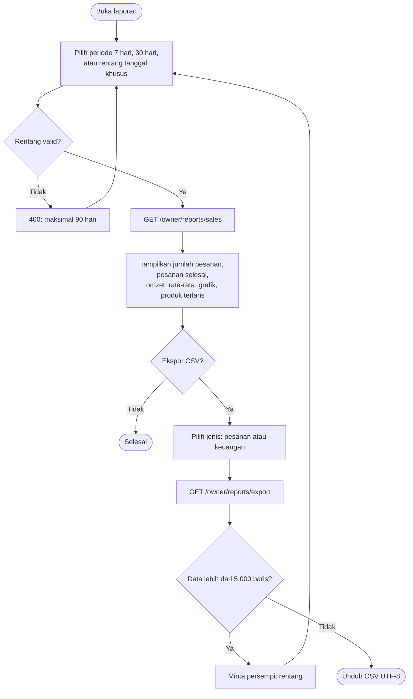

Catatan:

- Omzet hanya menghitung pesanan `selesai`; pesanan `dibatalkan` tidak dihitung.
- Laporan dan ekspor hanya dapat diakses pemilik; staf mendapat 403.
- Ekspor penjualan tidak menyertakan nomor HP dan alamat pelanggan.
- Periode tanpa data menghasilkan angka 0 dan file CSV dengan baris header saja.

## 16. Pratinjau storefront (O13)

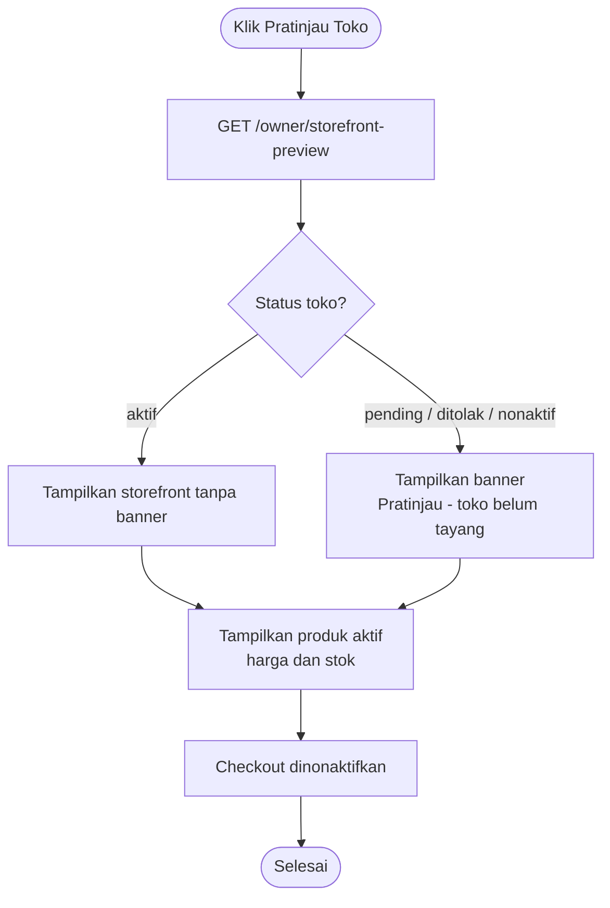

Catatan:

- Pratinjau hanya untuk toko milik pemilik yang sedang login.
- Pratinjau tidak dapat dibagikan sebagai tautan publik.
- Storefront publik tetap hanya menampilkan toko `aktif`.
- Produk nonaktif tidak muncul di pratinjau.

## 17. Aturan lintas alur

- Semua endpoint pemilik memerlukan JWT dengan role `OWNER`; role lain mendapat 403.
- Semua endpoint staf memerlukan role `STAFF`; staf tidak dapat membuka endpoint pemilik atau admin.
- Admin memakai `/admin` dengan role `ADMIN` dan tidak dapat mengubah data operasional toko.
- `shopId` selalu diambil dari token, bukan dari input klien, agar data tidak bocor antar toko.
- Hanya admin yang dapat menyetujui, menolak, menonaktifkan, atau mengaktifkan toko.
- Pemilik hanya dapat memicu transisi `ditolak` menjadi `pending` melalui pengajuan ulang.
- Transisi status toko dan status pesanan yang tidak valid ditolak dengan 409.
- Stok dikurangi saat pesanan dibuat, dikembalikan tepat satu kali saat dibatalkan, dan tidak berubah saat pesanan selesai.
- Pesanan `selesai` membuat satu pemasukan otomatis; pesanan `dibatalkan` tidak membuat pemasukan.
- Setelah pesanan selesai, tidak ada pembatalan atau pengembalian dana.
- Produk hanya boleh dihapus permanen jika belum pernah dipakai di pesanan.
- Jumlah staf aktif maksimal 5. Staf tidak dapat melihat keuangan, laporan, profil toko, atau mengelola staf.
- Pembatalan oleh pemilik atau staf wajib memiliki alasan 10-300 karakter.
- NIB dan foto usaha opsional; UMKM tanpa NIB tetap dapat mendaftar dan diverifikasi.
- Token JWT berlaku 8 jam dan login dibatasi 10 percobaan per menit per alamat IP.
- Notifikasi hanya tersedia di dalam aplikasi.
- Registrasi, pengajuan ulang, perubahan status pesanan, penyesuaian stok, pembuatan pemasukan, dan penambahan staf memakai transaksi database.
- Pemilik dan staf hanya melihat kontak pelanggan untuk pesanan tokonya; admin hanya melihat nama pelanggan.
