# Flowchart dan Alur Role Staf/Kasir

Dokumen pendamping `PRD Ratis Role Staf Kasir.md`. Semua diagram ditulis dengan **Mermaid** sehingga bisa dirender di GitHub, VS Code (ekstensi Mermaid), atau mermaid.live. Alur mengikuti keputusan tim pada bagian 15.3 PRD.

Dokumen ini fokus pada apa yang dilakukan staf/kasir. Keputusan admin dan pemilik hanya ditampilkan sebagai batas alur, bukan sebagai aksi yang bisa dilakukan staf. Batas tanggung jawab antar role dijelaskan di bagian 2.

## Daftar diagram

| No | Diagram | Fitur PRD |
| --- | --- | --- |
| 1 | Peta navigasi panel staf | Semua |
| 2 | Batas tanggung jawab staf, pemilik, dan admin | Semua |
| 3 | Login dan logout | S1 |
| 4 | Status toko dan akses staf | S1, bagian 7.3 |
| 5 | Status akun staf | S1, bagian 7.4 |
| 6 | Dashboard operasional | S2 |
| 7 | Manajemen pesanan | S3 |
| 8 | Transisi status pesanan | S3, bagian 7.2 |
| 9 | Pembatalan dan pengembalian stok | S3 |
| 10 | Penyesuaian stok | S4 |
| 11 | Lihat produk dan kategori | S5 |
| 12 | Notifikasi pesanan baru | S6 |
| 13 | Profil dan ganti kata sandi | S7 (Could) |
| 14 | Aturan lintas alur | Semua |

## 1. Peta navigasi panel staf

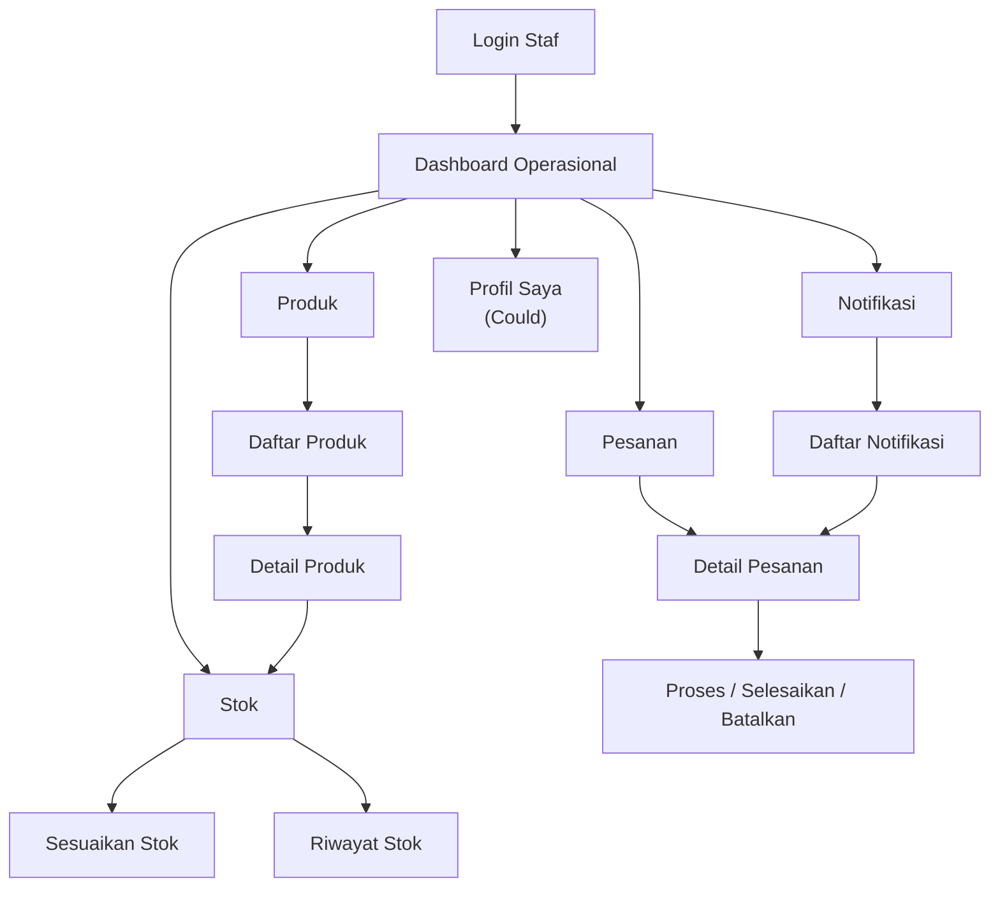

Catatan:

- Menu Keuangan, Laporan, Staf, dan Pengaturan Toko tidak pernah muncul di panel staf.
- Saat toko `nonaktif`, semua halaman tetap dapat dibuka, tetapi tombol aksi tulis dinonaktifkan dan banner mode baca-saja ditampilkan.
- Staf tidak dapat membuka halaman pemilik atau admin; rute tersebut ditolak.

## 2. Batas tanggung jawab staf, pemilik, dan admin

| Aspek | Staf/kasir | Pemilik UMKM | Admin |
| --- | --- | --- | --- |
| Tujuan utama | Menjalankan operasional harian | Menjalankan usaha sendiri | Menjaga kualitas platform |
| Cakupan data | Tokonya sendiri | Tokonya sendiri | Lintas toko |
| Asal akun | Dibuat pemilik | Registrasi publik | Seeding |
| Status toko | Melihat status, tidak mengubah | Melihat status dan mengajukan ulang | Menyetujui, menolak, menonaktifkan, dan mengaktifkan |
| Produk | Hanya melihat | Mengelola | Tidak boleh mengubah |
| Stok | Menyesuaikan | Menyesuaikan | Tidak boleh mengubah |
| Pesanan | Memproses, menyelesaikan, membatalkan | Memproses, menyelesaikan, membatalkan | Hanya membaca |
| Keuangan dan laporan | Tidak dapat mengakses | Melihat pemasukan otomatis dan mencatat pengeluaran | Tidak mengakses keuangan toko |
| Kelola staf | Tidak dapat mengakses | Mengelola staf tokonya, maksimal 5 aktif | Menonaktifkan akun bermasalah |
| Kontak pelanggan | Pesanan tokonya | Pesanan tokonya | Hanya nama |
| Notifikasi | Pesanan baru tokonya | Pesanan baru, status toko, dan stok menipis | Log aktivitas dan monitoring platform |
| Endpoint | `/staff` dengan role `STAFF` | `/owner` dengan role `OWNER` | `/admin` dengan role `ADMIN` |

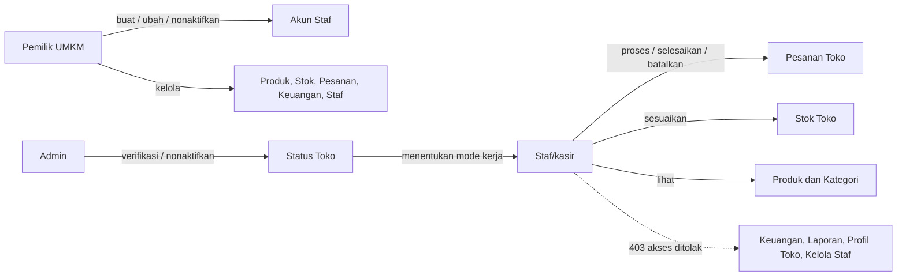

Batas tanggung jawab:

- Staf tidak dapat membuat akun sendiri, mengubah profil toko, atau mengelola produk.
- Staf tidak dapat melihat keuangan, laporan, dan ekspor; backend menolak dengan 403.
- Staf hanya melihat kontak pelanggan untuk pesanan tokonya.
- Admin tidak mengubah data operasional toko; admin hanya menentukan status toko.
- Pemilik menentukan akun staf dan dapat mereset password staf.

## 3. Login dan logout (S1)

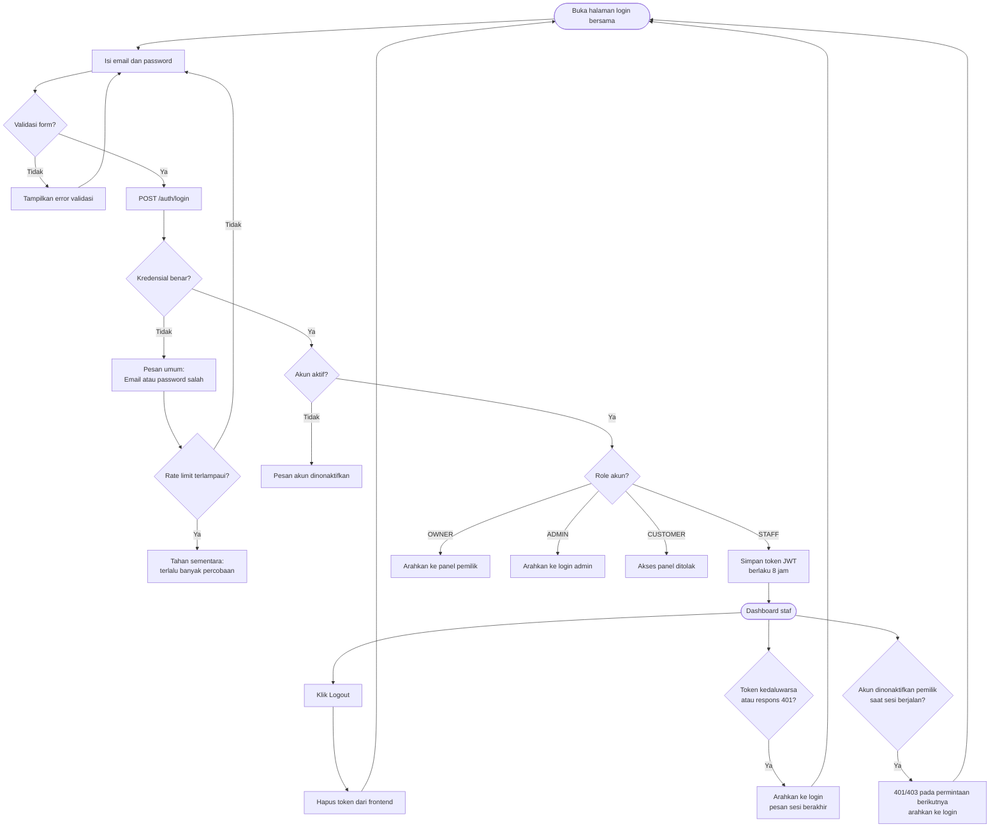

Catatan:

- Staf memakai halaman login yang sama dengan pemilik; tujuan panel ditentukan oleh role.
- Staf dengan toko `nonaktif` tetap dapat login dan melihat data, tetapi panel berada dalam mode baca-saja.
- Akun staf nonaktif tidak dapat login. Token lama ditolak karena status akun diperiksa pada setiap permintaan.
- Rate limit login 10 percobaan per menit per alamat IP.

## 4. Status toko dan akses staf

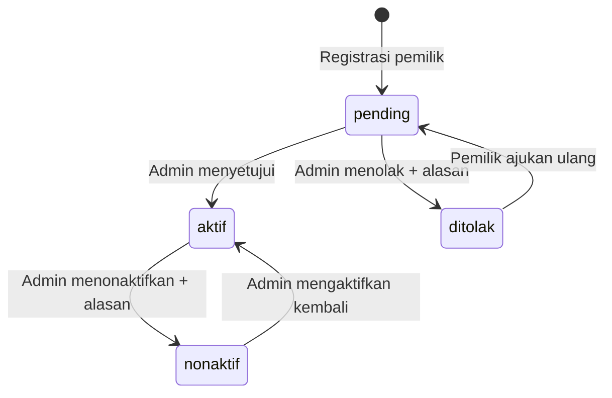

| Status toko | Yang dapat dilakukan staf | Storefront | Pesanan baru | Aksi utama |
| --- | --- | --- | --- | --- |
| `aktif` | Semua fitur operasional staf | Tayang | Diterima | Proses pesanan dan jaga stok |
| `nonaktif` | Login, melihat dashboard, produk, pesanan, dan riwayat; tidak dapat mengubah status pesanan atau stok | Tidak tayang | Ditolak | Menunggu admin mengaktifkan kembali; penyelesaian pesanan lama oleh pemilik |
| `pending` | Akun staf tidak dibuat pada status ini; jika ada data lama, hanya baca | Tidak tayang | Tidak ada | Menunggu verifikasi admin |
| `ditolak` | Akun staf tidak dibuat pada status ini; jika ada data lama, hanya baca | Tidak tayang | Tidak ada | Menunggu pemilik memperbaiki dan mengajukan ulang |

Catatan:

- Staf hanya dibuat pemilik saat toko `aktif`, sehingga status `pending` dan `ditolak` bukan kondisi normal akun staf.
- Status toko hanya dapat diubah admin. Staf tidak dapat mengaktifkan atau menonaktifkan toko.
- Saat toko `nonaktif`, backend menolak aksi tulis staf dengan 403 atau 409, bukan hanya menonaktifkan tombol di frontend.
- Penyelesaian pesanan lama saat toko `nonaktif` dilakukan pemilik.

## 5. Status akun staf

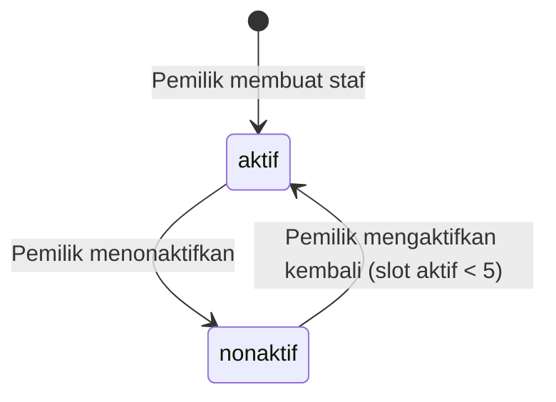

| Status akun | Dampak |
| --- | --- |
| `aktif` | Staf dapat login dan bekerja sesuai status toko. |
| `nonaktif` | Staf tidak dapat login. Token lama ditolak pada permintaan berikutnya. Riwayat pesanan dan stok tetap tersimpan. |

Catatan:

- Staf tidak dihapus permanen agar jejak operasional tidak hilang.
- Mengaktifkan kembali hanya boleh jika jumlah staf aktif belum mencapai 5.
- Perubahan status akun staf hanya dapat dilakukan pemilik.

## 6. Dashboard operasional (S2)

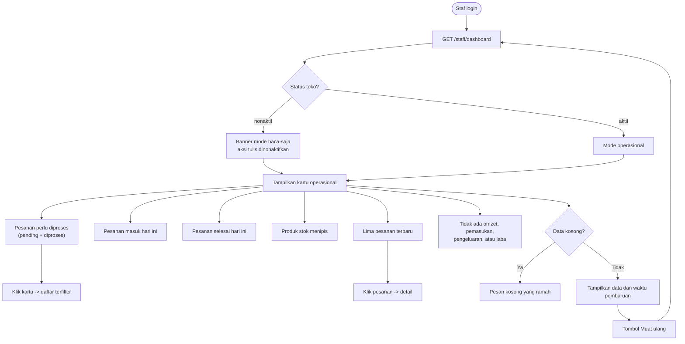

Catatan:

- Dashboard staf hanya memuat informasi operasional, bukan informasi keuangan.
- "Stok menipis" berarti stok kurang dari atau sama dengan `minStock` produk.
- Semua tanggal memakai WIB.
- Saat backend gratis sedang bangun, tampilkan kerangka loading dan teks "Menyiapkan data, mohon tunggu".

## 7. Manajemen pesanan (S3)

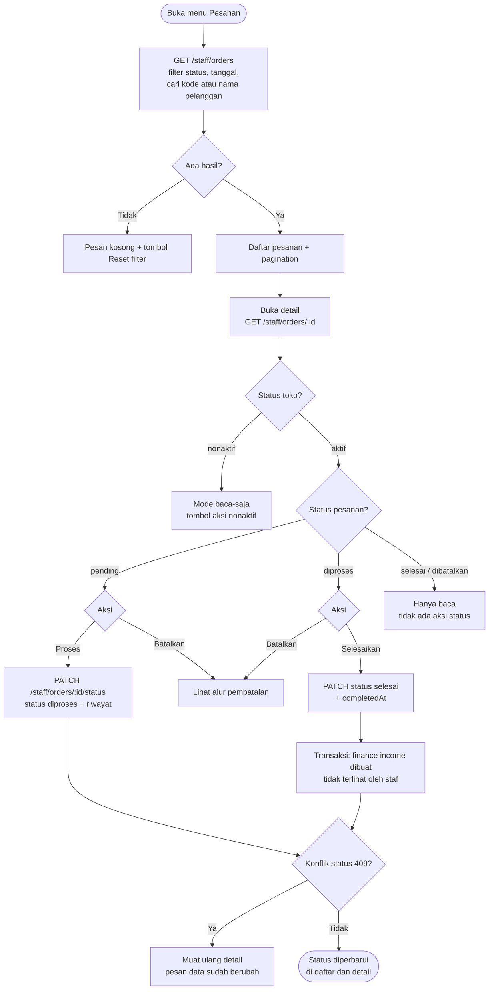

### Urutan interaksi memproses pesanan

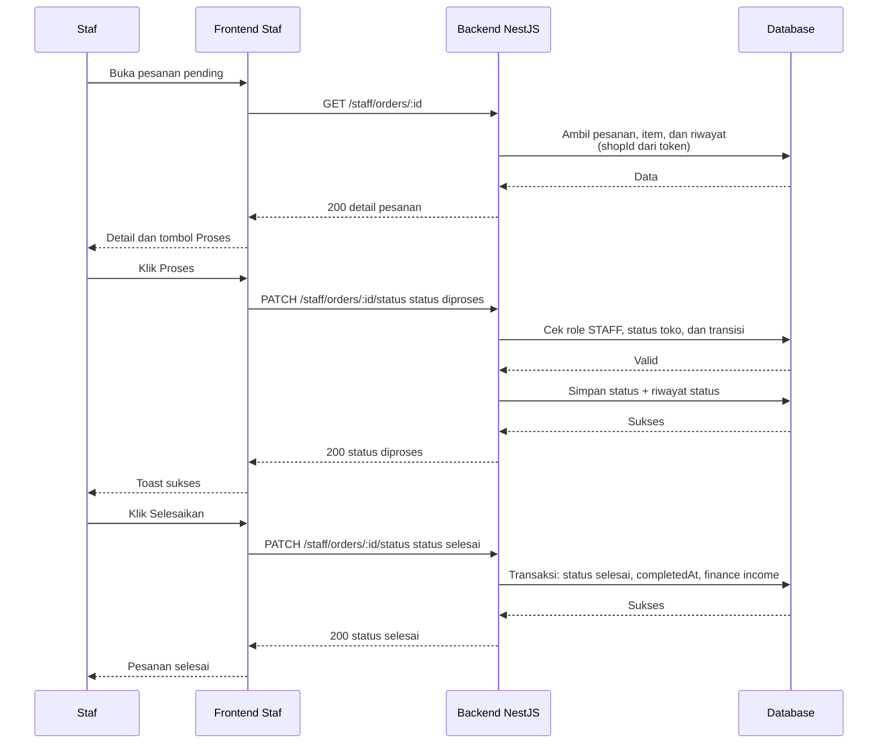

Catatan:

- Staf tidak dapat mengubah item atau total pesanan.
- Staf hanya melihat kontak pelanggan lengkap untuk pesanan tokonya.
- Pemasukan otomatis dibuat saat pesanan selesai, tetapi staf tidak dapat melihatnya.
- Pesanan `selesai` dan `dibatalkan` bersifat final.

## 8. Transisi status pesanan

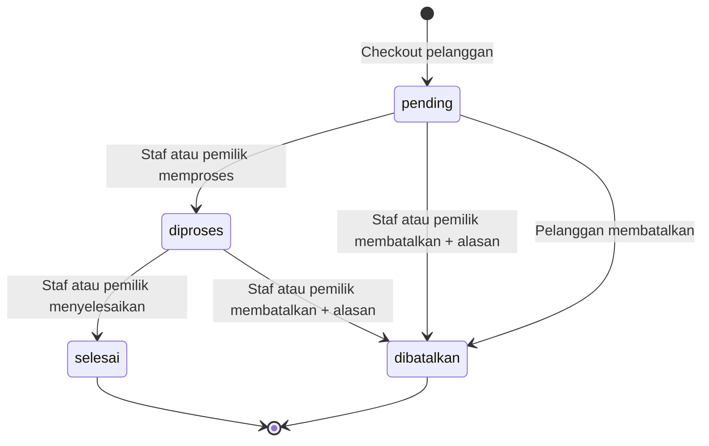

| Transisi | Pelaku | Efek stok | Efek keuangan |
| --- | --- | --- | --- |
| `pending` ke `diproses` | Staf atau pemilik | Tidak berubah | Tidak ada |
| `pending` ke `dibatalkan` | Staf, pemilik, atau pelanggan | Dikembalikan | Tidak ada |
| `diproses` ke `selesai` | Staf atau pemilik | Tidak berubah | Pemasukan otomatis dibuat |
| `diproses` ke `dibatalkan` | Staf atau pemilik | Dikembalikan | Tidak ada |

Catatan:

- Transisi di luar tabel ditolak dengan kode 409.
- Status `selesai` dan `dibatalkan` tidak dapat diubah lagi.
- Pembatalan oleh staf wajib memiliki alasan 10-300 karakter.
- Saat toko `nonaktif`, staf tidak dapat melakukan transisi apa pun; penyelesaian pesanan lama dilakukan pemilik.

## 9. Pembatalan dan pengembalian stok (S3)

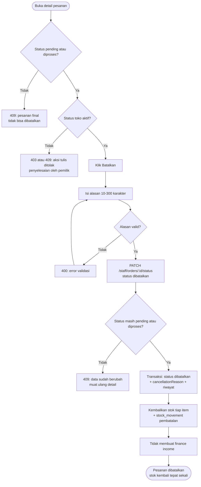

Catatan:

- Pengembalian stok dilakukan dalam transaksi yang sama dengan perubahan status.
- Klik ganda atau pembatalan ulang tidak mengembalikan stok dua kali.
- Pembatalan oleh pelanggan juga mengembalikan stok, tetapi alasan mengikuti PRD pelanggan.
- Setelah pesanan `selesai`, tidak ada pembatalan atau refund.

## 10. Penyesuaian stok (S4)

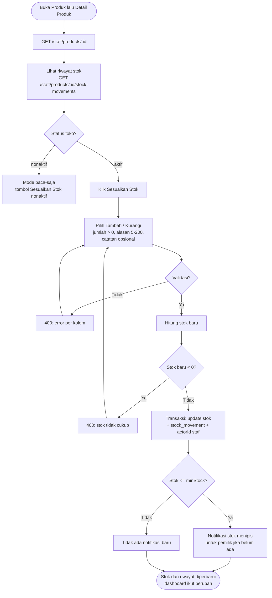

Catatan:

- Staf hanya dapat menyesuaikan stok, bukan mengubah nama, harga, kategori, atau status produk.
- Stok dikurangi saat pesanan dibuat pelanggan, bukan saat pesanan diproses.
- Pembatalan pesanan mengembalikan stok tepat satu kali; penyelesaian tidak mengubah stok lagi.
- Riwayat stok bersifat append-only dan mencatat staf sebagai pelaku.
- Notifikasi stok menipis ditujukan ke pemilik sesuai PRD pemilik; staf hanya menerima notifikasi pesanan baru.

## 11. Lihat produk dan kategori (S5)

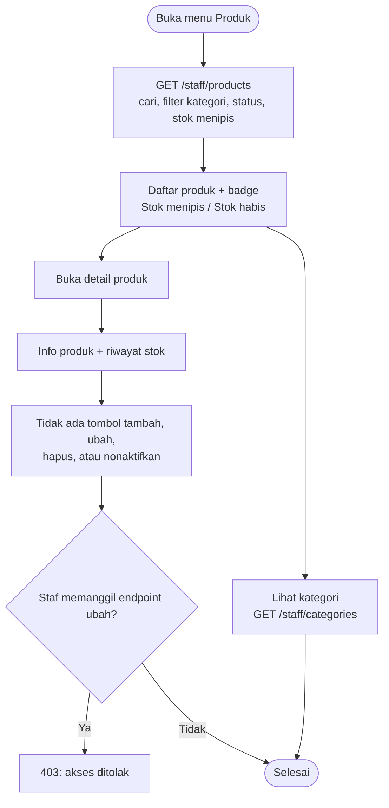

Catatan:

- Harga produk boleh dilihat karena dibutuhkan saat melayani pesanan, tetapi omzet dan laporan tidak ditampilkan.
- Produk nonaktif tetap terlihat di panel staf dengan badge agar staf tahu produk tersebut tidak tayang.
- Produk dengan stok 0 tetap tampil dan ditandai "Stok habis".
- Staf tidak dapat membuka produk toko lain; ID di luar cakupan menghasilkan 403 atau 404.

## 12. Notifikasi pesanan baru (S6)

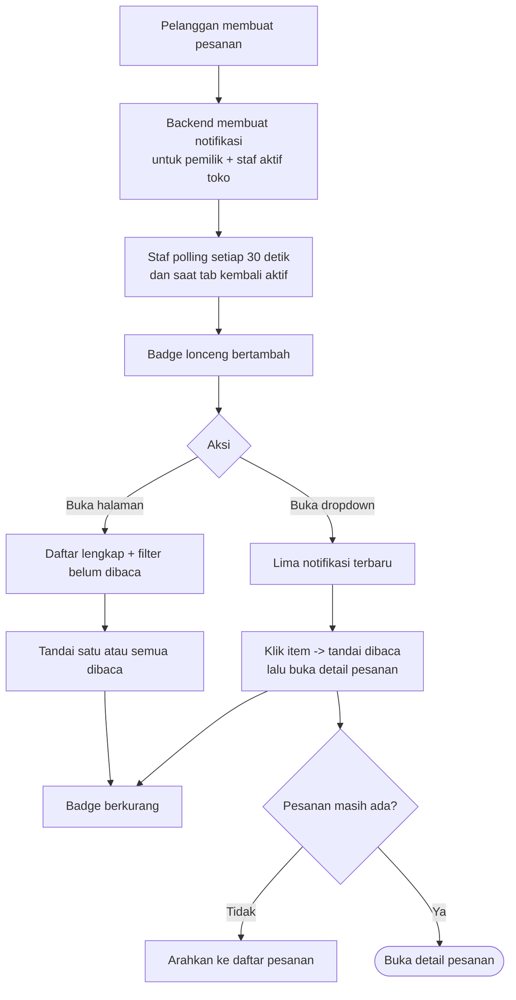

Catatan:

- Staf hanya menerima notifikasi pesanan baru untuk tokonya.
- Notifikasi keuangan, verifikasi toko, dan perubahan staf tidak dikirim ke staf.
- Tidak ada email atau WhatsApp pada versi ini.
- Jika data terkait sudah tidak ada, tautan diarahkan ke halaman daftar yang sesuai.

## 13. Profil dan ganti kata sandi (S7, Could)

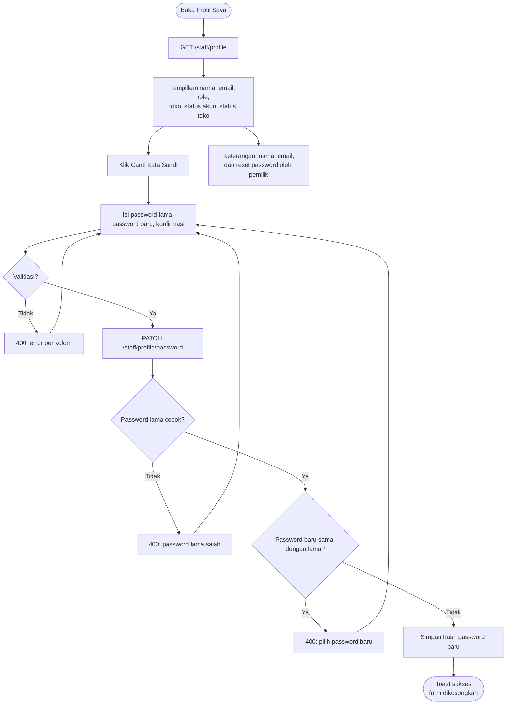

Catatan:

- Staf tidak dapat mengubah nama, email, role, atau toko.
- Pemilik tetap dapat mereset password staf kapan saja.
- Fitur ini berprioritas Could dan boleh ditunda jika waktu terbatas.

## 14. Aturan lintas alur

- Semua endpoint staf memerlukan JWT dengan role `STAFF`; role lain mendapat 403.
- Staf tidak dapat membuka endpoint pemilik (`/owner`) atau admin (`/admin`).
- `shopId` selalu diambil dari token, bukan dari input klien, agar data tidak bocor antar toko.
- Staf hanya dapat membaca dan mengubah data toko tempat ia terdaftar.
- Staf hanya dapat melihat kontak pelanggan untuk pesanan tokonya; admin hanya melihat nama pelanggan.
- Staf tidak dapat melihat keuangan, laporan, ekspor, profil toko, atau mengelola staf dan produk.
- Hanya pemilik yang dapat membuat, menonaktifkan, mengaktifkan, dan mereset password staf.
- Jumlah staf aktif maksimal 5 per toko. Staf tidak dihapus permanen.
- Saat toko `nonaktif`, staf dapat login dan melihat data, tetapi semua aksi tulis ditolak backend.
- Penyelesaian pesanan lama saat toko `nonaktif` dilakukan pemilik.
- Transisi status pesanan hanya `pending` ke `diproses`, `diproses` ke `selesai`, dan `pending` atau `diproses` ke `dibatalkan`; transisi lain ditolak dengan 409.
- Pembatalan oleh staf wajib memiliki alasan 10-300 karakter.
- Stok dikurangi saat pesanan dibuat, dikembalikan tepat satu kali saat dibatalkan, dan tidak berubah saat pesanan selesai.
- Pesanan `selesai` membuat satu pemasukan otomatis; pesanan `dibatalkan` tidak membuat pemasukan.
- Setelah pesanan selesai, tidak ada pembatalan atau pengembalian dana.
- Penyesuaian stok tidak boleh menghasilkan stok negatif dan selalu mencatat alasan serta pelaku.
- Perubahan status pesanan, pengembalian stok, dan penyesuaian stok memakai transaksi database.
- Token JWT berlaku 8 jam dan login dibatasi 10 percobaan per menit per alamat IP.
- Notifikasi hanya tersedia di dalam aplikasi; staf hanya menerima notifikasi pesanan baru.
