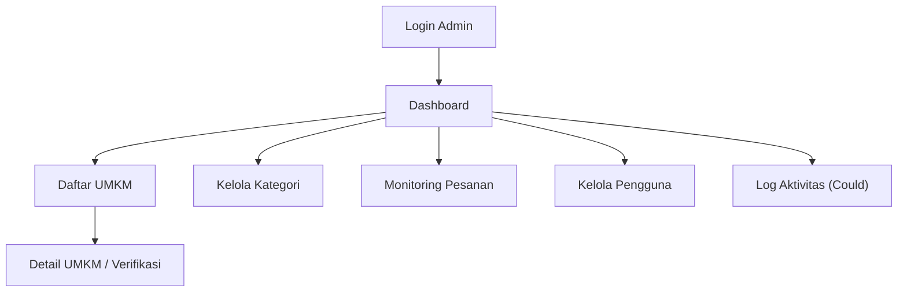
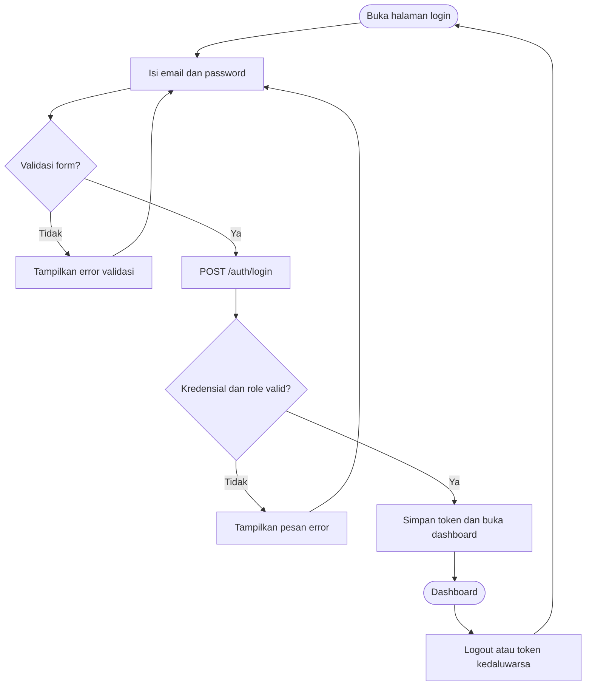
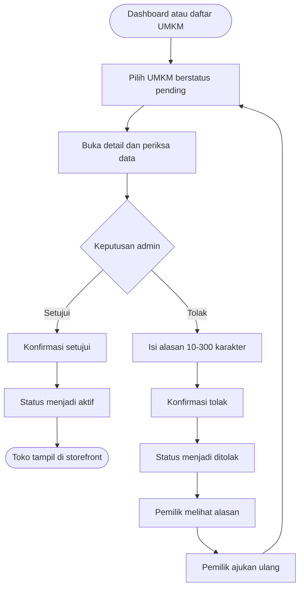
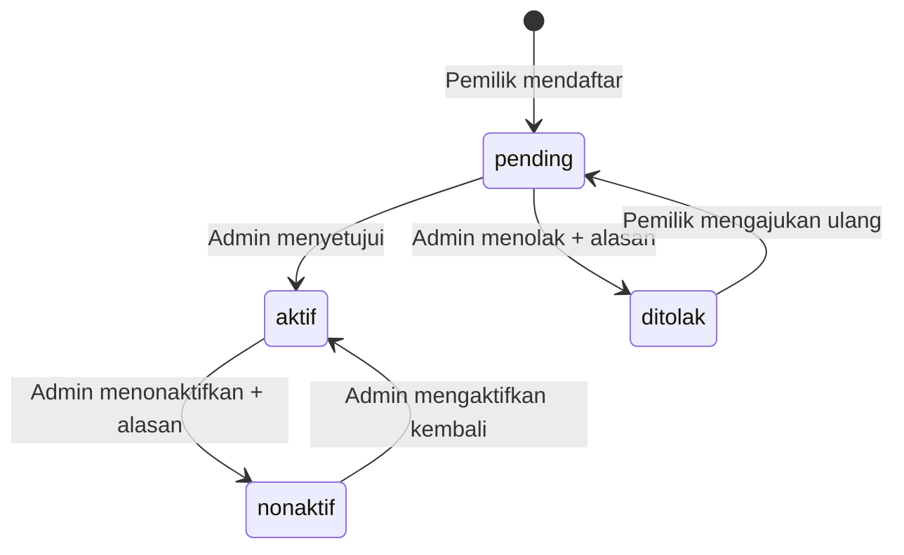
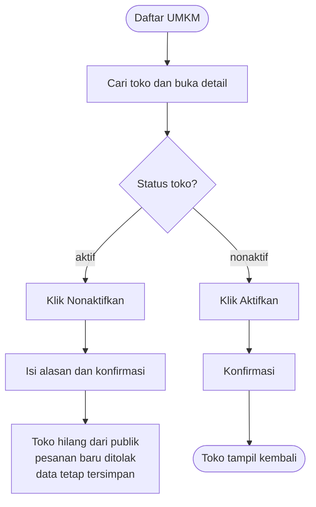

# Persiapan Desain UI Role Admin Ratis

Dokumen ini adalah panduan desain UI untuk role admin Ratis, disusun dari `PRD Ratis Role Admin.md` dan `Flowchart dan Alur Role Admin.md`. Isinya mencakup fitur tiap halaman, alur admin, flowchart, design system, dan prompt siap pakai untuk Google Stitch.

Cara pakai:

1. Buka Google Stitch, lalu tempel **Global style prompt** (bagian 6.1).
2. Tempel prompt halaman yang ingin dibuat (bagian 6.2).
3. Iterasi desain dengan instruksi tambahan, misalnya "lebih ringkas", "tambah whitespace", atau "buat versi tablet".
4. Catatan: Stitch menerima **prompt teks**, bukan kode Mermaid. Diagram Mermaid di dokumen ini dipakai untuk dokumentasi alur, bukan untuk ditempel ke Stitch.

## 1. Ringkasan

Panel admin Ratis dipakai untuk:

- Memverifikasi UMKM baru sebelum tampil di storefront.
- Menonaktifkan atau mengaktifkan kembali UMKM bermasalah.
- Mengelola kategori produk global.
- Memantau pesanan lintas toko tanpa mengubahnya.
- Menonaktifkan akun pengguna bermasalah.
- Melihat log aktivitas admin (fitur Could).

Target utama: admin dapat memverifikasi satu UMKM maksimal 3 klik dari dashboard dan menonaktifkan toko maksimal 2 klik dari daftar UMKM.

## 2. Prinsip desain

- **Cepat dan jelas:** informasi penting terlihat tanpa scroll berlebihan.
- **Aman:** aksi berisiko selalu memakai dialog konfirmasi dan alasan wajib.
- **Konsisten:** badge status, tombol, tabel, dan dialog memakai pola yang sama di semua halaman.
- **Tidak ambigu:** admin hanya membaca data pesanan dan tidak bisa mengubah data operasional toko.
- **Akuntabel:** perubahan status menampilkan siapa pelaku dan kapan.
- **Ramah data kosong:** loading, empty state, dan error state selalu ada.
- **Desktop-first, tablet-friendly:** layout utama untuk 1440px, tetap nyaman di 768px.

## 3. Design system

### 3.1 Palet warna

| Token | Hex | Pemakaian |
| --- | --- | --- |
| Primary | `#0F766E` | Tombol utama, menu aktif, tautan |
| Primary hover | `#115E59` | Hover tombol utama |
| Primary soft | `#CCFBF1` | Latar ikon, highlight ringan |
| Ink | `#0F172A` | Judul dan teks utama |
| Muted | `#64748B` | Teks sekunder, metadata |
| Background | `#F8FAFC` | Latar halaman |
| Surface | `#FFFFFF` | Kartu, tabel, modal |
| Border | `#E2E8F0` | Garis kartu, tabel, input |
| Pending | `#F59E0B` / `#FEF3C7` | Badge status pending |
| Aktif | `#22C55E` / `#DCFCE7` | Badge status aktif |
| Ditolak | `#EF4444` / `#FEE2E2` | Badge status ditolak |
| Nonaktif | `#64748B` / `#E2E8F0` | Badge status nonaktif |
| Danger | `#DC2626` | Tombol hapus dan nonaktifkan |
| Info | `#2563EB` | Pesan informasi |

Palet di atas adalah usulan dan boleh disesuaikan dengan identitas visual Ratis.

### 3.2 Tipografi

- **Font:** Plus Jakarta Sans (Google Fonts).
- **Judul halaman:** 24px / 32px, weight 700.
- **Judul kartu:** 18px / 26px, weight 600.
- **Body:** 14px / 22px, weight 400.
- **Label:** 12px / 16px, weight 600.
- **Angka KPI:** 32px / 40px, weight 700.
- **Teks kecil:** 12px / 18px, weight 400.

### 3.3 Spacing, radius, shadow

- Skala spacing: 4, 8, 12, 16, 24, 32, 40, 48px.
- Radius input dan tombol: 10px.
- Radius kartu: 14px.
- Radius modal: 20px.
- Shadow kartu: `0 1px 2px rgba(15, 23, 42, 0.06)`.
- Shadow modal: `0 16px 40px rgba(15, 23, 42, 0.16)`.
- Lebar sidebar: 264px.
- Tinggi header: 72px.
- Padding konten: 32px.
- Lebar konten maksimal: 1440px.

### 3.4 Komponen dasar

- Tombol: primary, secondary, ghost, danger.
- Input teks, textarea, select, search, date range.
- Tabel dengan header sticky dan horizontal scroll di tablet.
- Badge status dan badge role.
- Kartu KPI, kartu statistik, kartu profil.
- Modal dialog dan panel samping (drawer).
- Toast sukses, gagal, dan info.
- Skeleton loading.
- Empty state dan error state.
- Pagination.
- Toggle switch.
- Timeline riwayat status.

### 3.5 Ikon dan ilustrasi

- Ikon: Lucide outline, ukuran 16, 20, dan 24px.
- Ilustrasi empty state: garis sederhana, warna primary soft dan muted.
- Foto usaha: rasio 16:9, placeholder abu-abu dengan ikon toko.

### 3.6 Layout global

- Sidebar kiri: logo Ratis, menu Dashboard, UMKM, Kategori, Pesanan, Pengguna, Log.
- Header atas: judul halaman, nama admin, dan tombol logout.
- Menu aktif memakai latar primary soft dan teks primary.
- Di tablet, sidebar berubah menjadi drawer atau rail ikon.
- Tabel bisa digeser horizontal.
- Di layar kecil, kartu dan filter ditumpuk vertikal.

## 4. Peta halaman dan alur

### 4.1 Peta halaman



### 4.2 Alur login dan sesi



### 4.3 Alur verifikasi UMKM



### 4.4 Transisi status UMKM



### 4.5 Alur nonaktifkan dan aktifkan toko



## 5. Spesifikasi halaman

### 5.1 Login

**Rute:** `/admin/login`

**Tujuan:** pintu masuk aman ke panel admin.

**Layout:**

- Desktop: split screen. Panel kiri 45% berisi brand Ratis, tagline, dan ilustrasi abstrak. Panel kanan 55% berisi form di kartu selebar 400px.
- Tablet: panel brand menjadi banner atas atau disembunyikan, form tetap di tengah.
- Tanpa sidebar dan header admin.

**Fitur:**

1. Field email dengan validasi format email.
2. Field password minimal 8 karakter dengan tombol tampilkan atau sembunyikan.
3. Tombol Masuk full width dengan state loading dan disabled saat proses.
4. Pesan error di atas form: kredensial salah, akun dinonaktifkan, atau terlalu banyak percobaan.
5. Redirect otomatis ke dashboard setelah berhasil.
6. Admin yang sudah login dan membuka halaman login langsung diarahkan ke dashboard.
7. Pesan sesi berakhir saat diarahkan dari halaman admin karena token kedaluwarsa.
8. Tekan Enter untuk mengirim form.
9. Fokus awal pada kolom email.
10. Error hilang saat pengguna mulai mengetik ulang.

**State dan pesan:**

- Default: form kosong.
- Loading: tombol menampilkan spinner dan teks "Memproses...".
- Error: alert merah dengan ikon.
- Rate limit: "Terlalu banyak percobaan, coba lagi nanti."
- Sesi berakhir: "Sesi Anda berakhir. Silakan masuk kembali."

**Prompt Stitch:** bagian 6.2.1.

### 5.2 Dashboard

**Rute:** `/admin/dashboard`

**Tujuan:** memberi gambaran kondisi platform dalam sekali lihat dan mengarahkan admin ke tindakan mendesak.

**Layout:**

- Header halaman: sapaan "Selamat pagi, Admin", tanggal, waktu pembaruan terakhir, dan tombol Muat ulang.
- Banner perhatian jika ada UMKM pending: "3 UMKM menunggu verifikasi" dengan tombol Tinjau sekarang.
- Baris kartu status UMKM: pending, aktif, ditolak, nonaktif.
- Baris kartu total pesanan dan total omzet.
- Grafik tren pesanan atau omzet dengan pilihan 7 atau 30 hari.
- Daftar UMKM pending terbaru maksimal 5 dengan tombol Tinjau.
- Tabel lima toko dengan omzet tertinggi.
- State khusus cold start: skeleton dan teks "Menyiapkan data, mohon tunggu".

**Fitur:**

1. Kartu status bisa diklik menuju daftar UMKM dengan filter sesuai status.
2. Total omzet hanya menghitung pesanan berstatus selesai.
3. Grafik berubah saat rentang 7 atau 30 hari dipilih.
4. Daftar toko teratas ikut berubah mengikuti rentang.
5. Tombol Tinjau membuka detail verifikasi.
6. Tombol Muat ulang menyegarkan data tanpa reload halaman.
7. Empty state jika belum ada data: angka 0 dan pesan ramah.
8. Skeleton loading untuk kartu, grafik, dan daftar.

**Prompt Stitch:** bagian 6.2.2.

### 5.3 Daftar UMKM

**Rute:** `/admin/umkm`

**Tujuan:** mencari, memfilter, dan mengelola UMKM.

**Layout:**

- Judul halaman dan subjudul.
- Toolbar: kolom pencarian, filter status, tombol Reset filter, dan jumlah hasil.
- Tabel dengan kolom Nama Toko, Pemilik, Kontak, Tanggal Daftar, Status, dan Aksi.
- Pagination di bawah tabel.

**Fitur:**

1. Pencarian berdasarkan nama toko atau nama pemilik dengan jeda singkat sebelum mencari.
2. Filter status: semua, pending, aktif, ditolak, nonaktif.
3. Urutan default terbaru di atas.
4. Pagination 10 baris per halaman.
5. Aksi cepat Lihat detail dan Nonaktifkan atau Aktifkan sesuai status.
6. Badge status dengan warna berbeda.
7. Baris pending diberi aksen amber tipis agar mudah ditemukan.
8. Tombol Reset filter muncul saat filter aktif.
9. Empty state dengan ajakan mengubah kata kunci atau mereset filter.
10. Loading skeleton dan error state dengan tombol Coba lagi.

**Prompt Stitch:** bagian 6.2.3.

### 5.4 Detail UMKM dan verifikasi

**Rute:** `/admin/umkm/:id`

**Tujuan:** memeriksa data UMKM dan mengambil keputusan verifikasi atau perubahan status.

**Layout:**

- Header: tombol Kembali, nama toko, badge status, dan tanggal daftar.
- Dua kolom: konten utama 2/3 dan panel tindakan sticky 1/3.
- Konten utama: profil toko, data pemilik, ringkasan toko, dan riwayat status.
- Panel tindakan: tombol sesuai status dan teks bantuan.

**Fitur:**

1. Profil toko: nama, deskripsi, alamat, kontak, tanggal daftar, foto usaha, dan NIB jika diisi.
2. NIB dan foto usaha diberi label Opsional dan tampil dengan rapi saat kosong.
3. Data pemilik: nama dan email.
4. Ringkasan toko: jumlah produk dan jumlah pesanan.
5. Riwayat status berbentuk timeline: status lama, status baru, alasan, admin, dan waktu.
6. Tombol Setujui dan Tolak hanya untuk status pending.
7. Tombol Nonaktifkan hanya untuk status aktif.
8. Tombol Aktifkan hanya untuk status nonaktif.
9. Status ditolak menampilkan informasi menunggu pengajuan ulang pemilik.
10. Konflik status 409 menampilkan pesan data sudah berubah dan memuat ulang halaman.
11. Tombol Kembali mempertahankan filter dan halaman daftar sebelumnya.
12. Toast sukses setelah setiap aksi.

**Dialog:**

- Setujui: "Setujui UMKM ini?" dengan penjelasan toko langsung tampil di storefront.
- Tolak: textarea alasan wajib, penghitung karakter 10-300, dan peringatan alasan terlihat oleh pemilik.
- Nonaktifkan: textarea alasan wajib dan peringatan toko hilang dari publik serta tidak menerima pesanan baru.
- Aktifkan: konfirmasi singkat bahwa toko akan tampil kembali.

**Prompt Stitch:** bagian 6.2.4.

### 5.5 Kelola kategori

**Rute:** `/admin/kategori`

**Tujuan:** menjaga daftar kategori global tetap rapi.

**Layout:**

- Header dengan judul, subjudul, dan tombol Tambah Kategori.
- Kolom pencarian.
- Tabel: Nama, Slug, Jumlah Produk, Status, dan Aksi.
- Modal tambah atau ubah kategori.
- Dialog hapus.

**Fitur:**

1. Tambah kategori dengan nama 2-40 karakter.
2. Validasi nama unik tanpa peka huruf besar dan spasi tepi.
3. Pesan duplikat muncul di bawah kolom nama.
4. Ubah nama kategori lewat modal yang sama.
5. Saklar aktif atau nonaktif dengan konfirmasi singkat.
6. Hapus kategori dengan dialog konfirmasi.
7. Tombol hapus dinonaktifkan jika kategori masih dipakai produk, dengan tooltip jumlah produk.
8. Kategori nonaktif tidak muncul untuk produk baru, tetapi tetap tampil di produk lama.
9. Pencarian kategori berdasarkan nama.
10. Empty state jika belum ada kategori.

**Prompt Stitch:** bagian 6.2.5.

### 5.6 Monitoring pesanan

**Rute:** `/admin/pesanan`

**Tujuan:** memantau pesanan seluruh toko tanpa bisa mengubahnya.

**Layout:**

- Header dengan judul dan catatan hanya baca.
- Filter bar: status, toko, rentang tanggal, kode pesanan, dan Reset filter.
- Ringkasan jumlah pesanan dan total nilai sesuai filter.
- Tabel pesanan.
- Panel detail di sisi kanan.

**Fitur:**

1. Filter status: pending, diproses, selesai, dibatalkan.
2. Filter toko berupa dropdown yang bisa dicari.
3. Filter tanggal dari dan sampai, dengan pilihan cepat Hari ini, 7 hari, dan 30 hari.
4. Pencarian kode pesanan.
5. Filter bisa digabung.
6. Ringkasan berubah mengikuti filter aktif.
7. Panel detail berisi item, jumlah, harga satuan, subtotal, total, dan riwayat status.
8. Tidak ada tombol ubah status di halaman ini.
9. Data pelanggan dibatasi pada nama.
10. Kombinasi filter tercermin di alamat halaman.
11. Empty state dengan tombol Reset filter.
12. Pagination 10 baris.

**Prompt Stitch:** bagian 6.2.6.

### 5.7 Kelola pengguna

**Rute:** `/admin/pengguna`

**Tujuan:** menangani akun bermasalah di seluruh role.

**Layout:**

- Header dengan judul dan subjudul.
- Toolbar: pencarian, filter role, filter status akun, dan Reset filter.
- Tabel: Nama, Email, Role, Status Akun, Tanggal Daftar, Toko, dan Aksi.
- Dialog konfirmasi nonaktifkan atau aktifkan.

**Fitur:**

1. Pencarian berdasarkan nama atau email.
2. Filter role: admin, pemilik UMKM, staf, pelanggan.
3. Filter status akun: aktif atau nonaktif.
4. Badge role dan status dengan warna berbeda.
5. Tombol Nonaktifkan atau Aktifkan pada tiap baris.
6. Tombol dinonaktifkan pada akun admin yang sedang login, dengan tooltip alasan.
7. Admin aktif terakhir tidak bisa dinonaktifkan.
8. Nama toko terkait tampil untuk akun pemilik dan staf.
9. Dialog konfirmasi pemilik menjelaskan bahwa tokonya tidak ikut nonaktif dan menyediakan tautan Lihat toko.
10. Toast sukses atau gagal.
11. Pagination 10 baris.
12. Empty state dan error state.

**Prompt Stitch:** bagian 6.2.7.

### 5.8 Log aktivitas (Could)

**Rute:** `/admin/log`

**Tujuan:** akuntabilitas tindakan admin.

**Layout:**

- Header dengan judul, subjudul, dan badge Could.
- Filter jenis aksi, rentang tanggal, dan pencarian.
- Tabel: Waktu, Admin, Aksi, Objek, dan Alasan.
- Pagination.

**Fitur:**

1. Filter aksi: login, verifikasi, status UMKM, kategori, pengguna.
2. Filter rentang tanggal.
3. Pencarian nama admin atau ID objek.
4. Urutan terbaru di atas.
5. Tautan dari objek ke detail UMKM atau pengguna.
6. Tabel hanya baca.
7. Empty state "Belum ada log aktivitas".
8. Pagination.

**Prompt Stitch:** bagian 6.2.8.

### 5.9 State bersama dan halaman error

**Loading:**

- Skeleton untuk kartu KPI, grafik, tabel, dan detail.
- Teks "Menyiapkan data, mohon tunggu" saat cold start.

**Empty state:**

- Ikon sederhana, judul, deskripsi, dan tombol aksi.
- Contoh: "Tidak ada UMKM yang menunggu verifikasi".

**Error state:**

- "Gagal memuat data", "Periksa koneksi lalu coba lagi", dan tombol Coba lagi.

**403:**

- "Akses ditolak", "Halaman ini hanya untuk admin Ratis", dan tombol Kembali ke dashboard.

**404:**

- "Halaman tidak ditemukan" dan tombol Kembali ke dashboard.

**Sesi berakhir:**

- Modal atau redirect ke login dengan pesan "Sesi Anda berakhir. Silakan masuk kembali."

**Toast:**

- Sukses: hijau, ikon centang.
- Gagal: merah, ikon peringatan.
- Info: biru.
- Posisi kanan atas, hilang otomatis setelah 4 detik.

**Dialog konfirmasi:**

- Judul singkat, deskripsi dampak, tombol Batal, dan tombol aksi yang jelas.
- Aksi berbahaya memakai tombol merah.

**Prompt Stitch:** bagian 6.2.9.

## 6. Prompt untuk Google Stitch

### 6.1 Global style prompt

Tempel prompt ini lebih dulu, lalu prompt halaman.

```text
Create a modern admin panel UI for "Ratis", an Indonesian UMKM (small business) platform. Desktop-first at 1440x900, responsive to tablet. Clean, trustworthy, and calm. Background #F8FAFC, white surfaces, 1px #E2E8F0 borders, 14px card radius, subtle shadows. Primary teal-green #0F766E, hover #115E59, soft #CCFBF1. Text #0F172A, muted #64748B. Status colors: pending amber #F59E0B on #FEF3C7, aktif green #22C55E on #DCFCE7, ditolak red #EF4444 on #FEE2E2, nonaktif slate #64748B on #E2E8F0. Typography: Plus Jakarta Sans, headings 600/700, body 400/500. Lucide outline icons. Indonesian UI copy. Left sidebar 264px with Ratis logo and menu: Dashboard, UMKM, Kategori, Pesanan, Pengguna, Log. Top header 72px with page title, admin name "Admin Ratis", and logout. Content padding 32px. Primary buttons filled teal, secondary white with border, danger red. Inputs 44px height, 10px radius, visible focus ring. Accessible contrast and consistent 8px spacing. No dark mode.
```

### 6.2 Prompt per halaman

#### 6.2.1 Login

```text
Using the global Ratis admin style, design the admin login screen at 1440x900. Split layout: left 45% brand panel with a deep teal gradient (#0F766E to #115E59), subtle abstract UMKM pattern, Ratis logo, headline "Kelola ekosistem UMKM dalam satu panel", supporting line "Verifikasi toko, pantau pesanan, dan jaga kualitas platform.", and a small note "Akses khusus admin". Right 55% white area with a centered 400px form card: small Ratis logo, title "Masuk ke Panel Admin", subtitle "Gunakan akun admin yang terdaftar.", labeled email field with mail icon and placeholder "nama@ratis.id", labeled password field with lock icon, show/hide password button, full-width primary button "Masuk", inline error alert area above the fields, and footer text "Hanya untuk admin Ratis". Show the button in a loading state with a spinner. Indonesian copy, Plus Jakarta Sans, accessible focus states.
```

#### 6.2.2 Dashboard

```text
Using the global Ratis admin style, design the dashboard at 1440x900. Left sidebar 264px, top header 72px. Content: page greeting "Selamat pagi, Admin" with date "Senin, 23 November 2026" and a "Muat ulang" secondary button; an attention banner "3 UMKM menunggu verifikasi" with a "Tinjau sekarang" link; four KPI cards for UMKM status: Pending 3 (amber), Aktif 12 (green), Ditolak 2 (red), Nonaktif 1 (slate), each with icon, count, label, and "Lihat" link; two wide KPI cards: Total Pesanan 128 and Total Omzet Rp 12.450.000; a large area chart card "Tren Pesanan" with 7 hari / 30 hari segmented toggle and a smooth teal area line; a right column card "UMKM Menunggu Verifikasi" with 3-5 rows showing shop name, owner, date, and "Tinjau" buttons, plus an empty state variant; below, a table "Toko dengan Omzet Tertinggi" with rank, shop name, omzet, and order count. Use skeletons for loading. Indonesian copy.
```

#### 6.2.3 Daftar UMKM

```text
Using the global Ratis admin style, design the "Kelola UMKM" list page at 1440x900. Page header: title "Kelola UMKM", subtitle "Verifikasi pendaftar baru dan kelola toko yang sudah terdaftar." Toolbar: search input "Cari nama toko atau pemilik" with search icon, status filter dropdown with options Semua, Pending, Aktif, Ditolak, Nonaktif, a "Reset filter" text button, and result count "24 UMKM". Data table columns: Nama Toko (shop initial avatar, bold name, small slug), Pemilik, Kontak, Tanggal Daftar, Status badge, Aksi. Status badges use the defined colors. Row actions: "Lihat detail" secondary button and contextual "Nonaktifkan" danger text button or "Aktifkan" primary text button. Pending rows have a subtle amber left border. Footer pagination: "Menampilkan 1-10 dari 24 UMKM" with prev/next and page numbers. Include an empty state with illustration and "Tidak ada UMKM yang cocok" plus reset button. Indonesian copy, accessible table, horizontal scroll on tablet.
```

#### 6.2.4 Detail UMKM dan verifikasi

```text
Using the global Ratis admin style, design the UMKM detail and verification page at 1440x900. Top: back link "Kembali ke daftar UMKM", shop name "Warung Bu Sari" with status badge "Pending", and small meta "Terdaftar 12 Nov 2026". Two-column layout: main 2/3 and sticky side 1/3. Main: "Profil Toko" card with a 16:9 photo placeholder, shop name, description, address with map pin icon, phone with phone icon, registration date, and optional NIB row with an "Opsional" badge; "Data Pemilik" card with initials avatar, owner name, email; "Ringkasan Toko" with two stat tiles: 24 Produk and 56 Pesanan; "Riwayat Status" vertical timeline with status changes, reason, admin name, and timestamp. Side: sticky "Tindakan" card with helper text and buttons: primary "Setujui UMKM" and danger outline "Tolak" for pending; danger outline "Nonaktifkan Toko" for active; primary "Aktifkan Toko" for inactive; informational empty state for rejected. Include a reject modal with title "Tolak UMKM", required reason textarea, helper "Alasan akan dilihat pemilik", 10-300 character counter, and Batal / Tolak UMKM buttons. Indonesian copy.
```

#### 6.2.5 Kelola kategori

```text
Using the global Ratis admin style, design the "Kelola Kategori" page at 1440x900. Header: title "Kelola Kategori", subtitle "Kategori global yang dipakai semua toko.", primary button "+ Tambah Kategori". Toolbar: search input "Cari kategori" and result count. Table columns: Nama (folder icon and name), Slug (monospace, muted), Jumlah Produk (number badge), Status (toggle switch with Aktif/Nonaktif label), Aksi (edit pencil icon and delete trash icon). Show one row with delete disabled and a tooltip "Masih dipakai 12 produk. Nonaktifkan saja." Include the add/edit modal: title "Tambah Kategori", name field with helper "2-40 karakter, harus unik", inline error "Nama kategori sudah digunakan", character counter, Batal and Simpan buttons. Include a delete confirmation dialog. Empty state "Belum ada kategori" with CTA. Indonesian copy.
```

#### 6.2.6 Monitoring pesanan

```text
Using the global Ratis admin style, design the read-only "Monitoring Pesanan" page at 1440x900. Header: title "Monitoring Pesanan", subtitle "Pantau pesanan lintas toko. Halaman ini hanya baca." Filter bar: status dropdown, searchable shop dropdown, date range from/to, quick chips Hari ini / 7 hari / 30 hari, order code search, and Reset filter. Summary strip: "128 pesanan" and "Total Rp 12.450.000". Table columns: Kode Pesanan (monospace link), Toko, Pelanggan (name only), Total (right-aligned Rupiah), Status badge, Tanggal, Aksi "Detail" button. No edit or status-change buttons. Right-side detail drawer 480px: order code, shop, customer, date, status badge, item list with product name, qty, unit price, subtotal, total, and a status history timeline; close button and "Hanya baca" note. Pagination. Empty state with Reset filter. Indonesian copy.
```

#### 6.2.7 Kelola pengguna

```text
Using the global Ratis admin style, design the "Kelola Pengguna" page at 1440x900. Header: title "Kelola Pengguna", subtitle "Kelola akun admin, pemilik, staf, dan pelanggan." Toolbar: search "Cari nama atau email", role filter, status filter, reset. Table columns: Nama (initials avatar), Email, Role badge, Status badge, Tanggal Daftar, Toko (shop name link for owner/staff, dash for others), Aksi. Role badges: Admin indigo, Pemilik teal, Staf blue, Pelanggan slate. Row actions: "Nonaktifkan" danger text button or "Aktifkan" primary text button. Current admin row has a disabled action with tooltip "Ini akun Anda". Include confirmation dialog: title "Nonaktifkan akun?", body "Akun tidak akan bisa login. Data pesanan dan toko tetap tersimpan.", and for owner an extra note "Menonaktifkan pemilik tidak otomatis menonaktifkan toko." with a "Lihat toko" link. Pagination. Indonesian copy.
```

#### 6.2.8 Log aktivitas

```text
Using the global Ratis admin style, design the "Log Aktivitas" page at 1440x900. Header: title "Log Aktivitas", subtitle "Riwayat tindakan admin untuk akuntabilitas.", with a small "Could" badge. Filters: action type dropdown (Login, Verifikasi, Status UMKM, Kategori, Pengguna), date range, search "Cari admin atau ID objek", reset. Read-only table columns: Waktu, Admin (avatar and name), Aksi (badge), Objek (type and ID link), Alasan (truncated with tooltip). Newest first. Pagination. Empty state "Belum ada log aktivitas". Include a subtle read-only note. Indonesian copy.
```

#### 6.2.9 State bersama dan halaman error

```text
Using the global Ratis admin style, design a set of reusable states and overlays: table loading skeleton, dashboard card skeleton, empty state with icon and CTA, error state "Gagal memuat data" with "Coba lagi" button, 403 page "Akses ditolak" with "Kembali ke dashboard", 404 page "Halaman tidak ditemukan", session expired modal "Sesi Anda berakhir" with "Masuk kembali", success toast, error toast, and a destructive confirmation dialog. Keep them consistent with the Ratis admin design system. Indonesian copy.
```

### 6.3 Tips memakai Stitch

- Buat satu layar per prompt agar hasil fokus.
- Tempel global prompt lebih dulu, lalu prompt halaman.
- Jika ada batas karakter, pertahankan bagian gaya, layout, komponen, dan warna status.
- Iterasi dengan instruksi pendek: "more whitespace", "compact table", "use a right drawer", "tablet version".
- Stitch menghasilkan desain; warna, font, dan jarak tetap perlu dicek manual.
- Gunakan data contoh Indonesia agar hasil terasa realistis.
- Minta versi tablet terpisah untuk halaman dengan tabel lebar.

## 7. Checklist handoff desain

- [ ] Halaman login, dashboard, daftar UMKM, detail UMKM, kategori, pesanan, pengguna, dan log.
- [ ] State loading, empty, error, 403, 404, dan sesi berakhir.
- [ ] Dialog setujui, tolak, nonaktifkan, aktifkan, hapus, dan konfirmasi pengguna.
- [ ] Badge status dan role konsisten.
- [ ] Aksi berisiko memakai konfirmasi dan alasan wajib.
- [ ] Tidak ada tombol ubah status di halaman pesanan.
- [ ] Admin tidak bisa menonaktifkan akun sendiri.
- [ ] NIB dan foto usaha tampil rapi saat kosong.
- [ ] Layout desktop 1440px dan tablet 768px.
- [ ] Kontras warna dan focus state memenuhi aksesibilitas.
- [ ] Semua teks UI berbahasa Indonesia.

## 8. Asumsi dan catatan

- Palet warna, font, dan radius adalah usulan awal dan boleh disesuaikan dengan brand Ratis.
- Versi pertama tidak memakai dark mode.
- Ikon memakai Lucide; grafik memakai Recharts atau Chart.js.
- Foto usaha memakai placeholder sampai data asli tersedia.
- Prompt Stitch ditulis dalam bahasa Inggris agar hasil lebih optimal; teks UI tetap bahasa Indonesia.
- Alur lengkap ada di `Flowchart dan Alur Role Admin.md`, sedangkan aturan bisnis dan API ada di `PRD Ratis Role Admin.md`.
