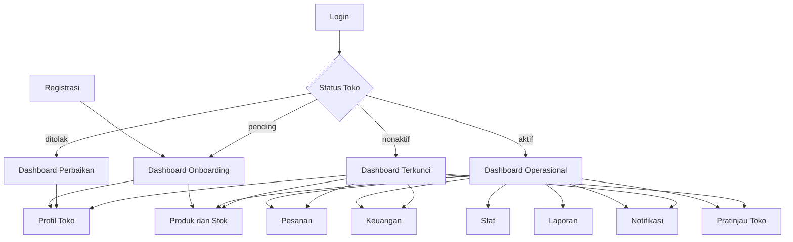
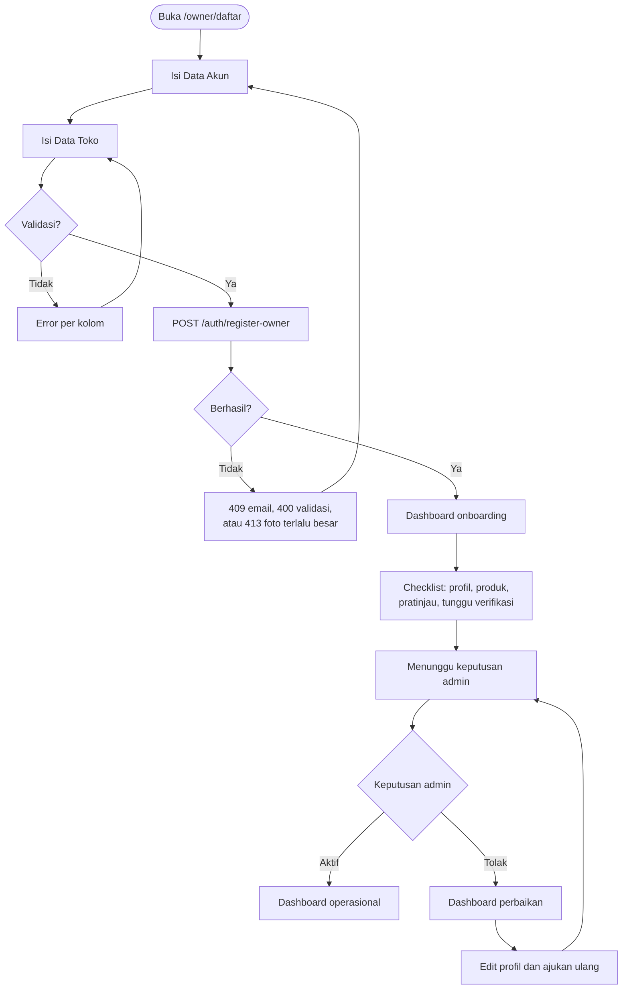
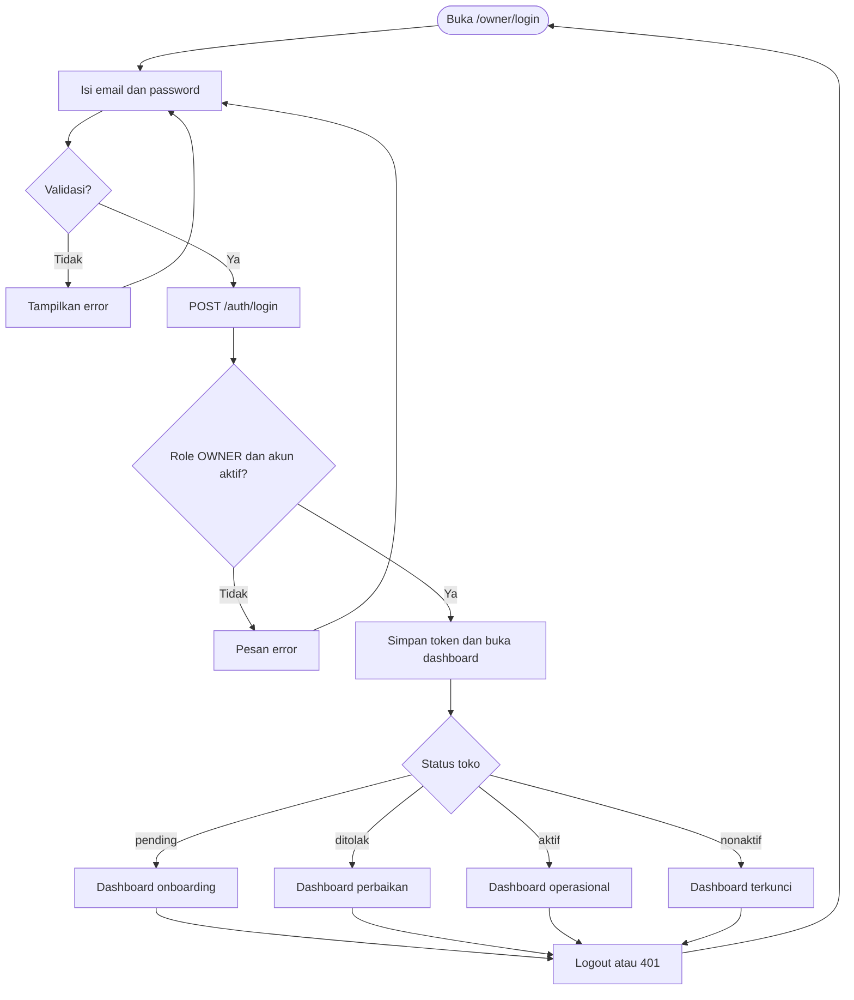
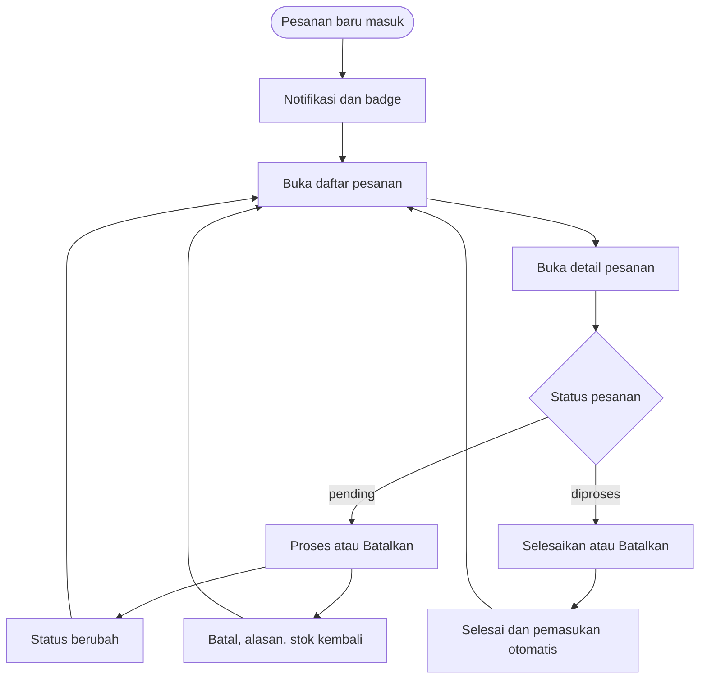
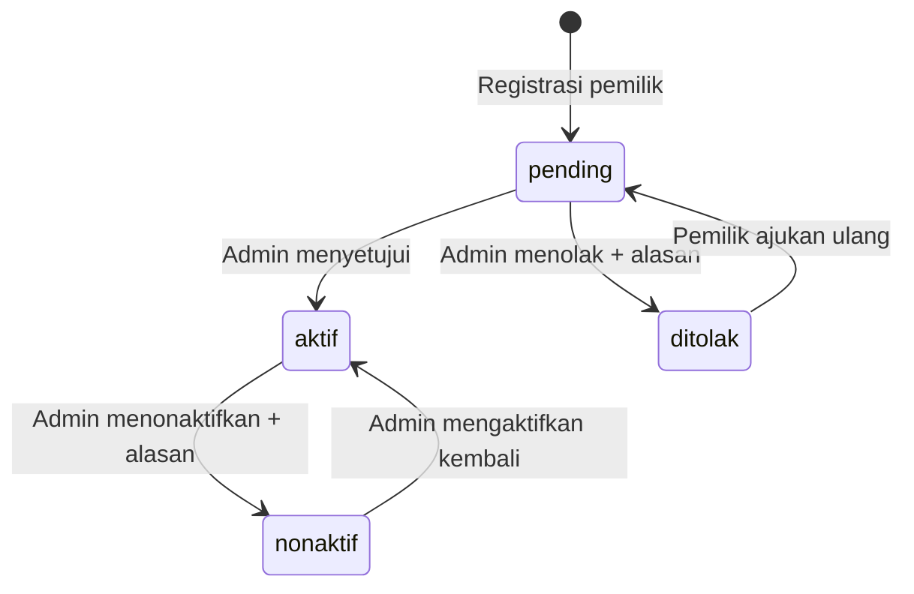

# Persiapan Desain UI Role Pemilik UMKM Ratis

Dokumen ini adalah panduan desain UI untuk role pemilik UMKM Ratis, disusun dari `PRD Ratis Role Pemilik UMKM.md` dan `Flowchart dan Alur Role Pemilik UMKM.md`. Isinya mencakup fitur tiap halaman, alur pemilik, design system, komponen khusus, dan prompt siap pakai untuk Google Stitch.

Cara pakai:

1. Buka Google Stitch, lalu tempel **Global style prompt** (bagian 6.1).
2. Tempel prompt halaman yang ingin dibuat (bagian 6.2).
3. Iterasi desain dengan instruksi tambahan, misalnya "lebih lega", "kartu pesanan lebih ringkas", atau "buat versi desktop".
4. Catatan: Stitch menerima **prompt teks**, bukan kode Mermaid. Diagram Mermaid di dokumen ini dipakai untuk dokumentasi alur, bukan untuk ditempel ke Stitch.

## 1. Ringkasan

Panel pemilik UMKM Ratis dipakai untuk:

- Mendaftarkan akun dan toko.
- Menyiapkan produk dan stok sebelum toko aktif.
- Memproses pesanan harian.
- Mencatat pengeluaran dan melihat laba.
- Mengelola staf dengan akses terbatas.
- Menerima notifikasi pesanan dan perubahan status toko.
- Melihat laporan penjualan dan mengekspor data.
- Melihat pratinjau storefront milik sendiri.

Target utama: pemilik dapat menyelesaikan pekerjaan harian dari ponsel, memproses satu pesanan maksimal 2 ketukan dari daftar, dan menambah produk pertama kurang dari 3 menit setelah akun dibuat.

### 1.1 Perbedaan dengan panel admin

| Aspek | Panel admin | Panel pemilik UMKM |
| --- | --- | --- |
| Peran | Mengawasi platform | Menjalankan usaha |
| Perangkat utama | Desktop | Ponsel |
| Kepadatan layar | Tinggi, banyak tabel | Sedang, banyak kartu |
| Navigasi | Sidebar penuh | Bottom navigation dan drawer |
| Fokus | Verifikasi, monitoring, kontrol | Operasional harian dan penjualan |
| Nada visual | Formal dan terkendali | Hangat, praktis, dan suportif |
| Cakupan data | Lintas toko | Hanya tokonya |
| Aksi utama | Menyetujui, menolak, menonaktifkan | Menjual, memproses, mencatat |
| Data pelanggan | Nama saja | Nama, nomor HP, dan alamat untuk pesanan tokonya |
| Warna brand | Teal Ratis | Teal Ratis dengan permukaan yang lebih lega |

Prinsip pemisahnya: **admin adalah ruang kontrol, pemilik adalah ruang kerja harian**. Keduanya memakai identitas visual Ratis yang sama, tetapi prioritas, kepadatan, dan cara navigasi berbeda.

### 1.2 Halaman yang didesain

1. Registrasi pemilik.
2. Login pemilik.
3. Dashboard operasional dan dashboard onboarding.
4. Profil toko.
5. Daftar produk dan stok.
6. Form tambah dan ubah produk.
7. Daftar pesanan.
8. Detail pesanan.
9. Keuangan.
10. Staf.
11. Notifikasi.
12. Laporan dan ekspor.
13. Pratinjau storefront.
14. State bersama, dialog, dan halaman error.

Halaman staf, pelanggan, dan admin tidak termasuk dalam dokumen ini.

### 1.3 Target pengalaman

| Pengalaman | Target |
| --- | --- |
| Registrasi sampai produk pertama siap | Kurang dari 10 menit |
| Memproses satu pesanan dari daftar | Maksimal 2 ketukan |
| Menambah produk | Kurang dari 3 menit |
| Menemukan produk stok menipis | Terlihat di dashboard tanpa mencari |
| Mencatat pengeluaran | Maksimal 3 langkah dari halaman keuangan |
| Mengekspor laporan | Maksimal 3 langkah |
| Ukuran layar utama | 390 px lebar ponsel, tetap nyaman di 1440 px desktop |
| Ukuran target sentuh | Minimal 44 x 44 px |

## 2. Prinsip desain

- **Mobile-first, desktop-comfortable:** semua aksi Must dirancang untuk satu tangan di ponsel, lalu diperlebar untuk desktop.
- **Satu langkah berikutnya jelas:** setiap halaman menunjukkan aksi utama, misalnya "Proses", "Selesaikan", "Tambah Produk", atau "Ajukan Ulang".
- **Tenang dan hangat:** tampilan tidak boleh terasa seperti sistem akuntansi yang rumit. Gunakan bahasa manusia, bukan istilah teknis.
- **Beban kognitif rendah:** tampilkan informasi yang dibutuhkan sekarang, sembunyikan detail sekunder di drawer atau halaman detail.
- **Angka dapat dipercaya:** omzet, stok, dan laba selalu punya penjelasan sumber dan periode.
- **Aman untuk aksi berisiko:** batalkan pesanan, hapus produk, dan nonaktifkan staf selalu memakai konfirmasi.
- **Konsisten dengan admin:** warna status, tipografi, radius, dan pola dialog mengikuti brand Ratis.
- **Ramah data kosong:** loading, empty state, error state, dan status toko nonaktif selalu punya tampilan yang jelas.

## 3. Design system

### 3.1 Palet warna

| Token | Hex | Pemakaian |
| --- | --- | --- |
| Primary | `#0F766E` | Tombol utama, menu aktif, tautan |
| Primary hover | `#115E59` | Hover tombol utama |
| Primary soft | `#CCFBF1` | Latar ikon, highlight ringan |
| Ink | `#0F172A` | Judul dan teks utama |
| Muted | `#64748B` | Teks sekunder, metadata |
| Background | `#F8FAFC` | Latar halaman |
| Surface | `#FFFFFF` | Kartu, tabel, modal, bottom sheet |
| Border | `#E2E8F0` | Garis kartu, tabel, input |
| Pending | `#F59E0B` / `#FEF3C7` | Badge status toko pending dan pesanan pending |
| Diproses | `#2563EB` / `#DBEAFE` | Badge pesanan diproses |
| Selesai / Aktif | `#22C55E` / `#DCFCE7` | Badge pesanan selesai, toko aktif, produk aktif |
| Dibatalkan / Ditolak | `#EF4444` / `#FEE2E2` | Badge pesanan dibatalkan, toko ditolak |
| Nonaktif | `#64748B` / `#E2E8F0` | Badge toko, produk, atau staf nonaktif |
| Stok menipis | `#D97706` / `#FFFBEB` | Badge stok menipis |
| Stok habis | `#DC2626` / `#FEE2E2` | Badge stok habis |
| Pemasukan | `#16A34A` / `#DCFCE7` | Nominal pemasukan |
| Pengeluaran | `#DC2626` / `#FEE2E2` | Nominal pengeluaran |
| Info | `#2563EB` | Pesan informasi |
| Danger | `#DC2626` | Tombol hapus, batalkan, dan nonaktifkan |

Palet di atas adalah usulan dan boleh disesuaikan dengan identitas visual Ratis. Warna status tidak boleh menjadi satu-satunya pembeda; selalu sertakan label teks atau ikon.

### 3.2 Tipografi

- **Font:** Plus Jakarta Sans (Google Fonts).
- **Judul halaman:** 24px / 32px, weight 700.
- **Judul kartu:** 18px / 26px, weight 600.
- **Body:** 14px / 22px, weight 400.
- **Body di ponsel:** 15px / 24px agar lebih nyaman dibaca.
- **Label:** 12px / 16px, weight 600.
- **Angka KPI:** 28px / 36px di ponsel, 32px / 40px di desktop, weight 700.
- **Teks kecil:** 12px / 18px, weight 400.
- **Tombol:** 14px / 20px, weight 600.
- **Input di ponsel:** 16px untuk mencegah zoom otomatis browser.

### 3.3 Spacing, radius, shadow

- Skala spacing: 4, 8, 12, 16, 24, 32, 40, 48px.
- Radius input dan tombol: 12px.
- Radius kartu: 16px.
- Radius modal dan bottom sheet: 20px.
- Radius badge dan chip: 999px.
- Shadow kartu: `0 1px 2px rgba(15, 23, 42, 0.06)`.
- Shadow modal: `0 16px 40px rgba(15, 23, 42, 0.16)`.
- Lebar sidebar desktop: 264px.
- Tinggi header desktop: 72px.
- Tinggi top app bar ponsel: 56px.
- Tinggi bottom navigation: 64px ditambah safe area.
- Padding konten: 20px di ponsel, 32px di desktop.
- Lebar konten maksimal: 1280px.
- Target sentuh minimal: 44 x 44px.

### 3.4 Komponen dasar

- Tombol: primary, secondary, ghost, danger, dan text button.
- Input teks, textarea, select, search, date range, dan input nominal Rupiah.
- Upload foto dengan pratinjau dan tombol hapus.
- Kartu KPI, kartu produk, kartu pesanan, kartu transaksi, dan kartu staf.
- Badge status toko, pesanan, produk, stok, dan sumber transaksi.
- Bottom navigation, sidebar, top app bar, dan notification bell.
- Modal di desktop dan bottom sheet di ponsel.
- Drawer detail di desktop dan halaman penuh di ponsel.
- Toast sukses, gagal, dan info.
- Skeleton loading.
- Empty state dan error state.
- Pagination dan tombol Muat lebih banyak.
- Toggle switch, segmented control, chip filter, dan character counter.
- Timeline riwayat status dan riwayat stok.
- Checklist onboarding.
- Sticky action bar untuk form dan detail pesanan.

### 3.5 Komponen khusus pemilik

- **Status banner:** muncul di atas konten saat toko `pending`, `ditolak`, atau `nonaktif`, berisi alasan dan tindakan yang relevan.
- **Onboarding checklist:** daftar langkah "Lengkapi profil", "Tambah produk pertama", "Pratinjau toko", dan "Tunggu verifikasi".
- **Product card:** foto, nama, harga, stok, badge stok, status, dan menu aksi.
- **Order card:** kode, pelanggan, total, status, waktu, dan tombol aksi utama.
- **Finance row:** tanggal, kategori, deskripsi, nominal berwarna, dan badge Otomatis atau Manual.
- **Staff limit meter:** indikator "3 dari 5 staf aktif".
- **Preview frame:** bingkai storefront dengan banner pratinjau dan tombol ganti tampilan ponsel atau desktop.
- **Sticky action bar:** tombol utama selalu terlihat di bawah layar ponsel.

### 3.6 Ikon dan ilustrasi

- Ikon: Lucide outline, ukuran 20 dan 24px.
- Ilustrasi empty state: garis sederhana dengan warna primary soft dan muted.
- Foto toko: rasio 16:9, placeholder abu-abu dengan ikon toko.
- Foto produk: rasio 1:1, placeholder dengan ikon produk.
- Ikon status: jam untuk pending, roda gigi untuk diproses, centang untuk selesai, silang untuk dibatalkan.
- Jangan memakai emoji di UI.

### 3.7 Layout global

**Desktop (1440px):**

- Sidebar kiri 264px: logo Ratis, nama toko, menu Dashboard, Pesanan, Produk, Keuangan, Staf, Laporan, Profil Toko, dan Pratinjau.
- Header atas 72px: judul halaman, badge status toko, lonceng notifikasi, nama pemilik, dan tombol logout.
- Area konten di kanan dengan lebar maksimal 1280px.
- Menu aktif memakai latar primary soft dan teks primary.
- Tabel lebar dapat digeser horizontal bila perlu.

**Tablet (768-1023px):**

- Sidebar berubah menjadi rail ikon atau drawer.
- Kartu KPI menjadi dua kolom.
- Tabel berubah menjadi tabel ringkas atau kartu.

**Ponsel (di bawah 768px):**

- Top app bar 56px: nama toko, badge status, lonceng notifikasi, dan menu.
- Bottom navigation 64px: Dashboard, Pesanan, Produk, Keuangan, dan Menu.
- Menu membuka drawer berisi Staf, Laporan, Profil Toko, Pratinjau, dan Logout.
- Tabel berubah menjadi kartu.
- Filter panjang memakai bottom sheet.
- Tombol utama memakai sticky action bar.
- Konten memiliki padding bawah agar tidak tertutup bottom navigation.

### 3.8 Aksesibilitas dan responsif

- Kontras teks minimal 4.5:1 untuk teks normal.
- Focus ring terlihat pada semua elemen interaktif.
- Setiap input memiliki label yang terlihat, bukan hanya placeholder.
- Pesan error muncul di dekat kolom dan diumumkan ke screen reader.
- Jangan mengandalkan warna saja untuk status; gunakan label dan ikon.
- Target sentuh minimal 44 x 44px.
- Tombol ikon memiliki `aria-label`.
- Dialog menangkap fokus dan dapat ditutup dengan Escape di desktop.
- Layout tidak boleh menyebabkan scroll horizontal di ponsel, kecuali tabel yang memang dapat digeser.
- Gunakan safe area untuk perangkat dengan notch.

## 4. Peta halaman dan alur

### 4.1 Peta halaman



### 4.2 Alur registrasi dan onboarding



### 4.3 Alur login dan sesi



### 4.4 Alur pesanan



### 4.5 Alur status toko



Catatan: pemilik hanya memicu transisi `ditolak` ke `pending`. Transisi lain dilakukan admin.

## 5. Spesifikasi halaman

### 5.1 Registrasi pemilik

**Rute:** `/owner/daftar`

**Tujuan:** membuat akun pemilik dan mengajukan toko tanpa bantuan admin.

**Layout:**

- Ponsel: top brand bar, judul "Buat akun usaha", progress dua bagian, kartu Data Akun, kartu Data Toko, dan sticky action bar "Daftar".
- Desktop: panel kiri 38% berisi brand, manfaat Ratis, dan ilustrasi toko; panel kanan 62% berisi form maksimal 640px.
- Form dibagi menjadi dua bagian dengan garis pemisah dan nomor langkah.
- NIB dan foto usaha diberi label "Opsional".

**Fitur:**

1. Data Akun: nama pemilik, email, nomor HP, password, dan konfirmasi password.
2. Data Toko: nama toko, deskripsi, alamat, NIB opsional, dan foto usaha opsional.
3. Tombol tampilkan atau sembunyikan password.
4. Validasi langsung di bawah kolom, termasuk kecocokan konfirmasi password.
5. Upload foto dengan pratinjau, batas 2 MB, dan tombol hapus.
6. Tombol "Daftar" berstatus loading dan nonaktif saat proses.
7. Tautan "Sudah punya akun? Masuk".
8. Setelah sukses, arahkan ke dashboard onboarding dengan pesan "Toko Anda menunggu verifikasi admin".

**State dan pesan:**

- Default: form kosong dengan fokus di kolom nama.
- Error validasi: border merah dan pesan di bawah kolom.
- Email duplikat: "Email sudah terdaftar. Masuk atau gunakan email lain."
- Foto gagal: "Foto gagal diunggah. Anda dapat melanjutkan tanpa foto."
- Loading: tombol "Mendaftarkan..." dengan spinner.
- Sukses: redirect ke dashboard onboarding.

**Prompt Stitch:** bagian 6.2.1.

### 5.2 Login pemilik

**Rute:** `/owner/login`

**Tujuan:** pintu masuk aman ke panel usaha.

**Layout:**

- Ponsel: kartu login di tengah, logo Ratis, judul "Masuk ke usaha Anda", form, dan tautan daftar.
- Desktop: split screen. Panel kiri 45% berisi brand, kutipan singkat tentang kemudahan mengelola usaha, dan ilustrasi abstrak; panel kanan 55% berisi form 400px.
- Tanpa sidebar dan header panel.

**Fitur:**

1. Field email dengan validasi format email.
2. Field password minimal 8 karakter dengan tombol tampilkan atau sembunyikan.
3. Tombol Masuk full width dengan state loading.
4. Pesan error di atas form: kredensial salah, akun dinonaktifkan, atau terlalu banyak percobaan.
5. Tautan "Belum punya akun? Daftarkan toko".
6. Redirect ke dashboard setelah berhasil.
7. Pesan sesi berakhir saat diarahkan dari halaman lain karena token kedaluwarsa.
8. Pemilik dengan toko `pending`, `ditolak`, atau `nonaktif` tetap masuk ke dashboard dengan banner status.

**State dan pesan:**

- Loading: "Memproses...".
- Error: alert merah dengan ikon.
- Rate limit: "Terlalu banyak percobaan, coba lagi nanti."
- Sesi berakhir: "Sesi Anda berakhir. Silakan masuk kembali."

**Prompt Stitch:** bagian 6.2.2.

### 5.3 Dashboard

**Rute:** `/owner/dashboard`

**Tujuan:** memberi gambaran kondisi usaha dan mengarahkan pemilik ke pekerjaan mendesak.

**Layout desktop:**

- Header halaman: sapaan "Selamat pagi, Bu Sari", nama toko, badge status, tanggal, dan tombol Muat ulang.
- Baris aksi cepat: Tambah Produk, Lihat Pesanan, Catat Pengeluaran, dan Pratinjau Toko.
- Empat kartu KPI: Omzet Hari Ini, Omzet Bulan Ini, Perlu Diproses, dan Stok Menipis.
- Baris grafik tren omzet atau pesanan 7/30 hari dan kartu "Produk Terlaris".
- Baris dua kolom: "Pesanan Perlu Ditindak" dan "Stok Menipis".
- Tabel atau daftar lima pesanan terbaru.

**Layout ponsel:**

- Banner status toko bila tidak aktif.
- Sapaan dan nama toko.
- Dua kartu KPI per baris.
- Tombol aksi cepat berbentuk chip atau kartu kecil.
- Grafik tren dengan tinggi 180px.
- Daftar pesanan perlu ditindak dan stok menipis sebagai kartu.
- Tombol "Lihat semua" pada setiap daftar.

**Fitur:**

1. Kartu KPI dapat diklik menuju daftar yang sudah terfilter.
2. Grafik berubah saat rentang 7 atau 30 hari dipilih.
3. Daftar pesanan menampilkan aksi Proses atau Selesaikan sesuai status.
4. Daftar stok menipis menampilkan tombol Sesuaikan Stok.
5. Tombol Muat ulang menyegarkan data tanpa reload halaman.
6. Badge pesanan baru muncul di menu Pesanan dan lonceng notifikasi.
7. Empty state jika belum ada data: angka 0 dan pesan ramah.
8. Skeleton loading untuk kartu, grafik, dan daftar.

**Mode onboarding:**

- Muncul saat toko `pending` atau `ditolak`.
- Kartu status besar berisi badge, alasan penolakan bila ada, dan tombol tindakan.
- Checklist: Lengkapi profil, Tambah produk pertama, Pratinjau toko, Tunggu verifikasi.
- Daftar produk yang sudah disiapkan.
- Angka penjualan disembunyikan atau ditampilkan 0 dengan keterangan "Toko belum aktif".

**Prompt Stitch:** bagian 6.2.3 untuk dashboard aktif dan 6.2.4 untuk dashboard onboarding.

### 5.4 Profil toko

**Rute:** `/owner/toko`

**Tujuan:** melihat identitas toko, status verifikasi, alasan dari admin, dan riwayat status.

**Layout:**

- Header profil dengan cover toko 16:9 atau placeholder, avatar toko, nama, slug, badge status, dan tombol aksi.
- Banner status bila `pending`, `ditolak`, atau `nonaktif`.
- Kartu Data Toko: deskripsi, nomor HP, alamat, NIB, dan foto.
- Kartu Dokumen Opsional dengan label "Opsional" dan empty state yang rapi.
- Kartu Riwayat Status berbentuk timeline.
- Tombol Edit untuk status `aktif` dan `ditolak`; tombol Ajukan Ulang untuk status `ditolak`.
- Tombol Pratinjau Toko bila fitur O13 dikerjakan.

**Fitur:**

1. Status `pending`: profil read-only, tampilkan pesan "Profil dapat diubah setelah admin meninjau atau menolak toko".
2. Status `ditolak`: tampilkan alasan, tombol Edit, dan Ajukan Ulang.
3. Status `aktif`: tombol Edit, dengan keterangan "Perubahan tidak memerlukan verifikasi ulang".
4. Status `nonaktif`: profil read-only dan pesan "Hubungi admin untuk mengaktifkan kembali toko".
5. Form edit memakai validasi yang sama seperti registrasi.
6. Foto pengganti menampilkan pratinjau dan batas 2 MB.
7. Dialog Ajukan Ulang menjelaskan bahwa status kembali `pending` dan data masuk ke antrean admin.
8. Riwayat status menampilkan status lama, status baru, alasan, pelaku, dan waktu.

**Prompt Stitch:** bagian 6.2.5.

### 5.5 Produk dan stok

**Rute:** `/owner/produk`

**Tujuan:** mengelola katalog dan menjaga stok tetap akurat.

**Layout desktop:**

- Header dengan judul "Produk", subjudul, dan tombol "+ Tambah Produk".
- Toolbar: pencarian, filter kategori, filter status, chip "Stok menipis", dan Reset filter.
- Tabel: Produk, Kategori, Harga, Stok, Status, dan Aksi.
- Pagination 10 baris.

**Layout ponsel:**

- Search bar penuh.
- Chip filter horizontal: Semua, Aktif, Nonaktif, Stok Menipis.
- Kartu produk: foto 1:1, nama, kategori, harga, badge stok, status, dan menu tiga titik.
- Tombol "+" mengambang atau tombol Tambah Produk di header.

**Fitur:**

1. Pencarian nama produk dengan jeda singkat.
2. Filter kategori dan status.
3. Badge "Stok menipis" dan "Stok habis".
4. Menu aksi: Lihat detail, Edit, Nonaktifkan atau Aktifkan, Hapus, dan Sesuaikan Stok.
5. Tombol Hapus dinonaktifkan untuk produk yang sudah pernah dipesan, dengan tooltip alasan.
6. Dialog konfirmasi untuk menonaktifkan atau menghapus produk.
7. Modal atau bottom sheet penyesuaian stok: Tambah atau Kurangi, jumlah, alasan, catatan opsional, dan pratinjau stok baru.
8. Drawer atau halaman riwayat stok: waktu, jenis, perubahan, stok sebelum dan sesudah, alasan, pelaku, dan kode pesanan.
9. Empty state "Belum ada produk" dengan tombol Tambah Produk.
10. State read-only saat toko `nonaktif`.

**Prompt Stitch:** bagian 6.2.6.

### 5.6 Form produk

**Rute:** `/owner/produk/baru` dan `/owner/produk/:id/edit`

**Tujuan:** menambah atau mengubah produk dengan cepat dan aman.

**Layout:**

- Desktop: dua kolom. Kolom utama 2/3 berisi form; kolom samping 1/3 berisi pratinjau produk dan status.
- Ponsel: satu kolom, pratinjau foto di atas, form di bawah, sticky action bar "Simpan Produk".
- Judul halaman: "Tambah Produk" atau "Ubah Produk".

**Fitur:**

1. Nama produk 3-100 karakter.
2. Kategori aktif dari admin.
3. Harga dalam Rupiah dengan pemisah ribuan otomatis.
4. Stok awal hanya saat menambah produk.
5. `minStock` dengan default 5.
6. Deskripsi maksimal 500 karakter.
7. Foto produk opsional dengan pratinjau 1:1.
8. Saat mengedit, stok ditampilkan sebagai kartu read-only dengan tombol "Sesuaikan Stok".
9. Toggle status aktif atau nonaktif saat mengedit.
10. Validasi harga lebih dari 0, stok tidak negatif, dan kategori wajib.
11. Tombol Batal dan Simpan; perubahan yang belum disimpan memicu dialog konfirmasi.

**Prompt Stitch:** bagian 6.2.7.

### 5.7 Daftar pesanan

**Rute:** `/owner/pesanan`

**Tujuan:** memproses pesanan pelanggan dengan cepat.

**Layout desktop:**

- Header dengan judul "Pesanan" dan ringkasan "3 pesanan perlu diproses".
- Tab atau chip status: Semua, Pending, Diproses, Selesai, Dibatalkan.
- Toolbar: pencarian kode atau nama pelanggan, filter tanggal, dan Reset filter.
- Tabel: Kode, Waktu, Pelanggan, Item, Total, Status, dan Aksi.
- Pagination 10 baris.

**Layout ponsel:**

- Chip status dapat digeser horizontal.
- Kartu pesanan: kode, waktu, nama pelanggan, jumlah item, total, badge status, dan tombol aksi utama.
- Pesanan baru memiliki aksen dan label "Baru".

**Fitur:**

1. Filter status dengan badge warna.
2. Pencarian kode pesanan atau nama pelanggan.
3. Filter tanggal Hari ini, 7 hari, 30 hari, atau rentang khusus.
4. Tombol Proses untuk `pending`, Selesaikan untuk `diproses`, dan Batalkan untuk `pending` atau `diproses`.
5. Klik kartu membuka detail pesanan.
6. Empty state "Belum ada pesanan" dengan penjelasan bahwa pesanan akan muncul setelah toko aktif.
7. Loading skeleton dan error state.

**Prompt Stitch:** bagian 6.2.8.

### 5.8 Detail pesanan

**Rute:** `/owner/pesanan/:id`

**Tujuan:** melihat detail pesanan dan mengubah status dengan aman.

**Layout:**

- Header: tombol Kembali, kode pesanan, badge status, dan waktu.
- Kartu Pelanggan: nama, nomor HP, alamat, dan catatan.
- Kartu Item: nama produk, jumlah, harga satuan, dan subtotal.
- Kartu Total: subtotal, total, dan keterangan "Pembayaran dilakukan di luar sistem".
- Kartu Riwayat Status berbentuk timeline.
- Desktop: panel tindakan sticky di kanan.
- Ponsel: sticky action bar di bawah.

**Fitur:**

1. Tombol Proses untuk `pending`.
2. Tombol Selesaikan untuk `diproses`.
3. Tombol Batalkan untuk `pending` atau `diproses`.
4. Dialog pembatalan dengan alasan wajib 10-300 karakter dan penghitung karakter.
5. Pesan konflik 409: "Status pesanan sudah berubah. Muat ulang detail."
6. Tidak ada tombol untuk mengubah item atau total.
7. Setelah selesai, tampilkan keterangan "Pemasukan sudah tercatat otomatis".
8. Setelah dibatalkan, tampilkan alasan dan keterangan "Stok sudah dikembalikan".
9. Kontak pelanggan lengkap hanya untuk pesanan toko ini.

**Prompt Stitch:** bagian 6.2.9.

### 5.9 Keuangan

**Rute:** `/owner/keuangan`

**Tujuan:** menampilkan pemasukan, pengeluaran, dan laba usaha secara sederhana.

**Layout:**

- Header: judul "Keuangan", subjudul, dan tombol "+ Tambah Pengeluaran".
- Filter periode: Hari ini, 7 hari, 30 hari, dan rentang khusus.
- Tiga kartu ringkasan: Pemasukan, Pengeluaran, dan Laba Bersih.
- Tab: Semua, Pemasukan, Pengeluaran.
- Desktop: tabel transaksi.
- Ponsel: kartu transaksi dengan nominal berwarna.
- Pagination 10 baris.

**Fitur:**

1. Badge "Otomatis" untuk pemasukan dari pesanan dan "Manual" untuk pengeluaran.
2. Entri otomatis tidak memiliki tombol edit atau hapus.
3. Tombol Edit dan Hapus hanya untuk pengeluaran manual.
4. Modal atau bottom sheet tambah pengeluaran: tanggal, kategori, deskripsi, dan nominal.
5. Tanggal masa depan ditolak dengan pesan jelas.
6. Ringkasan langsung berubah setelah pengeluaran ditambah, diedit, atau dihapus.
7. Laba negatif ditampilkan merah dengan ikon peringatan.
8. Empty state "Belum ada transaksi" dengan tombol Tambah Pengeluaran.
9. Keterangan "Pemasukan berasal dari pesanan selesai".

**Prompt Stitch:** bagian 6.2.10.

### 5.10 Staf

**Rute:** `/owner/staf`

**Tujuan:** mengelola akses staf tanpa memberikan seluruh kendali toko.

**Layout:**

- Header: judul "Staf", subjudul, indikator "3 dari 5 staf aktif", dan tombol "+ Tambah Staf".
- Kartu penjelasan hak akses: pesanan, stok, dan lihat produk; tanpa keuangan dan pengaturan toko.
- Desktop: tabel Nama, Email, Status, Tanggal Dibuat, dan Aksi.
- Ponsel: kartu staf dengan avatar inisial, nama, email, badge status, dan menu aksi.
- Modal atau bottom sheet tambah dan ubah staf.

**Fitur:**

1. Tambah staf: nama, email, password, dan konfirmasi password.
2. Ubah staf: nama dan reset password.
3. Tombol Nonaktifkan atau Aktifkan dengan dialog konfirmasi.
4. Tombol Tambah Staf dinonaktifkan saat jumlah aktif 5, dengan keterangan batas.
5. Email duplikat ditampilkan di bawah kolom email.
6. Staf tidak memiliki tombol hapus permanen.
7. State read-only saat toko `nonaktif`.
8. Empty state "Belum ada staf" dengan penjelasan manfaat staf.

**Prompt Stitch:** bagian 6.2.11.

### 5.11 Notifikasi

**Rute:** `/owner/notifikasi`

**Tujuan:** memberi tahu pemilik tentang kejadian penting tanpa meninggalkan aplikasi.

**Layout:**

- Header: judul "Notifikasi", filter "Belum dibaca", dan tombol "Tandai semua dibaca".
- Daftar notifikasi dengan ikon jenis, judul, pesan singkat, waktu, dan titik belum dibaca.
- Desktop: daftar satu kolom maksimal 760px.
- Ponsel: daftar penuh dengan pembagi antaritem.
- Dropdown lonceng berisi lima notifikasi terbaru dan tautan "Lihat semua".

**Fitur:**

1. Notifikasi pesanan baru menuju detail pesanan.
2. Notifikasi stok menipis menuju produk atau penyesuaian stok.
3. Notifikasi status toko menuju profil toko.
4. Klik notifikasi menandai dibaca dan membuka tautan.
5. Tombol Tandai semua dibaca.
6. Badge belum dibaca di lonceng dan bottom navigation.
7. Empty state "Tidak ada notifikasi baru".
8. Notifikasi baru muncul tanpa reload halaman.

**Prompt Stitch:** bagian 6.2.12.

### 5.12 Laporan dan ekspor

**Rute:** `/owner/laporan`

**Tujuan:** membantu pemilik mengevaluasi penjualan dan mengunduh data.

**Layout:**

- Header: judul "Laporan", subjudul, dan tombol "Ekspor CSV".
- Filter periode: 7 hari, 30 hari, dan rentang khusus.
- Empat kartu KPI: Jumlah Pesanan, Pesanan Selesai, Omzet, dan Rata-rata Nilai Pesanan.
- Grafik penjualan harian.
- Dua kartu: Produk Terlaris dan Komposisi Status Pesanan.
- Modal ekspor: jenis data, periode, catatan batas 90 hari dan 5.000 baris.

**Fitur:**

1. Omzet hanya dari pesanan selesai.
2. Grafik dan kartu berubah mengikuti periode.
3. Produk terlaris menampilkan jumlah item terjual.
4. Komposisi status pesanan memakai badge dan persentase.
5. Tombol Ekspor CSV dengan state loading.
6. Jika data kosong, tampilkan 0 dan pesan ramah.
7. Jika rentang lebih dari 90 hari, tampilkan error dan minta persempit.
8. Staf tidak dapat membuka halaman ini.

**Prompt Stitch:** bagian 6.2.13.

### 5.13 Pratinjau storefront

**Rute:** `/owner/pratinjau`

**Tujuan:** memberi gambaran nyata tampilan toko sebelum atau sesudah aktif.

**Layout:**

- Preview bar di atas: tombol Kembali, badge status, judul "Pratinjau Toko", dan toggle "Ponsel / Desktop".
- Banner "Pratinjau — toko belum tayang" untuk toko yang belum aktif.
- Bingkai storefront dengan cover toko, nama, deskripsi, katalog produk, dan tombol checkout.
- Tombol checkout dinonaktifkan dengan keterangan "Pratinjau hanya untuk melihat tampilan".

**Fitur:**

1. Hanya menampilkan produk aktif.
2. Produk stok habis tetap tampil dengan label "Stok habis".
3. Empty state jika belum ada produk.
4. Pratinjau tidak dapat dibagikan sebagai tautan publik.
5. Storefront publik tetap hanya untuk toko `aktif`.
6. Toggle ponsel dan desktop mengubah lebar bingkai, bukan data.

**Prompt Stitch:** bagian 6.2.14.

### 5.14 State bersama dan halaman error

**Loading:**

- Skeleton untuk kartu KPI, grafik, daftar produk, daftar pesanan, dan detail.
- Teks "Menyiapkan data, mohon tunggu" saat cold start.

**Empty state:**

- Ikon sederhana, judul, deskripsi, dan tombol aksi.
- Contoh: "Belum ada produk", "Belum ada pesanan", "Tidak ada notifikasi baru".

**Error state:**

- "Gagal memuat data", "Periksa koneksi lalu coba lagi", dan tombol Coba lagi.
- Jika aksi gagal, tampilkan toast dan pertahankan data yang sudah ada.

**Status toko:**

- Banner `pending`: "Toko Anda sedang ditinjau admin" dengan checklist.
- Banner `ditolak`: alasan penolakan dan tombol Perbaiki Profil.
- Banner `nonaktif`: alasan dan keterangan bahwa pesanan baru tidak diterima.

**403:**

- "Akses ditolak", "Halaman ini hanya untuk pemilik toko", dan tombol Kembali ke dashboard.
- Tampilkan saat staf mencoba membuka halaman keuangan atau pengaturan toko.

**404:**

- "Halaman tidak ditemukan" dan tombol Kembali ke dashboard.

**Sesi berakhir:**

- Modal atau redirect ke login dengan pesan "Sesi Anda berakhir. Silakan masuk kembali."

**Toast:**

- Sukses: hijau, ikon centang.
- Gagal: merah, ikon peringatan.
- Info: biru.
- Posisi kanan atas di desktop, bawah di atas bottom navigation pada ponsel.
- Hilang otomatis setelah 4 detik.

**Dialog dan bottom sheet:**

- Judul singkat, deskripsi dampak, tombol Batal, dan tombol aksi yang jelas.
- Aksi berbahaya memakai tombol merah.
- Di ponsel, dialog kompleks memakai bottom sheet yang dapat digeser.
- Di desktop, dialog memakai modal tengah.

**Prompt Stitch:** bagian 6.2.15.

## 6. Prompt untuk Google Stitch

### 6.1 Global style prompt

Tempel prompt ini lebih dulu, lalu prompt halaman.

```text
Create a modern, mobile-first business management UI for "Ratis", an Indonesian UMKM platform. Design primarily at 390x844 for mobile, with a responsive desktop version at 1440x900. The feel is warm, practical, and trustworthy: a daily business companion, not a corporate admin panel. Background #F8FAFC, white cards, 1px #E2E8F0 borders, 16px card radius, subtle shadows. Primary teal-green #0F766E, hover #115E59, soft #CCFBF1. Text #0F172A, muted #64748B. Status colors: pending amber #F59E0B on #FEF3C7, diproses blue #2563EB on #DBEAFE, selesai and aktif green #22C55E on #DCFCE7, dibatalkan and ditolak red #EF4444 on #FEE2E2, nonaktif slate #64748B on #E2E8F0. Typography Plus Jakarta Sans, headings 600/700, body 400/500. Lucide outline icons. Indonesian UI copy. Mobile layout: 56px top app bar with shop name and status badge, 64px bottom navigation for Dashboard, Pesanan, Produk, Keuangan, and Menu, 44px minimum touch targets, sticky primary actions. Desktop layout: 264px left sidebar and 72px top header. Use cards instead of dense tables on mobile. Accessible contrast, visible focus rings, no dark mode.
```

### 6.2 Prompt per halaman

#### 6.2.1 Registrasi pemilik

```text
Using the global Ratis owner style, design the owner registration screen at 390x844 and a desktop variant at 1440x900. Mobile: top brand bar with Ratis logo, title "Buat akun usaha", subtitle "Mulai jualan online dan kelola usaha dalam satu tempat.", a two-step progress indicator, two white form cards "Data Akun" and "Data Toko", and a sticky bottom primary button "Daftar". Data Akun fields: Nama Pemilik, Email, Nomor HP, Password, Konfirmasi Password with show/hide buttons. Data Toko fields: Nama Toko, Deskripsi, Alamat, NIB optional with "Opsional" badge, and a photo upload area with preview. Desktop: left 38% teal brand panel with simple storefront illustration and benefit bullets, right 62% centered form max 640px. Include inline validation, duplicate email alert, upload error state, loading button "Mendaftarkan...", and footer link "Sudah punya akun? Masuk". Indonesian copy, warm and clear.
```

#### 6.2.2 Login pemilik

```text
Using the global Ratis owner style, design the owner login screen at 390x844 and 1440x900. Mobile: centered white card with small Ratis logo, title "Masuk ke usaha Anda", subtitle "Kelola pesanan, stok, dan keuangan toko Anda.", labeled email and password fields with icons and show/hide password, full-width primary button "Masuk", inline error alert area, and footer link "Belum punya akun? Daftarkan toko". Desktop: split screen, left 45% deep teal brand panel with a warm abstract UMKM pattern, Ratis logo, headline "Usaha Anda, dalam satu genggaman", supporting line about orders, stock, and profit, and a small note "Untuk pemilik UMKM"; right 55% white area with a 400px form card. Show loading state "Memproses..." and session-expired message. Indonesian copy, accessible focus states.
```

#### 6.2.3 Dashboard aktif

```text
Using the global Ratis owner style, design the active shop dashboard at 390x844 and 1440x900. Mobile: top app bar with shop name "Dapur Bu Sari", green "Aktif" badge, notification bell with red unread dot, and menu icon. Content: greeting "Selamat pagi, Bu Sari", date "Senin, 23 November 2026", and refresh icon; four KPI cards in a 2x2 grid: Omzet Hari Ini Rp450.000, Omzet Bulan Ini Rp8.750.000, Perlu Diproses 3, Stok Menipis 2; a compact teal area chart "Tren Omzet" with 7 hari / 30 hari toggle; a card "Pesanan Perlu Ditindak" with 2 order rows showing code, customer, total, status, and "Proses" button; a card "Stok Menipis" with product name, remaining stock, and "Sesuaikan" button; a card "Produk Terlaris" with 3 product rows. Desktop: 264px sidebar, 72px header, KPI row, large chart, right column for orders and low stock, and a recent orders table. Use realistic Indonesian data, skeleton loading, and friendly empty states.
```

#### 6.2.4 Dashboard onboarding

```text
Using the global Ratis owner style, design the onboarding dashboard for a pending shop at 390x844 and 1440x900. Show a prominent amber status card: "Toko Anda sedang ditinjau admin", explanation that the storefront will appear after approval, and a secondary button "Lihat Profil Toko". Below it, a checklist card "Siapkan toko Anda" with four steps: Lengkapi profil toko (done), Tambah produk pertama (done), Pratinjau toko (available), Tunggu verifikasi admin (in progress). Show a compact preview list of prepared products with image, name, price, and stock. Add a "Tambah Produk" primary button and a "Pratinjau Toko" secondary button. On desktop, use a two-column layout with the status and checklist on the left and product preview on the right. Do not show sales KPIs or revenue charts. Include a rejected variant with a red status card, admin reason, and buttons "Perbaiki Profil" and "Ajukan Ulang". Indonesian copy, encouraging tone.
```

#### 6.2.5 Profil toko

```text
Using the global Ratis owner style, design the "Profil Toko" page at 390x844 and 1440x900. Top: cover photo area 16:9 with shop avatar, shop name "Dapur Bu Sari", slug "dapur-bu-sari", status badge "Aktif", and buttons "Edit Profil" and "Pratinjau Toko". Below: a status card explaining that active shop profile changes do not require re-verification. Main content cards: "Identitas Toko" with name, description, and photo; "Kontak dan Alamat" with phone and address; "Dokumen Opsional" with NIB and business photo, showing an "Opsional" badge and neat empty state; "Riwayat Status" vertical timeline with old status, new status, reason, actor, and timestamp. Include variants for pending (read-only banner), rejected (red banner with reason, "Perbaiki Profil" and "Ajukan Ulang" buttons), and nonaktif (slate banner, read-only). Use a clean two-column desktop layout and a single-column mobile layout. Indonesian copy.
```

#### 6.2.6 Produk dan stok

```text
Using the global Ratis owner style, design the "Produk" page at 390x844 and 1440x900. Mobile: top app bar, title "Produk", subtitle "Kelola katalog dan stok toko Anda.", primary button "+ Tambah Produk", search bar, horizontally scrollable filter chips Semua, Aktif, Nonaktif, Stok Menipis, and product cards. Each product card shows a square photo, name "Kue Lapis Legit", category "Kue", price "Rp150.000", stock "12", a green "Aktif" badge, and a three-dot menu. Include a card with amber "Stok menipis" badge and one with red "Stok habis". Desktop: toolbar with search, category select, status select, low-stock chip, and a data table with columns Produk, Kategori, Harga, Stok, Status, Aksi. Include a stock adjustment bottom sheet: current stock, Tambah or Kurangi segmented control, quantity input, reason field, optional note, preview "Stok baru: 15", and primary button "Simpan Penyesuaian". Include a stock history drawer with type badges, change, before/after, reason, actor, and order code. Indonesian copy, accessible touch targets.
```

#### 6.2.7 Form produk

```text
Using the global Ratis owner style, design the "Tambah Produk" and "Ubah Produk" form at 390x844 and 1440x900. Mobile: top app bar with back button and title, a square photo upload area with placeholder and helper "JPG atau PNG, maksimal 2 MB", form fields Nama Produk, Kategori, Harga with Rp prefix and thousand separators, Stok Awal, Stok Minimum, Deskripsi with character counter, and a sticky bottom action bar with "Batal" and "Simpan Produk". Desktop: two-column layout, main form 2/3 and a sticky side card 1/3 with product preview and status toggle. On edit mode, hide the stock input and show a read-only stock card with "Sesuaikan Stok" link; show an active/nonaktif toggle. Include inline validation for price greater than 0, non-negative stock, and required active category. Use realistic Indonesian product data and a calm, uncluttered layout.
```

#### 6.2.8 Daftar pesanan

```text
Using the global Ratis owner style, design the "Pesanan" list at 390x844 and 1440x900. Mobile: top app bar, title "Pesanan", summary "3 pesanan perlu diproses", horizontally scrollable status chips Semua, Pending, Diproses, Selesai, Dibatalkan, search field, date filter button, and order cards. Each card shows order code "RTS-20261123-001", time "14.20 WIB", customer "Rina", item count "2 item", total "Rp150.000", status badge, and a primary action button "Proses" or "Selesaikan". Mark new orders with a subtle teal accent and "Baru" label. Desktop: table with columns Kode, Waktu, Pelanggan, Item, Total, Status, Aksi, and pagination. Include empty state "Belum ada pesanan" with explanation that orders appear after the shop is active, plus loading skeleton and error state. Indonesian copy, clear visual hierarchy.
```

#### 6.2.9 Detail pesanan

```text
Using the global Ratis owner style, design the order detail page at 390x844 and 1440x900. Header: back button, order code "RTS-20261123-001", amber "Pending" badge, and time. Cards: "Pelanggan" with name, phone, address, and note; "Item Pesanan" with product name, quantity, unit price, subtotal, and total; "Pembayaran" with total and helper "Pembayaran dilakukan di luar sistem"; "Riwayat Status" vertical timeline. Mobile: sticky bottom action bar with primary "Proses" and secondary danger text "Batalkan". Desktop: main content 2/3 and sticky action panel 1/3. Include a cancel bottom sheet with title "Batalkan pesanan?", required reason textarea, helper "Alasan akan terlihat di riwayat pesanan", 10-300 character counter, and buttons Batal / Batalkan Pesanan. Include variants for diproses (Selesaikan button), selesai (green confirmation "Pemasukan sudah tercatat"), and dibatalkan (reason and "Stok sudah dikembalikan"). Indonesian copy.
```

#### 6.2.10 Keuangan

```text
Using the global Ratis owner style, design the "Keuangan" page at 390x844 and 1440x900. Header: title "Keuangan", subtitle "Pantau pemasukan, pengeluaran, dan laba usaha.", and primary button "+ Tambah Pengeluaran". Period filter chips: Hari ini, 7 hari, 30 hari, Rentang Tanggal. Three summary cards: Pemasukan Rp8.750.000 in green, Pengeluaran Rp2.300.000 in red, Laba Bersih Rp6.450.000 in teal. Tabs: Semua, Pemasukan, Pengeluaran. Mobile: transaction cards with date, category, description, amount colored green or red, and badge "Otomatis" or "Manual". Desktop: table with columns Tanggal, Jenis, Kategori, Deskripsi, Nominal, Sumber, Aksi. Auto income rows have no edit or delete actions and show a small lock icon. Include an expense bottom sheet: date, category select, description, amount with Rp prefix, and save button. Include a negative-profit variant in red, empty state, and pagination. Indonesian copy.
```

#### 6.2.11 Staf

```text
Using the global Ratis owner style, design the "Staf" page at 390x844 and 1440x900. Header: title "Staf", subtitle "Bantu operasional toko dengan akses terbatas.", an indicator "3 dari 5 staf aktif", and primary button "+ Tambah Staf". Add a soft teal permission card explaining: staf dapat memproses pesanan, menyesuaikan stok, dan melihat produk; staf tidak dapat melihat keuangan atau mengubah profil toko. Mobile: staff cards with initials avatar, name "Rina", email, green "Aktif" badge, and a three-dot menu. Desktop: table with columns Nama, Email, Status, Tanggal Dibuat, Aksi. Include an add staff bottom sheet with Nama, Email, Password, Konfirmasi Password and helper "Maksimal 5 staf aktif". Include an edit staff sheet with name and reset password. Include a deactivate confirmation dialog explaining that the staff cannot login but history remains. Show a disabled "Tambah Staf" state when the limit is reached. Indonesian copy.
```

#### 6.2.12 Notifikasi

```text
Using the global Ratis owner style, design the notification center at 390x844 and 1440x900. Mobile: top app bar with back button, title "Notifikasi", filter chip "Belum dibaca", and text button "Tandai semua dibaca". List items with icon, title, short message, relative time, and unread dot. Example items: "Pesanan baru masuk" with order code and total, "Stok menipis" with product name and remaining stock, "Toko disetujui" with a link to the dashboard. Desktop: centered list max 760px with the same content and a right-side hint panel showing notification preferences "Hanya notifikasi dalam aplikasi". Include empty state "Tidak ada notifikasi baru", unread and read variants, and a bell dropdown with the five latest notifications and "Lihat semua" link. Indonesian copy, calm and scannable.
```

#### 6.2.13 Laporan dan ekspor

```text
Using the global Ratis owner style, design the "Laporan" page at 390x844 and 1440x900. Header: title "Laporan", subtitle "Lihat performa penjualan toko Anda.", and secondary button "Ekspor CSV". Period filter: 7 hari, 30 hari, Rentang Tanggal. Four KPI cards: Jumlah Pesanan 32, Pesanan Selesai 28, Omzet Rp8.750.000, Rata-rata Nilai Pesanan Rp312.500. A large teal line or area chart "Penjualan Harian". Two cards: "Produk Terlaris" with product name, sold quantity, and revenue; "Komposisi Status Pesanan" with a horizontal stacked bar and legend Pending, Diproses, Selesai, Dibatalkan. Include an export bottom sheet with data type (Pesanan atau Keuangan), period, note "Maksimal 90 hari dan 5.000 baris", and primary button "Unduh CSV". Show loading state on export, empty state, and a warning when the range is too wide. Indonesian copy.
```

#### 6.2.14 Pratinjau storefront

```text
Using the global Ratis owner style, design the storefront preview page at 390x844 and 1440x900. Top preview bar: back button, title "Pratinjau Toko", status badge "Pending", and a segmented toggle "Ponsel / Desktop". For a non-active shop, show a prominent amber banner "Pratinjau — toko belum tayang" with helper "Toko akan terlihat oleh pelanggan setelah disetujui admin." Inside a device frame, show the public storefront: cover photo, shop name "Dapur Bu Sari", description, product grid with square photos, name, price, and stock labels. Include a disabled checkout button with helper "Pratinjau hanya untuk melihat tampilan". Show product cards with "Stok habis" label. Desktop variant uses a wider browser frame. Include an empty state when there are no active products. Indonesian copy, polished and realistic.
```

#### 6.2.15 State bersama dan halaman error

```text
Using the global Ratis owner style, design a set of reusable states and overlays for the owner panel: dashboard KPI skeleton, chart skeleton, product card skeleton, order card skeleton, empty state with simple line illustration and CTA, error state "Gagal memuat data" with "Coba lagi", 403 page "Akses ditolak" with "Kembali ke dashboard", 404 page "Halaman tidak ditemukan", session expired modal "Sesi Anda berakhir" with "Masuk kembali", success toast, error toast, info toast, and a destructive confirmation bottom sheet for canceling an order. Include status banners for pending, rejected, and inactive shops. Keep everything consistent with the Ratis owner design system, mobile-first, with clear Indonesian copy and accessible touch targets.
```

### 6.3 Tips memakai Stitch

- Buat satu layar per prompt agar hasil fokus.
- Tempel global prompt lebih dulu, lalu prompt halaman.
- Minta varian ponsel 390px lebih dulu, lalu desktop 1440px.
- Jika ada batas karakter, pertahankan bagian gaya, layout, komponen, warna status, dan bottom navigation.
- Iterasi dengan instruksi pendek: "more whitespace", "larger touch targets", "card layout instead of table", "sticky action bar", "tablet version".
- Stitch menghasilkan desain; warna, font, dan jarak tetap perlu dicek manual.
- Gunakan data contoh Indonesia agar hasil terasa realistis.
- Jangan menempelkan kode Mermaid ke Stitch; Mermaid hanya untuk dokumentasi alur.
- Pastikan setiap mockup ponsel tetap menampilkan bottom navigation dan tidak menampilkan menu admin.

## 7. Checklist handoff desain

- [ ] Halaman registrasi, login, dashboard aktif, dashboard onboarding, profil toko, produk, form produk, pesanan, detail pesanan, keuangan, staf, notifikasi, laporan, dan pratinjau.
- [ ] State loading, empty, error, 403, 404, sesi berakhir, dan status toko.
- [ ] Dialog Ajukan Ulang, Batalkan Pesanan, Hapus Produk, Nonaktifkan Staf, dan Hapus Pengeluaran.
- [ ] Bottom sheet penyesuaian stok, tambah pengeluaran, tambah staf, dan ekspor CSV.
- [ ] Badge status toko, pesanan, produk, stok, dan sumber transaksi konsisten.
- [ ] Layout ponsel 390px dan desktop 1440px.
- [ ] Bottom navigation dan sidebar tidak pernah tampil bersamaan.
- [ ] Tombol utama dapat dijangkau satu tangan di ponsel.
- [ ] Target sentuh minimal 44 x 44px.
- [ ] Tidak ada menu admin, kategori global, monitoring lintas toko, atau pengelolaan pengguna.
- [ ] Pemilik tidak dapat mengubah status toko sendiri.
- [ ] Staf tidak dapat melihat keuangan dan pengaturan toko.
- [ ] NIB dan foto usaha tampil rapi saat kosong.
- [ ] Format Rupiah dan tanggal WIB konsisten.
- [ ] Kontras warna, focus state, dan label form memenuhi aksesibilitas.
- [ ] Semua teks UI berbahasa Indonesia.

## 8. Asumsi dan catatan

- Palet warna, font, dan radius adalah usulan awal dan boleh disesuaikan dengan brand Ratis.
- Versi pertama tidak memakai dark mode.
- Ikon memakai Lucide; grafik memakai Recharts atau Chart.js.
- Foto toko dan produk memakai placeholder sampai data asli tersedia.
- Prompt Stitch ditulis dalam bahasa Inggris agar hasil lebih optimal; teks UI tetap bahasa Indonesia.
- Panel pemilik memakai pendekatan mobile-first, berbeda dari panel admin yang desktop-first.
- Halaman staf, pelanggan, dan admin tidak termasuk dalam dokumen ini.
- Alur lengkap ada di `Flowchart dan Alur Role Pemilik UMKM.md`, sedangkan aturan bisnis dan API ada di `PRD Ratis Role Pemilik UMKM.md`.
