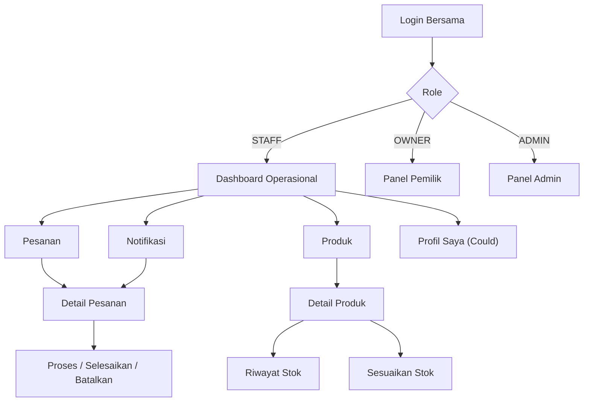
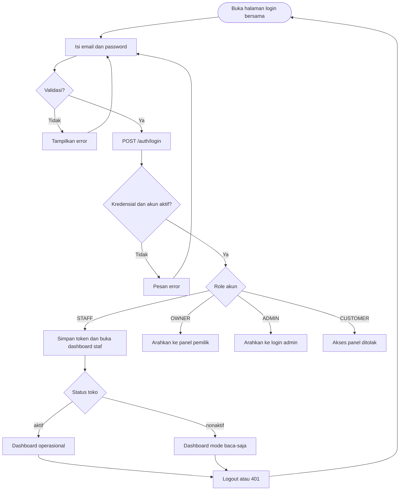
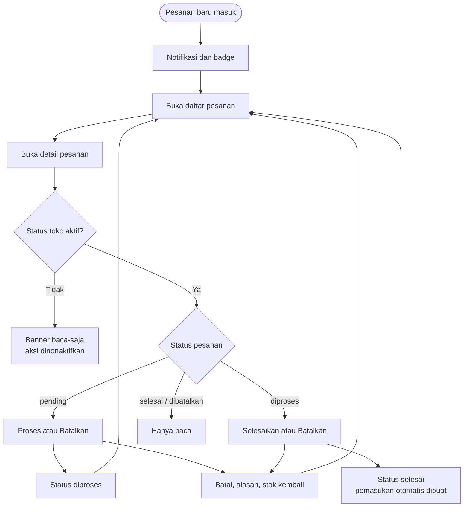
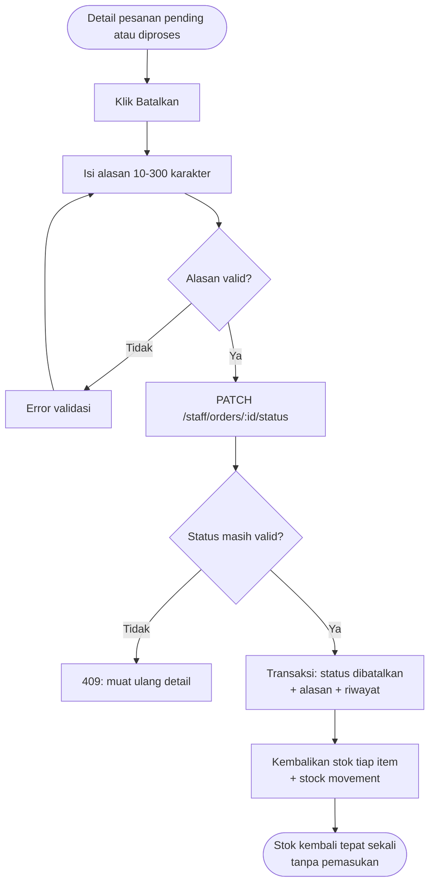
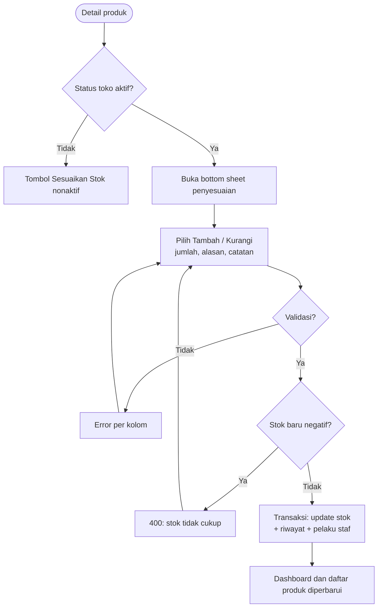
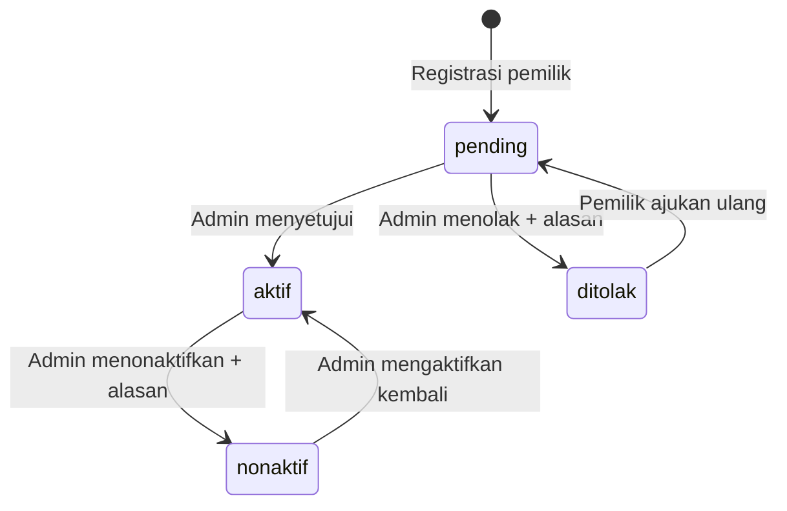

# Persiapan Desain UI Role Staf/Kasir Ratis

Dokumen ini adalah panduan desain UI untuk role staf/kasir Ratis, disusun dari `PRD Ratis Role Staf Kasir.md` dan `Flowchart dan Alur Role Staf Kasir.md`. Isinya mencakup fitur tiap halaman, alur staf, design system, komponen khusus, dan prompt siap pakai untuk Google Stitch.

Cara pakai:

1. Buka Google Stitch, lalu tempel **Global style prompt** (bagian 6.1).
2. Tempel prompt halaman yang ingin dibuat (bagian 6.2).
3. Iterasi desain dengan instruksi tambahan, misalnya "lebih ringkas", "kartu pesanan lebih padat", atau "buat versi desktop".
4. Catatan: Stitch menerima **prompt teks**, bukan kode Mermaid. Diagram Mermaid di dokumen ini dipakai untuk dokumentasi alur, bukan untuk ditempel ke Stitch.

## 1. Ringkasan

Panel staf/kasir Ratis dipakai untuk:

- Memproses pesanan harian toko.
- Menyelesaikan dan membatalkan pesanan dengan alasan.
- Menyesuaikan stok dengan alasan yang tercatat.
- Melihat katalog produk dan kategori tanpa mengubahnya.
- Melihat status toko dan banner mode baca-saja.
- Menerima notifikasi pesanan baru.
- Melihat profil akun dan mengganti kata sandi sendiri (fitur Could).

Target utama: staf dapat memproses satu pesanan maksimal 2 ketukan dari daftar, menyelesaikan pesanan maksimal 2 ketukan, dan menyesuaikan stok maksimal 4 langkah, semuanya nyaman dari ponsel.

### 1.1 Perbedaan dengan panel pemilik dan admin

| Aspek | Panel staf/kasir | Panel pemilik UMKM | Panel admin |
| --- | --- | --- | --- |
| Peran | Operasional harian | Menjalankan usaha | Mengawasi platform |
| Perangkat utama | Ponsel dan tablet | Ponsel | Desktop |
| Kepadatan layar | Rendah, fokus aksi | Sedang, banyak kartu | Tinggi, banyak tabel |
| Navigasi | Bottom navigation dan drawer | Bottom navigation dan drawer | Sidebar penuh |
| Fokus | Pesanan dan stok | Seluruh usaha | Verifikasi dan monitoring |
| Nada visual | Cepat, tenang, jelas | Hangat dan suportif | Formal dan terkendali |
| Cakupan data | Hanya tokonya | Hanya tokonya | Lintas toko |
| Keuangan | Tidak terlihat sama sekali | Pemasukan, pengeluaran, laba | Tidak mengakses keuangan toko |
| Produk | Hanya lihat | Kelola penuh | Tidak boleh mengubah |
| Aksi utama | Proses, selesaikan, batalkan, sesuaikan stok | Jual, proses, catat | Setujui, tolak, nonaktifkan |
| Data pelanggan | Nama, nomor HP, dan alamat untuk pesanan tokonya | Nama, nomor HP, dan alamat untuk pesanan tokonya | Nama saja |
| Warna brand | Teal Ratis | Teal Ratis | Teal Ratis |

Prinsip pemisahnya: **staf adalah ruang kerja operasional, pemilik adalah ruang kendali usaha, admin adalah ruang kontrol platform**. Ketiganya memakai identitas visual Ratis yang sama, tetapi menu dan data yang ditampilkan dibatasi sesuai role.

### 1.2 Halaman yang didesain

1. Login staf (halaman login bersama dengan pemilik).
2. Dashboard operasional.
3. Daftar pesanan.
4. Detail pesanan.
5. Produk dan stok.
6. Detail produk dan riwayat stok.
7. Modal atau bottom sheet penyesuaian stok.
8. Notifikasi.
9. Profil saya dan ganti kata sandi (fitur Could).
10. State bersama, dialog, dan halaman error.

Halaman keuangan, laporan, pengaturan toko, kelola staf, kelola produk, admin, dan pelanggan tidak termasuk dalam dokumen ini.

### 1.3 Target pengalaman

| Pengalaman | Target |
| --- | --- |
| Login sampai pesanan pertama dibuka | Kurang dari 1 menit |
| Memproses satu pesanan dari daftar | Maksimal 2 ketukan |
| Menyelesaikan pesanan dari detail | Maksimal 2 ketukan |
| Membatalkan pesanan | Maksimal 3 langkah termasuk alasan |
| Menyesuaikan stok | Maksimal 4 langkah |
| Menemukan pesanan yang perlu diproses | Terlihat di dashboard tanpa mencari |
| Ukuran layar utama | 390 px lebar ponsel, tetap nyaman di 1440 px desktop |
| Ukuran target sentuh | Minimal 44 x 44 px |
| Waktu muat dashboard | Kurang dari 3 detik saat backend aktif |

## 2. Prinsip desain

- **Mobile-first, desktop-comfortable:** semua aksi Must dirancang untuk satu tangan di ponsel, lalu diperlebar untuk desktop.
- **Satu langkah berikutnya jelas:** setiap halaman menunjukkan aksi utama, misalnya "Proses", "Selesaikan", "Batalkan", atau "Sesuaikan Stok".
- **Cepat di antara pelanggan:** aksi pesanan harus bisa dilakukan tanpa membuka banyak layar.
- **Terbatas dan aman:** staf tidak boleh melihat atau menemukan jalan menuju keuangan, laporan, profil toko, atau kelola staf.
- **Mode baca-saja terlihat jelas:** saat toko `nonaktif`, banner dan tombol nonaktif menjelaskan bahwa operasional dihentikan sementara.
- **Konsisten dengan pemilik:** warna status, tipografi, radius, dan pola dialog mengikuti brand Ratis.
- **Beban kognitif rendah:** tampilkan informasi yang dibutuhkan sekarang, sembunyikan detail sekunder di drawer atau halaman detail.
- **Ramah data kosong:** loading, empty state, error state, dan status toko selalu punya tampilan yang jelas.

## 3. Design system

### 3.1 Palet warna

| Token | Hex | Pemakaian |
| --- | --- | --- |
| Primary | `#0F766E` | Tombol utama, menu aktif, tautan |
| Primary hover | `#115E59` | Hover tombol utama |
| Primary soft | `#CCFBF1` | Latar ikon, highlight ringan |
| Ink | `#0F172A` | Judul dan teks utama |
| Muted | `#64748B` | Teks sekunder, metadata |
| Background | `#F8FAFC` | Latar halaman |
| Surface | `#FFFFFF` | Kartu, tabel, modal, bottom sheet |
| Border | `#E2E8F0` | Garis kartu, tabel, input |
| Pending | `#F59E0B` / `#FEF3C7` | Badge pesanan pending |
| Diproses | `#2563EB` / `#DBEAFE` | Badge pesanan diproses |
| Selesai | `#22C55E` / `#DCFCE7` | Badge pesanan selesai |
| Dibatalkan | `#EF4444` / `#FEE2E2` | Badge pesanan dibatalkan |
| Nonaktif | `#64748B` / `#E2E8F0` | Badge toko, produk, atau staf nonaktif |
| Stok menipis | `#D97706` / `#FFFBEB` | Badge stok menipis |
| Stok habis | `#DC2626` / `#FEE2E2` | Badge stok habis |
| Info | `#2563EB` | Pesan informasi |
| Danger | `#DC2626` | Tombol batalkan dan aksi berisiko |

Palet di atas adalah usulan dan boleh disesuaikan dengan identitas visual Ratis. Warna status tidak boleh menjadi satu-satunya pembeda; selalu sertakan label teks atau ikon. Tidak ada warna khusus keuangan karena staf tidak melihat data keuangan.

### 3.2 Tipografi

- **Font:** Plus Jakarta Sans (Google Fonts).
- **Judul halaman:** 24px / 32px, weight 700.
- **Judul kartu:** 18px / 26px, weight 600.
- **Body:** 14px / 22px, weight 400.
- **Body di ponsel:** 15px / 24px agar lebih nyaman dibaca.
- **Label:** 12px / 16px, weight 600.
- **Angka KPI:** 28px / 36px di ponsel, 32px / 40px di desktop, weight 700.
- **Teks kecil:** 12px / 18px, weight 400.
- **Tombol:** 14px / 20px, weight 600.
- **Input di ponsel:** 16px untuk mencegah zoom otomatis browser.

### 3.3 Spacing, radius, shadow

- Skala spacing: 4, 8, 12, 16, 24, 32, 40, 48px.
- Radius input dan tombol: 12px.
- Radius kartu: 16px.
- Radius modal dan bottom sheet: 20px.
- Radius badge dan chip: 999px.
- Shadow kartu: `0 1px 2px rgba(15, 23, 42, 0.06)`.
- Shadow modal: `0 16px 40px rgba(15, 23, 42, 0.16)`.
- Lebar sidebar desktop: 264px.
- Tinggi header desktop: 72px.
- Tinggi top app bar ponsel: 56px.
- Tinggi bottom navigation: 64px ditambah safe area.
- Padding konten: 20px di ponsel, 32px di desktop.
- Lebar konten maksimal: 1280px.
- Target sentuh minimal: 44 x 44px.

### 3.4 Komponen dasar

- Tombol: primary, secondary, ghost, danger, dan text button.
- Input teks, textarea, select, search, date range, dan input jumlah stok.
- Kartu KPI, kartu pesanan, kartu produk, dan kartu riwayat stok.
- Badge status pesanan, status toko, status produk, stok menipis, dan stok habis.
- Bottom navigation, sidebar, top app bar, dan notification bell.
- Modal di desktop dan bottom sheet di ponsel.
- Drawer detail di desktop dan halaman penuh di ponsel.
- Toast sukses, gagal, dan info.
- Skeleton loading.
- Empty state dan error state.
- Pagination dan tombol Muat lebih banyak.
- Toggle switch, segmented control, chip filter, dan character counter.
- Timeline riwayat status pesanan dan riwayat stok.
- Sticky action bar untuk detail pesanan dan penyesuaian stok.

### 3.5 Komponen khusus staf

- **Read-only banner:** muncul di atas konten saat toko `nonaktif`, berisi alasan dan penjelasan bahwa operasional dihentikan sementara.
- **Order action card:** kartu pesanan dengan aksi utama sesuai status, misalnya "Proses" atau "Selesaikan".
- **Order status stepper:** indikator sederhana pending, diproses, selesai, atau dibatalkan.
- **New order marker:** aksen tipis dan label "Baru" pada pesanan `pending` yang belum dibuka staf.
- **Product card read-only:** foto, nama, kategori, harga, stok, dan badge stok tanpa tombol ubah.
- **Stock adjustment sheet:** bottom sheet berisi jenis Tambah atau Kurangi, jumlah, alasan, catatan, dan pratinjau stok baru.
- **Stock movement timeline:** daftar pergerakan stok dengan jenis, perubahan, stok sebelum dan sesudah, alasan, pelaku, dan kode pesanan.
- **No-finance note:** keterangan singkat bahwa data keuangan hanya dapat diakses pemilik.
- **Profile card:** identitas staf, toko, status akun, dan akses ganti kata sandi.
- **Notification bell:** lonceng dengan badge jumlah pesanan baru yang belum dibaca.

### 3.6 Ikon dan ilustrasi

- Ikon: Lucide outline, ukuran 20 dan 24px.
- Ilustrasi empty state: garis sederhana dengan warna primary soft dan muted.
- Foto produk: rasio 1:1, placeholder dengan ikon produk.
- Ikon status: jam untuk pending, roda gigi untuk diproses, centang untuk selesai, silang untuk dibatalkan.
- Ikon stok: kotak untuk stok, segitiga peringatan untuk stok menipis, silang untuk stok habis.
- Jangan memakai emoji di UI.

### 3.7 Layout global

**Desktop (1440px):**

- Sidebar kiri 264px: logo Ratis, nama toko, menu Dashboard, Pesanan, Produk, Notifikasi, dan Profil Saya.
- Header atas 72px: judul halaman, badge status toko, lonceng notifikasi, nama staf, dan tombol logout.
- Area konten di kanan dengan lebar maksimal 1280px.
- Menu aktif memakai latar primary soft dan teks primary.
- Tabel lebar dapat digeser horizontal bila perlu.
- Menu Keuangan, Laporan, Staf, dan Pengaturan Toko tidak pernah muncul.

**Tablet (768-1023px):**

- Sidebar berubah menjadi rail ikon atau drawer.
- Kartu KPI menjadi dua kolom.
- Tabel berubah menjadi tabel ringkas atau kartu.

**Ponsel (di bawah 768px):**

- Top app bar 56px: nama toko, badge status, lonceng notifikasi, dan menu.
- Bottom navigation 64px: Dashboard, Pesanan, Produk, Notifikasi, dan Menu.
- Menu membuka drawer berisi Profil Saya dan Logout.
- Tabel berubah menjadi kartu.
- Filter panjang memakai bottom sheet.
- Tombol utama memakai sticky action bar.
- Konten memiliki padding bawah agar tidak tertutup bottom navigation.

**Catatan navigasi stok:**

- Pintasan "Stok" pada flowchart direpresentasikan sebagai chip filter "Stok Menipis" dan "Stok Habis" di halaman Produk, serta tombol "Sesuaikan Stok" pada detail produk. Tidak perlu menu terpisah agar navigasi staf tetap sederhana.

### 3.8 Aksesibilitas dan responsif

- Kontras teks minimal 4.5:1 untuk teks normal.
- Focus ring terlihat pada semua elemen interaktif.
- Setiap input memiliki label yang terlihat, bukan hanya placeholder.
- Pesan error muncul di dekat kolom dan diumumkan ke screen reader.
- Jangan mengandalkan warna saja untuk status; gunakan label dan ikon.
- Target sentuh minimal 44 x 44px.
- Tombol ikon memiliki `aria-label`.
- Dialog menangkap fokus dan dapat ditutup dengan Escape di desktop.
- Layout tidak boleh menyebabkan scroll horizontal di ponsel, kecuali tabel yang memang dapat digeser.
- Gunakan safe area untuk perangkat dengan notch.

## 4. Peta halaman dan alur

### 4.1 Peta halaman



### 4.2 Alur login dan sesi



### 4.3 Alur memproses pesanan



### 4.4 Alur pembatalan dan pengembalian stok



### 4.5 Alur penyesuaian stok



### 4.6 Status toko dan akses staf



| Status toko | Tampilan panel staf | Aksi tulis | Aksi utama |
| --- | --- | --- | --- |
| `aktif` | Mode operasional | Diizinkan | Proses pesanan dan jaga stok |
| `nonaktif` | Banner baca-saja dengan alasan | Ditolak backend | Menunggu admin mengaktifkan kembali |
| `pending` | Banner informasi, data hanya baca | Ditolak backend | Menunggu verifikasi admin |
| `ditolak` | Banner informasi, data hanya baca | Ditolak backend | Menunggu pemilik memperbaiki data |

Catatan: akun staf hanya dibuat pemilik saat toko `aktif`, sehingga status `pending` dan `ditolak` bukan kondisi normal. Status toko hanya dapat diubah admin.

## 5. Spesifikasi halaman

### 5.1 Login staf

**Rute:** `/` (halaman login bersama; staf diarahkan ke `/staff/dashboard`)

**Tujuan:** pintu masuk aman ke panel operasional dengan akun yang dibuat pemilik.

**Layout:**

- Ponsel: kartu login di tengah, logo Ratis, judul "Masuk ke toko Anda", form, dan catatan "Akun staf dibuat oleh pemilik toko".
- Desktop: split screen. Panel kiri 45% berisi brand, ilustrasi abstrak toko, dan kutipan tentang membantu operasional; panel kanan 55% berisi form 400px.
- Tanpa sidebar dan header panel.

**Fitur:**

1. Field email dengan validasi format email.
2. Field password minimal 8 karakter dengan tombol tampilkan atau sembunyikan.
3. Tombol Masuk full width dengan state loading dan disabled saat proses.
4. Pesan error di atas form: kredensial salah, akun dinonaktifkan, atau terlalu banyak percobaan.
5. Redirect otomatis ke dashboard staf setelah berhasil.
6. Pengguna yang sudah login dan membuka halaman login langsung diarahkan ke panel sesuai role.
7. Pesan sesi berakhir saat diarahkan dari halaman staf karena token kedaluwarsa.
8. Pemilik yang memakai halaman ini diarahkan ke panel pemilik; admin diarahkan ke login admin; pelanggan ditolak.
9. Staf dengan toko `nonaktif` tetap masuk ke dashboard dengan banner baca-saja.

**State dan pesan:**

- Default: form kosong dengan fokus di kolom email.
- Loading: tombol "Memproses..." dengan spinner.
- Error: alert merah dengan ikon.
- Rate limit: "Terlalu banyak percobaan, coba lagi nanti."
- Sesi berakhir: "Sesi Anda berakhir. Silakan masuk kembali."
- Akun nonaktif: "Akun Anda dinonaktifkan. Hubungi pemilik toko."

**Prompt Stitch:** bagian 6.2.1.

### 5.2 Dashboard operasional

**Rute:** `/staff/dashboard`

**Tujuan:** memberi gambaran pekerjaan operasional hari ini dan mengarahkan staf ke pesanan yang mendesak.

**Layout desktop:**

- Header halaman: sapaan "Selamat pagi, Bagus", nama toko, badge status, tanggal, dan tombol Muat ulang.
- Banner perhatian jika ada pesanan perlu diproses: "3 pesanan menunggu diproses" dengan tombol Lihat pesanan.
- Empat kartu KPI: Perlu Diproses, Masuk Hari Ini, Selesai Hari Ini, dan Stok Menipis.
- Baris dua kolom: daftar "Pesanan Perlu Ditindak" dan daftar "Stok Menipis".
- Daftar lima pesanan terbaru dengan tombol pintas ke detail.
- Pintasan ke halaman Pesanan dan Produk.

**Layout ponsel:**

- Banner status toko bila `nonaktif`.
- Sapaan dan nama toko.
- Dua kartu KPI per baris.
- Tombol aksi cepat berbentuk chip atau kartu kecil.
- Daftar pesanan perlu ditindak sebagai kartu dengan tombol Proses atau Selesaikan.
- Daftar stok menipis dengan tombol Sesuaikan Stok.
- Tombol "Lihat semua" pada setiap daftar.

**Fitur:**

1. Kartu KPI dapat diklik menuju daftar yang sudah terfilter.
2. Daftar pesanan menampilkan aksi Proses atau Selesaikan sesuai status.
3. Daftar stok menipis menampilkan tombol Sesuaikan Stok.
4. Tombol Muat ulang menyegarkan data tanpa reload halaman.
5. Badge pesanan baru muncul di menu Pesanan dan lonceng notifikasi.
6. Tidak ada omzet, pemasukan, pengeluaran, atau laba di halaman ini.
7. Empty state jika belum ada data: angka 0 dan pesan ramah.
8. Skeleton loading untuk kartu dan daftar.
9. Saat toko `nonaktif`, tampilkan banner baca-saja dan nonaktifkan aksi tulis.

**Prompt Stitch:** bagian 6.2.2.

### 5.3 Daftar pesanan

**Rute:** `/staff/pesanan`

**Tujuan:** memproses pesanan pelanggan dengan cepat.

**Layout desktop:**

- Header dengan judul "Pesanan" dan ringkasan "3 pesanan perlu diproses".
- Tab atau chip status: Semua, Pending, Diproses, Selesai, Dibatalkan.
- Toolbar: pencarian kode atau nama pelanggan, filter tanggal, dan Reset filter.
- Tabel: Kode, Waktu, Pelanggan, Item, Total, Status, dan Aksi.
- Pagination 10 baris.

**Layout ponsel:**

- Chip status dapat digeser horizontal.
- Kartu pesanan: kode, waktu, nama pelanggan, jumlah item, total, badge status, dan tombol aksi utama.
- Pesanan baru memiliki aksen teal tipis dan label "Baru".

**Fitur:**

1. Filter status dengan badge warna.
2. Pencarian kode pesanan atau nama pelanggan.
3. Filter tanggal Hari ini, 7 hari, 30 hari, atau rentang khusus.
4. Tombol Proses untuk `pending`, Selesaikan untuk `diproses`, dan Batalkan untuk `pending` atau `diproses`.
5. Klik kartu membuka detail pesanan.
6. Empty state "Belum ada pesanan" dengan penjelasan bahwa pesanan akan muncul setelah pelanggan checkout.
7. Loading skeleton dan error state.
8. Saat toko `nonaktif`, tombol aksi dinonaktifkan dan banner baca-saja tampil.

**Prompt Stitch:** bagian 6.2.3.

### 5.4 Detail pesanan

**Rute:** `/staff/pesanan/:id`

**Tujuan:** melihat detail pesanan dan mengubah status dengan aman.

**Layout:**

- Header: tombol Kembali, kode pesanan, badge status, dan waktu.
- Kartu Pelanggan: nama, nomor HP, alamat, dan catatan.
- Kartu Item: nama produk, jumlah, harga satuan, dan subtotal.
- Kartu Total: subtotal, total, dan keterangan "Pembayaran dilakukan di luar sistem".
- Kartu Riwayat Status berbentuk timeline.
- Desktop: panel tindakan sticky di kanan.
- Ponsel: sticky action bar di bawah.

**Fitur:**

1. Tombol Proses untuk `pending`.
2. Tombol Selesaikan untuk `diproses`.
3. Tombol Batalkan untuk `pending` atau `diproses`.
4. Dialog pembatalan dengan alasan wajib 10-300 karakter dan penghitung karakter.
5. Pesan konflik 409: "Status pesanan sudah berubah. Muat ulang detail."
6. Tidak ada tombol untuk mengubah item atau total.
7. Setelah selesai, tampilkan keterangan "Pesanan selesai diproses".
8. Setelah dibatalkan, tampilkan alasan dan keterangan "Stok sudah dikembalikan".
9. Kontak pelanggan lengkap hanya untuk pesanan toko ini.
10. Saat toko `nonaktif`, tombol aksi dinonaktifkan dengan keterangan "Penyelesaian pesanan lama dilakukan pemilik".

**Prompt Stitch:** bagian 6.2.4.

### 5.5 Produk dan stok

**Rute:** `/staff/produk`

**Tujuan:** melihat katalog dan menemukan produk yang stoknya perlu disesuaikan.

**Layout desktop:**

- Header dengan judul "Produk" dan subjudul "Lihat katalog dan pantau stok toko."
- Toolbar: pencarian, filter kategori, filter status, dan Reset filter.
- Chip cepat: Semua, Stok Menipis, Stok Habis.
- Tabel: Produk, Kategori, Harga, Stok, Status, dan Aksi.
- Pagination 10 baris.

**Layout ponsel:**

- Search bar penuh.
- Chip filter horizontal: Semua, Stok Menipis, Stok Habis, Nonaktif.
- Kartu produk: foto 1:1, nama, kategori, harga, stok, badge stok, dan status.
- Tombol di kartu hanya "Lihat detail" dan "Sesuaikan Stok".

**Fitur:**

1. Pencarian nama produk dengan jeda singkat.
2. Filter kategori dan status produk.
3. Badge "Stok menipis" dan "Stok habis".
4. Tidak ada tombol Tambah, Edit, Hapus, atau Nonaktifkan.
5. Menu aksi hanya Lihat detail dan Sesuaikan Stok.
6. Empty state "Belum ada produk" dengan penjelasan bahwa produk dikelola pemilik.
7. Loading skeleton dan error state.
8. Saat toko `nonaktif`, tombol Sesuaikan Stok dinonaktifkan.

**Prompt Stitch:** bagian 6.2.5.

### 5.6 Detail produk dan riwayat stok

**Rute:** `/staff/produk/:id`

**Tujuan:** melihat informasi produk dan riwayat pergerakan stok.

**Layout:**

- Header: tombol Kembali, nama produk, kategori, dan badge status produk.
- Kartu utama: foto 1:1, harga, stok saat ini, `minStock`, deskripsi, dan badge stok.
- Kartu ringkasan stok: stok saat ini, ambang stok menipis, dan status.
- Kartu Riwayat Stok berbentuk timeline atau tabel ringkas.
- Desktop: dua kolom, konten 2/3 dan panel ringkasan stok 1/3.
- Ponsel: satu kolom dengan tombol Sesuaikan Stok di sticky action bar.

**Fitur:**

1. Riwayat stok menampilkan waktu, jenis, perubahan, stok sebelum dan sesudah, alasan, pelaku, dan kode pesanan.
2. Filter riwayat berdasarkan jenis dan tanggal.
3. Tombol Sesuaikan Stok membuka bottom sheet.
4. Tidak ada tombol ubah produk atau hapus produk.
5. Empty state riwayat: "Belum ada pergerakan stok".
6. Loading skeleton dan error state.
7. Saat toko `nonaktif`, tombol Sesuaikan Stok dinonaktifkan.

**Prompt Stitch:** bagian 6.2.6.

### 5.7 Modal atau bottom sheet penyesuaian stok

**Tujuan:** mencatat perubahan stok dengan alasan yang jelas.

**Layout:**

- Desktop: modal tengah selebar 480px.
- Ponsel: bottom sheet yang dapat digeser.
- Ringkasan di atas: nama produk dan stok saat ini.
- Segmented control Tambah atau Kurangi.
- Input jumlah, alasan wajib 5-200 karakter, dan catatan opsional.
- Pratinjau "Stok baru: 15" yang berubah mengikuti input.
- Tombol Batal dan Simpan Penyesuaian.

**Fitur:**

1. Jumlah harus bilangan bulat lebih dari 0.
2. Alasan wajib 5-200 karakter dengan penghitung karakter.
3. Pratinjau stok baru berwarna merah jika hasilnya negatif.
4. Tombol Simpan berstatus loading dan nonaktif saat proses.
5. Validasi di bawah kolom jika jumlah atau alasan tidak valid.
6. Setelah sukses, tutup sheet, tampilkan toast, dan perbarui stok serta riwayat.
7. Saat toko `nonaktif`, tombol Simpan tidak tersedia.

**Prompt Stitch:** bagian 6.2.7.

### 5.8 Notifikasi

**Rute:** `/staff/notifikasi`

**Tujuan:** memberi tahu staf tentang pesanan baru tanpa meninggalkan aplikasi.

**Layout:**

- Header: judul "Notifikasi", filter "Belum dibaca", dan tombol "Tandai semua dibaca".
- Daftar notifikasi dengan ikon jenis, judul, pesan singkat, waktu, dan titik belum dibaca.
- Desktop: daftar satu kolom maksimal 760px.
- Ponsel: daftar penuh dengan pembagi antaritem.
- Dropdown lonceng berisi lima notifikasi terbaru dan tautan "Lihat semua".

**Fitur:**

1. Notifikasi pesanan baru menuju detail pesanan.
2. Klik notifikasi menandai dibaca dan membuka tautan.
3. Tombol Tandai semua dibaca.
4. Badge belum dibaca di lonceng dan bottom navigation.
5. Empty state "Tidak ada notifikasi baru".
6. Notifikasi baru muncul tanpa reload halaman.
7. Hanya notifikasi pesanan baru untuk tokonya; tidak ada notifikasi keuangan atau verifikasi toko.

**Prompt Stitch:** bagian 6.2.8.

### 5.9 Profil saya (Could)

**Rute:** `/staff/profil`

**Tujuan:** memberi staf kendali atas keamanan akunnya tanpa membuka pengaturan toko.

**Layout:**

- Header: judul "Profil Saya".
- Kartu identitas: avatar inisial, nama, email, role, nama toko, status akun, status toko, dan tanggal akun dibuat.
- Kartu ganti kata sandi: password lama, password baru, konfirmasi password, dan tombol Simpan.
- Catatan bahwa perubahan nama, email, dan reset password dilakukan pemilik.
- Tombol Logout.

**Fitur:**

1. Tombol tampilkan atau sembunyikan password.
2. Password baru minimal 8 karakter dan harus sama dengan konfirmasi.
3. Password baru tidak boleh sama dengan password lama.
4. Error password lama salah tampil di bawah kolom.
5. Setelah sukses, form dikosongkan dan muncul toast.
6. Tidak ada tombol ubah nama, email, role, atau toko.

**Prompt Stitch:** bagian 6.2.9.

### 5.10 State bersama dan halaman error

**Loading:**

- Skeleton untuk kartu KPI, daftar pesanan, daftar produk, dan detail.
- Teks "Menyiapkan data, mohon tunggu" saat cold start.

**Empty state:**

- Ikon sederhana, judul, deskripsi, dan tombol aksi.
- Contoh: "Belum ada pesanan", "Belum ada produk", "Tidak ada notifikasi baru".

**Error state:**

- "Gagal memuat data", "Periksa koneksi lalu coba lagi", dan tombol Coba lagi.
- Jika aksi gagal, tampilkan toast dan pertahankan data yang sudah ada.

**Status toko:**

- Banner `nonaktif`: alasan dan keterangan bahwa operasional dihentikan sementara serta penyelesaian pesanan lama dilakukan pemilik.
- Banner `pending` atau `ditolak`: keterangan bahwa operasional belum tersedia.

**403:**

- "Akses ditolak", "Halaman ini tidak tersedia untuk staf", dan tombol Kembali ke dashboard.
- Tampilkan saat staf mencoba membuka rute keuangan, laporan, profil toko, kelola staf, atau admin.

**404:**

- "Halaman tidak ditemukan" dan tombol Kembali ke dashboard.

**Sesi berakhir:**

- Modal atau redirect ke login dengan pesan "Sesi Anda berakhir. Silakan masuk kembali."

**Toast:**

- Sukses: hijau, ikon centang.
- Gagal: merah, ikon peringatan.
- Info: biru.
- Posisi kanan atas di desktop, bawah di atas bottom navigation pada ponsel.
- Hilang otomatis setelah 4 detik.

**Dialog dan bottom sheet:**

- Judul singkat, deskripsi dampak, tombol Batal, dan tombol aksi yang jelas.
- Aksi berbahaya memakai tombol merah.
- Di ponsel, dialog kompleks memakai bottom sheet yang dapat digeser.
- Di desktop, dialog memakai modal tengah.

**Prompt Stitch:** bagian 6.2.10.

## 6. Prompt untuk Google Stitch

### 6.1 Global style prompt

Tempel prompt ini lebih dulu, lalu prompt halaman.

```text
Create a modern, mobile-first operational UI for "Ratis", an Indonesian UMKM platform, designed for store staff and cashiers. Design primarily at 390x844 for mobile, with a responsive desktop version at 1440x900. The feel is fast, calm, and focused: a daily operations tool, not a full business dashboard. Background #F8FAFC, white cards, 1px #E2E8F0 borders, 16px card radius, subtle shadows. Primary teal-green #0F766E, hover #115E59, soft #CCFBF1. Text #0F172A, muted #64748B. Status colors: pending amber #F59E0B on #FEF3C7, diproses blue #2563EB on #DBEAFE, selesai green #22C55E on #DCFCE7, dibatalkan red #EF4444 on #FEE2E2, nonaktif slate #64748B on #E2E8F0, low stock amber #D97706 on #FFFBEB, out of stock red #DC2626 on #FEE2E2. Typography Plus Jakarta Sans, headings 600/700, body 400/500. Lucide outline icons. Indonesian UI copy. Mobile layout: 56px top app bar with shop name and status badge, 64px bottom navigation for Dashboard, Pesanan, Produk, Notifikasi, and Menu, 44px minimum touch targets, sticky primary actions. Desktop layout: 264px left sidebar and 72px top header. Staff menus only: Dashboard, Pesanan, Produk, Notifikasi, Profil Saya. Never show Keuangan, Laporan, Staf, or Pengaturan Toko. Use cards instead of dense tables on mobile. Include a visible read-only banner state for an inactive shop. Accessible contrast, visible focus rings, no dark mode.
```

### 6.2 Prompt per halaman

#### 6.2.1 Login staf

```text
Using the global Ratis staff style, design the shared login screen at 390x844 and 1440x900. Mobile: centered white card with small Ratis logo, title "Masuk ke toko Anda", subtitle "Proses pesanan dan jaga stok toko Anda.", labeled email and password fields with icons and show/hide password, full-width primary button "Masuk", inline error alert area, and helper text "Akun staf dibuat oleh pemilik toko". Desktop: split screen, left 45% deep teal brand panel with a warm abstract storefront pattern, Ratis logo, headline "Bantu operasional toko tetap lancar", supporting line about orders and stock, and a small note "Untuk staf dan kasir"; right 55% white area with a 400px form card. Show loading state "Memproses..." and session-expired message. Indonesian copy, accessible focus states.
```

#### 6.2.2 Dashboard staf

```text
Using the global Ratis staff style, design the staff dashboard at 390x844 and 1440x900. Mobile: top app bar with shop name "Kopi Nusantara", green "Aktif" badge, notification bell with red unread dot, and menu icon. Content: greeting "Selamat pagi, Bagus", date "Senin, 23 November 2026", and refresh icon; four KPI cards in a 2x2 grid: Perlu Diproses 3, Masuk Hari Ini 5, Selesai Hari Ini 4, Stok Menipis 2; a card "Pesanan Perlu Ditindak" with order rows showing code, customer, total, status, and primary button "Proses"; a card "Stok Menipis" with product name, remaining stock, and "Sesuaikan" button; a "Pesanan Terbaru" list with "Lihat semua". Do not show revenue, income, expenses, or profit. Desktop: 264px sidebar, 72px header, KPI row, two-column lists, and a recent orders table. Include a read-only banner variant for an inactive shop. Use realistic Indonesian data, skeleton loading, and friendly empty states.
```

#### 6.2.3 Daftar pesanan

```text
Using the global Ratis staff style, design the "Pesanan" list at 390x844 and 1440x900. Mobile: top app bar, title "Pesanan", summary "3 pesanan perlu diproses", horizontally scrollable status chips Semua, Pending, Diproses, Selesai, Dibatalkan, search field, date filter button, and order cards. Each card shows order code "RTS-20261123-001", time "14.20 WIB", customer "Rina", item count "2 item", total "Rp150.000", status badge, and a primary action button "Proses" or "Selesaikan". Mark new orders with a subtle teal accent and "Baru" label. Desktop: table with columns Kode, Waktu, Pelanggan, Item, Total, Status, Aksi, and pagination. Include empty state "Belum ada pesanan", loading skeleton, error state, and a read-only variant with disabled action buttons for an inactive shop. Indonesian copy, clear visual hierarchy.
```

#### 6.2.4 Detail pesanan

```text
Using the global Ratis staff style, design the order detail page at 390x844 and 1440x900. Header: back button, order code "RTS-20261123-001", amber "Pending" badge, and time. Cards: "Pelanggan" with name, phone, address, and note; "Item Pesanan" with product name, quantity, unit price, subtotal, and total; "Pembayaran" with total and helper "Pembayaran dilakukan di luar sistem"; "Riwayat Status" vertical timeline. Mobile: sticky bottom action bar with primary "Proses" and secondary danger text "Batalkan". Desktop: main content 2/3 and sticky action panel 1/3. Include a cancel bottom sheet with title "Batalkan pesanan?", required reason textarea, helper "Alasan akan terlihat di riwayat pesanan", 10-300 character counter, and buttons Batal / Batalkan Pesanan. Include variants for diproses (Selesaikan button), selesai (green confirmation "Pesanan selesai diproses"), dibatalkan (reason and "Stok sudah dikembalikan"), and an inactive-shop read-only state explaining that the owner completes old orders. Indonesian copy.
```

#### 6.2.5 Produk dan stok

```text
Using the global Ratis staff style, design the "Produk" page at 390x844 and 1440x900. Mobile: top app bar, title "Produk", subtitle "Lihat katalog dan pantau stok toko.", search bar, horizontally scrollable filter chips Semua, Stok Menipis, Stok Habis, Nonaktif, and product cards. Each product card shows a square photo, name "Kopi Susu Gula Aren", category "Minuman", price "Rp22.000", stock "12", a green "Aktif" badge, and a three-dot menu with only "Lihat detail" and "Sesuaikan Stok". Include a card with amber "Stok menipis" badge and one with red "Stok habis". No add, edit, delete, or deactivate buttons anywhere. Desktop: toolbar with search, category select, status select, low-stock chip, and a data table with columns Produk, Kategori, Harga, Stok, Status, Aksi. Include empty state "Belum ada produk" and a read-only variant for an inactive shop. Indonesian copy, accessible touch targets.
```

#### 6.2.6 Detail produk dan riwayat stok

```text
Using the global Ratis staff style, design the product detail page at 390x844 and 1440x900. Header: back button, product name "Kopi Susu Gula Aren", category "Minuman", and green "Aktif" badge. Main card: square photo, price "Rp22.000", current stock "12", minimum stock "5", description, and stock status badge. A summary card shows current stock, low-stock threshold, and status. A "Riwayat Stok" card shows a timeline with type badges (Stok awal, Penjualan, Pembatalan, Penyesuaian), change amount, stock before and after, reason, actor "Bagus", and order code when relevant. Add filter chips for type and a date filter. Mobile: sticky bottom button "Sesuaikan Stok". Desktop: two-column layout with content 2/3 and a sticky stock summary 1/3. No edit or delete product actions. Include empty history state and an inactive-shop read-only variant. Indonesian copy.
```

#### 6.2.7 Penyesuaian stok

```text
Using the global Ratis staff style, design the stock adjustment bottom sheet for mobile and a centered modal for desktop. Show the product name "Kopi Susu Gula Aren" and current stock "12" at the top. Include a segmented control "Tambah" / "Kurangi", a quantity input, a required reason field with helper "5-200 karakter" and character counter, an optional note field, and a live preview "Stok baru: 15" that turns red if the result is negative. Footer: secondary "Batal" and primary "Simpan Penyesuaian" with loading state. Show inline validation for invalid quantity, short reason, and insufficient stock. Keep the layout compact, calm, and easy to use with one hand. Indonesian copy.
```

#### 6.2.8 Notifikasi

```text
Using the global Ratis staff style, design the notification center at 390x844 and 1440x900. Mobile: top app bar with back button, title "Notifikasi", filter chip "Belum dibaca", and text button "Tandai semua dibaca". List items with a bell or order icon, title, short message, relative time, and unread dot. Example items: "Pesanan baru masuk" with order code and total, and "Pesanan baru menunggu diproses" with customer name. Desktop: centered list max 760px with the same content and a right-side hint panel stating "Hanya notifikasi pesanan baru untuk toko Anda". Include empty state "Tidak ada notifikasi baru", unread and read variants, and a bell dropdown with the five latest notifications and "Lihat semua" link. Indonesian copy, calm and scannable.
```

#### 6.2.9 Profil saya

```text
Using the global Ratis staff style, design the "Profil Saya" page at 390x844 and 1440x900. Header: title "Profil Saya". Identity card: initials avatar, name "Bagus Anugrah", email, blue "Staf" role badge, shop name "Kopi Nusantara", green "Aktif" account badge, shop status badge, and join date. Security card: "Ganti Kata Sandi" with current password, new password, confirm password fields, show/hide buttons, and primary button "Simpan Kata Sandi". Add helper text that name, email, and password reset are managed by the shop owner. Include a logout button. Show inline validation and a success toast variant. Indonesian copy, simple and secure.
```

#### 6.2.10 State bersama dan halaman error

```text
Using the global Ratis staff style, design a set of reusable states and overlays for the staff panel: KPI card skeleton, order card skeleton, product card skeleton, empty state with simple line illustration and CTA, error state "Gagal memuat data" with "Coba lagi", 403 page "Akses ditolak" with "Kembali ke dashboard", 404 page "Halaman tidak ditemukan", session expired modal "Sesi Anda berakhir" with "Masuk kembali", success toast, error toast, info toast, and a destructive confirmation bottom sheet for canceling an order. Include an inactive-shop read-only banner with reason and helper that the owner completes old orders. Keep everything consistent with the Ratis staff design system, mobile-first, with clear Indonesian copy and accessible touch targets. Never include finance menus or financial data.
```

### 6.3 Tips memakai Stitch

- Buat satu layar per prompt agar hasil fokus.
- Tempel global prompt lebih dulu, lalu prompt halaman.
- Minta varian ponsel 390px lebih dulu, lalu desktop 1440px.
- Jika ada batas karakter, pertahankan bagian gaya, layout, komponen, warna status, dan bottom navigation.
- Iterasi dengan instruksi pendek: "more whitespace", "larger touch targets", "card layout instead of table", "sticky action bar", "tablet version".
- Stitch menghasilkan desain; warna, font, dan jarak tetap perlu dicek manual.
- Gunakan data contoh Indonesia agar hasil terasa realistis.
- Jangan menempelkan kode Mermaid ke Stitch; Mermaid hanya untuk dokumentasi alur.
- Pastikan setiap mockup ponsel menampilkan bottom navigation dan tidak menampilkan menu keuangan, laporan, staf, atau pengaturan toko.
- Tampilkan varian mode baca-saja untuk toko `nonaktif` pada dashboard, pesanan, dan produk.

## 7. Checklist handoff desain

- [ ] Halaman login, dashboard, daftar pesanan, detail pesanan, produk, detail produk, penyesuaian stok, notifikasi, dan profil saya.
- [ ] State loading, empty, error, 403, 404, sesi berakhir, dan status toko `nonaktif`.
- [ ] Dialog Batalkan Pesanan dan bottom sheet penyesuaian stok.
- [ ] Badge status pesanan, status toko, status produk, stok menipis, dan stok habis konsisten.
- [ ] Layout ponsel 390px dan desktop 1440px.
- [ ] Bottom navigation dan sidebar tidak pernah tampil bersamaan.
- [ ] Tombol utama dapat dijangkau satu tangan di ponsel.
- [ ] Target sentuh minimal 44 x 44px.
- [ ] Tidak ada menu keuangan, laporan, kelola staf, pengaturan toko, atau admin.
- [ ] Tidak ada tombol tambah, ubah, hapus, atau nonaktifkan produk.
- [ ] Tidak ada angka omzet, pemasukan, pengeluaran, atau laba di halaman staf.
- [ ] Staf tidak dapat mengubah status toko.
- [ ] Mode baca-saja saat toko `nonaktif` terlihat jelas dan aksi tulis nonaktif.
- [ ] Format Rupiah dan tanggal WIB konsisten.
- [ ] Kontras warna, focus state, dan label form memenuhi aksesibilitas.
- [ ] Semua teks UI berbahasa Indonesia.

## 8. Asumsi dan catatan

- Palet warna, font, dan radius adalah usulan awal dan boleh disesuaikan dengan brand Ratis.
- Versi pertama tidak memakai dark mode.
- Ikon memakai Lucide. Grafik tidak diperlukan di dashboard staf karena fokusnya operasional, bukan analitik.
- Foto produk memakai placeholder sampai data asli tersedia.
- Prompt Stitch ditulis dalam bahasa Inggris agar hasil lebih optimal; teks UI tetap bahasa Indonesia.
- Panel staf memakai pendekatan mobile-first, sama seperti panel pemilik, tetapi dengan menu dan data yang lebih terbatas.
- Halaman keuangan, laporan, pengaturan toko, kelola staf, admin, dan pelanggan tidak termasuk dalam dokumen ini.
- Alur lengkap ada di `Flowchart dan Alur Role Staf Kasir.md`, sedangkan aturan bisnis dan API ada di `PRD Ratis Role Staf Kasir.md`.
